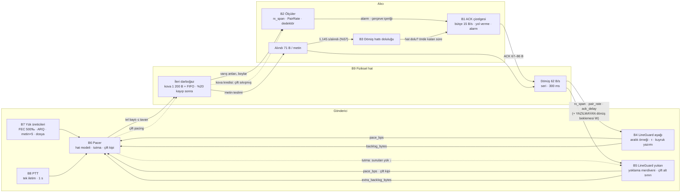

# Asimetrik hat kontrol döngüsü — birleşik ilişki haritası

Tarih: 2026-11-25. Çalışma belgesi; ürün kodu değiştirmez. Tek geçerli harita budur.

Bu belge iki bağımsız kod okumasının birleşimidir:
- Gövde (bölüm 0–12): yerel oturumun okuması, `yerel/iliski-haritasi` dalındaki
  `ASIMETRIK-HAT-ILISKI-HARITASI-YEREL.md` (commit `b2390862`) dosyasından aynen alındı. Satır
  numaraları `cd15a3ae` ağacına göredir (ürün kodu `125b9afa` + salt gözlem kancaları;
  `line_guard.rs`, `pacer.rs`, `sender.rs`, `arrival_rate.rs` satırları `125b9afa` ile aynıdır,
  `receiver.rs` satırları kancalar yüzünden ≈ 160 satır ileridedir).
- Bölüm 13–15: bu belgenin önceki sürümünden (aynı PR, commit `2e9fa3e1`) gövdede olmayanlar ve
  2026-11-25 teslimlerinin bulguları.

Ortak kusur adları (#175'te kullanılan K1–K9) ile gövdedeki kök neden (KN) ve döngü (D) numaraları
bölüm 13'te eşlenir.

---

## Gövde: PoC yolu (cc-port + bitmap ACK + yön hızı profili 12 500 / 62 B/s)

Durum: salt kod okuması + var olan tek izin yeniden hesabı. Yeni koşu, test, derleme yok.
Kod ağacı: `cd15a3ae` (aday + #251 + #233 PTT pilotu + salt gözlem kancaları).
İz: kancalı iki süreçli netem koşusu, tohum 1, PTT'siz, 100 s; hat 20 s'de 6 250'ye indi, 60 s'de 12 500'e döndü, 85,0–85,5 s kısa dip.
Etiketler: **[KOD]** = koddan okundu (dosya:satır), **[İZ]** = izde görüldü, **[HESAP]** = koddan/izden aritmetik, ölçülmedi.

Kısaltmalar (hepsi depo köküne göreli):

| Kısa | Dosya |
|---|---|
| RX | `crates/adaptive-transport/src/receiver.rs` |
| AR | `crates/adaptive-transport/src/arrival_rate.rs` |
| ACK | `crates/adaptive-transport/src/ack.rs` |
| LG | `crates/adaptive-transport/src/line_guard.rs` |
| PAC | `crates/adaptive-transport/src/pacer.rs` |
| SND | `crates/adaptive-transport/src/sender.rs` |
| RT | `crates/client-core/src/runtime.rs` |
| TR | `crates/client-core/src/transport.rs` |
| PTT | `crates/kama-app/src/ptt.rs` |
| SLS | `crates/adaptive-transport/tests/starved_line_sim.rs` |
| APO | `crates/kama-integration/tests/asym_product_outcome.rs` |

---

## 0. Tek paragrafta döngü

Bu profilde gönderim hızını belirleyen tek zincir şudur: alıcının ACK'i (aralık + çift alanı + `ack_delay`) → LineGuard tavanı (`pace_bps`) ve yazdığı kuyruk baytı → pacer hat modeli → tel. BBR portu, eski durum makinesi ve uçuş penceresi bağlayıcı hiçbir karara girmez (SND:3183-3185 hızı ezer; SND:2761-2780 uçuş tabanı ≥ 10,68 s × hız; SND:5662-5670 durumların gönderim dalı yok). Döngünün geri bildirim kolu 62 B/s'lik dönüş hattından geçer: en küçük ACK 67 B = 1,08 s serileşir, bütçe 15 B/s ACK aralığını 4,5–5,7 s'ye bağlar, hattın %57'sini metin alındıları tutar. Bu yüzden her karar 2–8 s bayat bilgiyle verilir ve dönüş hattındaki 1 s'lik bir bekleme göndericide 6–7 kB'lik sahte kuyruk olarak okunur. Beş hedefin dördü aynı iki niceliğe bağlıdır: **τ'nun doğruluğu** (cephenin alıcıya varış anı tahmini) ve **çift alt sınırının göndericiye ulaşması**.

---

## 1. Okuyucular arası çelişkilerin kodla çözümü

| No | Çelişki | Kodun dediği | Hüküm |
|---|---|---|---|
| Ç1 | Alarm dışı ACK'in 2,4–7,8 s beklemesi "yol verme" mi "bütçe" mi | RX:943-948 yol vermeyi bütçeden ÖNCE sınar ve döner; hat doluyken bütçe değerlendirilmez, sayılmaz. İzin kod sabitleriyle yeniden oynatılması (15 B/s, tavan 258 B, cost = IP baytı): ACK 8'den sonra çıkış anındaki jeton cost'un yalnız 0,7–45 B üstünde; 100 s'de 1 746 / 1 758 B harcandı | Kararlı durumda bağlayıcı **bütçedir**; yol verme bütçe anının üstüne 0–3 s ekler. Yalnız ilk 24 s'de (kova dolu) yol verme tek bağlayıcıdır (ACK 3: 8,2 s). "Ölçülen bekleme" hazır bir ACK'in bekletilmesi değil, ACK aralığının kendisidir |
| Ç2 | Yoklama merdiveni adım başına 2 ACK mı 3 ACK mı | LG:1753-1754 hüküm ACK'i doğrulama sayılmaz; LG:1611-1614 doğrulama "iki uç da bugünkü tavanla gönderildi" ister, hüküm noktası `base_pace` ile gönderilmiştir → başarıdan sonraki ACK ölüdür | **3 ACK/adım**. 6 223 → 12 500 dört adım; hükümler en iyi hâlde 2., 5., 8., 11. ACK'te. İz: ACK 15 yoklama, 16 yükseldi, 17 ölü, 18 yoklama |
| Ç3 | 84,72–86,98 s susması RecoverArq mı | SND:5663 RecoverArq yalnız ek bir ARQ planı çağırır, tutma dalı yok. Tutan kapı PAC:246-249 (`line_is_open`); yazan SND:4371-4375 | Susma **LineGuard'ın pacer'a yazdığı kuyruktur**. 2 × 1 128,8 ms = 2 257,6 ms ↔ ölçülen 2 257 ms |
| Ç4 | Dönüş beklemesini `ack_delay`'e yazmak "alan anlamını değiştirir" mi | LG:31-33 ve 49-51 modül belgesi zaten "alıcı ACK'i dönüş hattı boşken çıkarır; bekleme `ack_delay`'in içindedir" der. RX:1016 alarm ACK'i için bu öncülü bozar, RX:1630-1634 beklemeyi yazmaz | Beklemeyi `ack_delay`'e eklemek yeni anlam değil, **belgeli öncülün geri kurulmasıdır**. RTT örneği (SND:4176) bekleme kadar küçülür: yol RTT'sine yaklaşır |
| Ç5 | Ölçüm aralığı (M) iki ACK mi bir ACK mi geriye uzanır | RX:1700-1702, 1719-1723: son çıkan ACK'in en büyüğünden sonraki ilk seq (bir ACK). LG:1565-1567 ve 1700-1702 yorumları "iki ACK" der | Kod **bir ACK**. LG'nin kayıt budaması iki cephe tutar (zararsız fazla). Başlangıç yoklamasının "M yoklamadan önce başlar" gerekçesi (LG:1701-1702) bu yüzden her zaman tutmaz — okunmadı, hedefleri etkilediği gösterilmedi |
| Ç6 | "393 ms kodda yok" ↔ "SLS'de var" | SLS:1795 `wait_bound = 2·(MTU+28)/6 250` | 393 ms = 6 250 B/s'de **iki tam datagramın serileşmesi**; PTT payından (≈ 372 ms) bağımsız türetilmiş |
| Ç7 | Kesme anında `by_bytes` yazmak çözüm mü | Aynı fikir daha önce `min(by_bytes, max(by_delay, by_growth))` olarak yazıldı (kuyruk tahmini yaması) ve sahip almadı. `by_bytes` ayrıca τ hatasını aynen taşır (LG:1825-1828) | **Yama kümesine girmez**; sahip kararı SK-2 olarak seçenek × sayı ile sunulur |
| Ç8 | Çift değeri "alt sınır" mı | RX:1802-1809 tam serileştiren FIFO varsayar. Kovalı darboğazda boş hatta g = (L1+L2−burst)/R | Serileştiren hatta alt sınır; kovalı hatta ≤ +%11,7 şişik (burst 1 200 B, L 1 074 B). Hat = beyan iken sıkışma sınaması çifti atar, hat < 0,98 × beyan iken şişik değer geçer |

---

## 2. Bileşenler

| No | Bileşen | Kod | Durumu taşıyan değişkenler |
|---|---|---|---|
| B1 | Alıcı ACK çizelgesi: tetik, bütçe kovası, yol verme, alarm istisnası | RX:933-1017, 1335-1409, 1596-1604 | `ack_tokens_mb`, `ack_budget_last_ns`, `uplink_yield`, `return_line_ahead_ns`, `alarm_yield_clear_ns`, `drop_alarm` |
| B2 | Alıcı ölçüleri: ölçüm aralığı (rx_span/span_first), çift alt sınırı (PairRate), daralma dedektörü + kanıt aynası, ilk pencere | RX:506-694, 1629-1751, 1841-1977; AR:205-515 | `arrival_ns`, `pair.top/reported/armed/alarmed/after_squeeze`, `rate_drop.reference_bps/fired`, `alarm_pair_saved`, `alarm_span_first` |
| B3 | Dönüş hattının paylaşılan doluluğu (cihaz başına tek sayı) | RT:569-665, 5640-5812, 6338-6349 | `busy_until_ns` |
| B4 | LineGuard aşağı yön: aralık örneği, tavan, cephe τ, kuyruk yazımı | LG:1185-1236, 1448-1847 | `rate_bps`, `pace_bps`, `frontier`, `lags`(4), `queue_peaks`(8), `points`(8), `growth_recent` |
| B5 | LineGuard yukarı yön: doğrulama → süreli yoklama → hüküm; çift alt sınırıyla açma | LG:1381-1437, 1595-1756, 1855-1901 | `probe`, `step_permille`, `refuted_bps`, `pair_allowed` |
| B6 | Pacer: jeton kovası + hat modeli + çift kipi; uçuş kapısı | PAC:46-266; SND:2761-2808, 3153-3191, 4325-4381 | `line.backlog`, `line.model.rate_bps`, `pair_open`, `since_pair_ns` |
| B7 | Tel yükü üreticileri: FEC ön oranı 500‰, ARQ, metin kopyaları, PTO probu, dosya penceresi, alındı (yan ürün) | RT:495-515, 4405-4543; SND:5639-5704; `loss.rs` | `pending_fec`, `pending_lost`, `dup_queue`, `tx_queue` |
| B8 | PTT yolu: 300 ms birleşik demet, tek iletim, 1 s son tarih, alıcı sıralayıcı | PTT:267-343, 1098-1110, 1394-1407; RT:3347-3357, 4346-4355, 4491-4502; TR:536-633 | `single_shot`, son tarih, sessizlik sonu 2,3 s |
| B9 | Fiziksel hat: ileri darboğaz (ölçümde jeton kovası burst 1 200 B + FIFO 64 p; kayıp darboğazdan sonra), dönüş 62 B/s tam serileştiren + 300 ms | düzenek | kova jetonu, FIFO doluluğu |
| B10 | Fikstür ve CI | SLS; APO; `.github/workflows/` | — |
| B11 | Bu profilde bağlayıcı OLMAYAN parçalar: BBR portu, eski durum makinesi, uçuş penceresi | SND:2761-2771, 3183-3185, 5245-5470, 5662-5670 | — (teşhisi bulandırır: durma anında etiket "RecoverArq") |

---

## 3. Akış şeması

---

## 4. Bağ tablosu

Ağırlık: G = güçlü (tek başına bir hedefi düşürür), O = orta, Z = zayıf.

| No | Kaynak → hedef | Taşınan nicelik | Mekanizma (dosya:satır) | Gecikme / kazanç | Ağ. | İzde |
|---|---|---|---|---|---|---|
| E01 | LineGuard `pace_bps` → pacer hat modeli hızı, jeton hızı, uçuş tabanı | tavan (tel B/s) | SND:4366, 3080, 2784-2801, 3183-3186, 2775-2780 | gecikme 0; kazanç 1:1; pay yok | G | evet: 12 500 → 6 638 (22,26 s) → 6 223 (25,56 s) |
| E02 | LineGuard `backlog_bytes` = min(by_bytes, by_delay) → pacer hat kuyruğu → BÜTÜN şeritler | bayt; tutma = bayt / tavan | LG:1825-1846; SND:4371-4372; PAC:150-159, 187-190, 246-249 | 151 ms, 1 754 ms, ≥ 0,72 s, 1 133 ms | G | evet |
| E03 | LineGuard `extra_backlog_bytes` (başarısız yoklama) → pacer hat kuyruğuna EK | bayt | LG:1745-1751; SND:4374; PAC:164-170 | aynı gecikme fazlası E02 ile birlikte iki kez: kazanç 2× | G (seyrek) | evet: ACK 19, 2 257 ms |
| E04 | Pacer gönderimi → ileri darboğaz kuyruğu | (tavan − gerçek hat) × geri bildirim gecikmesi | SND:2761-2808 (uçuş kapısı bağlamaz) | 6 250 B/s × 2,186 s = 13,7 kB | G | evet: 13 072 B = 2,09 s |
| E05 | İleri darboğaz → alıcı varış anları → rx_span | (first,last] varış süresi | RX:1717-1751 | kovalı hatta örnek = R·W/(W − kredi): 2 datagramda +%6,2 | O | evet: 264→266, 323,584 ms → 6 638 |
| E06 | rx_span + span_first + bitmap → LineGuard aralık örneği | kuyruk artışı g, hız = tel baytı / rx_span | RT:4064-4100; SND:6589-6622; LG:1185-1236, 1757-1778 | eşik max(1 228/R, send_span/20): 98 → 197 ms; yalnız indirir | G | evet: ACK 7, 8 |
| E07 | Alıcı daralma dedektörü + kanıt aynası → alarm ACK'i (taban 1 ACK, aralık kanıtın ilk seq'inden) | `drop_alarm`, `alarm_span_first` | AR:253-300, 497-515; RX:583-640, 1644-1651, 1724-1727 | gerçek düşüşte kanıt +636 ms; 100 s'de 13 algılama, 6 kanıtlı alarm, gerçek daralma 1 | G | evet |
| E08 | Alıcı bütçe kovası → ACK aralığı | 15 B/s jeton, 68–86 B/ACK | RX:718-724, 933-983 | 4,5–5,7 s kararlı aralık; alarm için ayrılmış jeton yok | G | evet: 23 ACK / 100 s |
| E09 | Dönüş hattı doluluğu → ACK yol vermesi | hat dolu mu; önde kalan süre | RT:654-656, 5687-5693; RX:1003-1017 | alarm dışı: sınırsız, bütçe anının üstüne 0–3 s; alarm: bir kez | G | evet: ACK 3 (8,2 s), ACK 9/12/16/18 |
| E10 | Metin akışı → alındı → dönüş hattı | metin başına 71 B = 1,145 s | `crates/kama-app/src/messaging.rs`; RT:3558-3563, 624-635 | dönüşün %57'si; veri 1 ms tikle hattı ACK'ten (20 ms tik) önce alır | G | evet: 52 × 71 B |
| E11 | Alarm ACK'inin dolu hatta çıkışı → dönüş kuyruğunda bekleme W → LineGuard τ | W (ms); `ack_delay`'de YOK | RX:1010-1016, 1630-1634; LG:1521-1526 | W ≤ bir datagramın serileşmesi (1,145 s); τ W kadar geç | G | evet: ACK 19 W = 1 129 ms, ACK 21 1 134 ms, ACK 22 699 ms; alarm dışı 22 ACK'te fazlalık 300,1–300,4 ms |
| E12 | τ hatası → by_delay ve by_bytes (aynı miktarda) | rate × W bayt sahte kuyruk | LG:1825-1838 | 6 608 × 1,13 s = 7,5 kB → 1,13 s tutma; min() korumaz | G | evet: ACK 21 |
| E13 | τ hatası → olağan yoklamanın hükmü | abs_q, growth > expect/2 | LG:1660-1674, 1706-1715 (aralık yalnız başlangıç yoklamasında okunur: 1898) | eşik 46–82 ms, hata 1 129 ms | G | evet: ACK 19 `probe_failed`, aynı ACK'in aralığı g = +24 µs |
| E14 | Başarısız hüküm → `rate_bps = min`, adım 62‰, `refuted_bps` | merdiven başa döner; çift eşiği yükselir | LG:1732-1751, 1386-1392 | kazanılan adım kaybolur | O | evet |
| E15 | Pacer tutması → sonraki ACK'te doğrulama (gönderim ≥ %90 tavan) | aralıkta gönderilen bayt / süre | LG:1617-1621, 1779-1781 | 1 s tutma 3–8 s'lik aralıkta gönderimi %12–33 düşürür | O | dolaylı: ACK 20–22'de yoklama yok |
| E16 | LineGuard `pair_pacing` → pacer çift kipi → alıcı PairRate | 500 ms'de bir ardışık iki datagram | LG:1432-1437; PAC:122-127, 253-260 | yoklama kaydı dururken kapalı (≈ 1 ACK aralığı / 3) | G | dolaylı |
| E17 | Darboğaz kova kredisi → PairRate sıkışma sınaması | çift aralığı (L1+L2−burst)/R | RX:1862, 1872-1887 | 75,84 ms ↔ eşik 77,33 ms; çift ve ardındaki çift atılır; sınır burst ≤ 1 181 B | G | evet: oran 0,881–0,897 |
| E18 | Kuyruk boşalma patlaması (hat hızlanınca) → PairRate + yükseliş alarmı | iki tam serileşme aralığı | RX:510-520, 1958-1968 | +614 ms; değer 12 163 B/s gövde | G | evet: çıkış aralıkları 85,9 / 86,0 ms |
| E19 | Aynı patlama → dedektör referansı ↑ → kuyruk bitince "daralma" → çift değerleri silinir, alarm yeniden yol verir | `alarm_pair_saved = [0,0]`, `alarm_yield_clear_ns = 0` | AR:285-297; RX:584-594, 620-640 | algılama +886 ms, kanıt +908 ms, ACK +1 699 ms | G | evet: ACK 15 |
| E20 | pair_rate alanı → LineGuard `on_pair_rate` | kapasite alt sınırı (× 1228/1200) | SND:4328-4358; LG:1381-1407, 1815-1817 | tek ACK'te profile dönüş; koşul > 1,05 × max(tavan, ret) | G | hayır (hiç ateşlemedi) |
| E21 | Doğrulama → yoklama → hüküm merdiveni | adım 62 → 124 → 248 → 496‰ | LG:1605-1622, 1721-1731, 1855-1901 | 3 ACK/adım; 11 ACK ≈ 48 s | G (yapısal) | evet |
| E22 | Pacer tutması → metin / PTT | kalan tutma süresi | SND:8945, 8970, 8998 | metin: T12 2 106 ms, T42 1 280 ms, T46 1 297 ms; PTT: > 372 ms geç, > 700 ms bırakılır | G | evet (metin); PTT koddan |
| E23 | Çift kipi → öncelikli datagramın baş-of-line beklemesi | +1 datagram | PAC:253-260 | 6 250'de 172 → 344 ms | O | dolaylı: [35,58) p95 398 ms |
| E24 | Kendi ters yön ACK akışı (ileri hattı paylaşır) → LineGuard sayacı (EKSİK BAĞ) | 57 B/s (%0,9) | RT:3676-3683; SND:6163-6198; LG:831-839 | tavan = tahmin iken toplam %100,2 | Z (birleşince O) | evet |
| E25 | FEC 500‰ + ARQ → tel payı | 8 kaynak / 4 parite; kayıp ilanı ACK başına toplu | RT:495-515; `loss.rs`:738-783; SND:5653-5660 | tel: parite ≈ %30, yeniden iletim ≈ %12; faydalı ≈ %49 | O | evet |
| E26 | RECOVERED (alıcı) → ARQ iptali (gönderici) | 56 + 2n B çerçeve | RT:3905-3929, 5648-5666 | dolu dönüşte ACK'ten sonra, kuyruk 16 | O | evet: 11 datagram |
| E27 | PTT tek iletim + %20 kayıp → zamanında oran | beklenen %80, eşik %75 | RT:3351-3354, 4410-4411 | 28 demette yalnız kayıpla geçme olasılığı 0,82 | G | başka kayıt: %82,1 / %78,6 / %75,0 |
| E28 | Taşıma sessizliği → PTT sessizlik sonu | boşluk ↔ 2,3 s | PTT:302-324, 1394-1407 | 2 257 ms tutmada bölünme olasılığı ≈ 0,87 | G | dolaylı |
| E29 | Kayıp/bırakılan PTT demeti → sonraki demet | +100 ms delik beklemesi | TR:536-542, 614-633 | pay 372 → 252 ms | O | hayır |
| E30 | Alıcı bütçe formülleri → gönderici ilk penceresi ve uçuş tabanı | 5,4 s ve 10,68 s (ikisi de 0x14 boylarından) | RX:99-122; RT:541-554, 3324-3333 | dosya penceresi 67 500 B ↔ uçuş tabanı ≥ 131 kB | O (öngörü) | hayır |
| E31 | ACK istemeyen PN → rx_span = NONE | ölçümsüz ACK | RX:901-922, 1733-1742 | bir ACK aralığı; iki ardışıkta boşluk bütçesi R/2 | Z | tutarlı: ACK 3 |
| E32 | BBR portu / durum makinesi → gönderim | cwnd yalnız max() ile; hız ezilir | SND:2767-2769, 3183-3185 | kazanç ≈ 0 | Z | evet |

---

## 5. Kapalı döngüler

Her satır bir durumdan aynı duruma dönen yoldur. "Kilit" = döngü kendi çıkış koşulunu kendisi bozuyor.

**D1 — Sahte kuyruk döngüsü (kilit).** Hedef 3, 4, 2.
tavan < hat → çift pacing açık, darboğaz boş → alıcıda 500 ms'lik pencere hızı çiftlerle sıçrar, referans şişer (AR:285-291) → gönderici pace'indeki varışlar %70 altı okunur, kanıt aynası aynı referansla "yeterli" der (AR:497-515; ön koşulu AR:411-425 tutmuyor) → alarm ACK'i bir kez yol verir, sonra alındının arkasına girer (RX:1016) → W τ'ya girer (LG:1525) → sahte kuyruk (LG:1825-1846) ve, yoklama hükmü bekliyorsa, sahte ret + aynı miktarın ikinci kez yazımı (LG:1745-1751, SND:4374) → pacer bütün şeritleri tutar → aralıkta gönderim < %90 → doğrulama yok, adım 62‰, ret seviyesi çift eşiğini de yükseltir → tavan < hat sürer.
İz: ACK 19 (2 257 ms), ACK 21 (1 133 ms), ACK 22, 23; 60 s sonrası tel kullanımı %44–57.

**D2 — Hızlanma kilidi (yalnız kovalı darboğazda).** Hedef 4, 3.
tavan < hat → darboğaz çiftler arasında boş → kova dolu → çiftin ikincisi (L1+L2−burst)/R sonra çıkar → sıkışma sınaması çifti ve ardındakini atar (RX:1884-1887) → pair_rate yok ya da gönderim hızı → `on_pair_rate` %5 koşulunu geçemez → tavan < hat.

**D3 — Yükseliş kanıtının silinmesi.** Hedef 4.
hat ↑ → duran kuyruk yeni hızda boşalır → iki tam çift, yükseliş alarmı (RX:514-520) → aynı patlama dedektör referansını yeni hıza çıkarır → kuyruk biter, varış gönderici tavanına döner → "daralma" algılanır, çiftler saklanıp sıfırlanır (RX:588) → kanıt 21 ms'de yeter, saklanan atılır, aralık daraltılır, tek yol verme hakkı sıfırlanır (RX:632-636) → ACK çiftsiz çıkar → tavan açılmaz → D2 ya da merdiven.
Kuyruklu her daralmadan sonraki her toparlanmada aynı sıra oluşur (belirlenimci). İz: ACK 15.

**D4 — Kör süre → kuyruk → eksik boşaltma (yavaş yakınsayan).** Hedef 3, 2.
hat ↓ → T_kör = kanıt 0,64 s + yol verme 0,1–1,1 s + (arkaya girme 0–1,13 s) + ACK serileşmesi 1,145 s + yayılım 0,3 s = 2,2–4,3 s → Q = (S−L)·T_kör → kesme ACK'i yazılan = min(…) = cephenin gönderildiği andaki kuyruk = gerçek kuyruğun (s_L − t_d)/(t_ACK − t_d) kadarı → gönderici 151 ms sonra devam eder, tavan = tahmin olduğundan kuyruk erimez → kalan, bütçenin izin verdiği sonraki ACK'te (3–7 s) yeniden ölçülüp yazılır.
İz: 1 007 / 13 072 B (%7,7), ikinci ACK %71, üçüncü ACK'te biter; kuyruk 13,3 s boyunca 393 ms'nin üstünde.

**D5 — Dönüş hattı doluluğu.** Hedef 1, 3, 4.
metin (2 s) → alındı 71 B → dönüş %57 dolu → ACK yol verir + bütçe 15 B/s → ACK aralığı 4,35 s (ort.) → kesme, kayıp ilanı, RECOVERED ve yoklama hükmü o kadar gecikir → ileri kuyruk ↑ → metin teslimi ve alındı gecikir. Alarm ACK'i bu sırayı bir kez deler ve D1'i besler.

**D6 — Tutma ↔ çift sayısı (hedef 3 ↔ hedef 4 takası).**
tutma ↑ → ACK aralığı başına hat hızında art arda varan nitelikli çift sayısı ↓ → alan "en büyük ikinci" olduğundan (RX:1970-1976) iki çiftten az → pair_rate yok → toparlanma +1 ACK. Kuyruk tahmini yamasının yeni kırmızısı buydu (toparlanma ACK#4, sınır 3).

**D7 — Kalıcı kuyruk.** Hedef 3, 2.
tavan = tahmin (pay yok, LG:1773-1774) + sayılmayan kendi ACK akışı 57 B/s → toplam %100,2 → kuyruk erimez → 4 ACK sonra tabana girer (LG:1528-1532), by_delay ve by_bytes görmez → her yoklama 80–164 ms ekler, hüküm beklerken kuyruk yazılmaz (LG:1821-1823) → kuyruk kalır.
İz: [35,58) s bekleme medyan 235 ms, p95 398 ms, en çok 438 ms.

**D8 — Yoklama ↔ çift dışlaması.** Hedef 4.
yoklama kaydı dururken çift pacing kapalı (LG:1435) → 3 ACK'lik döngünün bir aralığında alıcıya çift gitmez → tek ACK'lik yol o aralıkta kör.

**D9 — Alarm jetonu.** Hedef 1, 3.
planlı ACK kovayı cost düzeyine indirir (RX:952-970; sessizlik eşiği iki kısa aralıktan sonra olağan aralığa eşitlenir) → gerçek daralmanın alarm ACK'i ≤ 4,7 s jeton bekler → T_kör ↑. 20 s'deki düşüş başlangıç kovasının artığıyla beklemedi (jeton 98 B ≥ 71 B); iz bu daralmayı olduğundan iyi gösteriyor. ACK 22/23: 2,39 / 2,53 s.

**D10 — PTT bölünmesi (D1'in türevi).** Hedef 2.
tutma ≥ 2,3 s − kadans → sessizlik sonu akışı bitirir → sonraki açılışlı demet ikinci açılışı üretir, aradaki kompakt demetler yetim.

---

## 6. Hedef × kök neden matrisi

● = doğrudan düşürür, ○ = dolaylı / büyütür. Sınıf: KH = kod hatası, TB = tasarım boşluğu (karar ister), FS = fizik sınırı, DE = düzenek etkisi.

| Kök neden | Sınıf | H1 CC | H2 PTT | H3 Hız sınır. | H4 Hızlanma | H5 Test | Hedef |
|---|---|---|---|---|---|---|---|
| KN-01 Dönüş beklemesi τ'da: alarm ACK'i dolu hatta çıkar, `ack_delay` taşımaz (RX:1016, 1630-1634 ↔ LG:1521-1526) | KH | | ● | ● | ● | ○ | 3 |
| KN-02 Çift yazım: aynı gecikme fazlası hem kuyruk hem yoklama eki (LG:1745-1751, 1842-1846; SND:4371-4375) | KH | | ● | ● | ○ | | 2–3 |
| KN-03 Yükseliş kanıtının silinmesi + sahte kanıtlı alarm (RX:584-594, 620-640; AR:285-297) | KH | ○ | | ● | ● | | 2 |
| KN-04 Sıkışma kuralı ↔ kovalı darboğaz (RX:1862-1887; düzenek burst 1 200 B) | DE + TB | | | ● | ● | ○ | 2 |
| KN-05 Kör pencere boşaltması min(by_bytes, by_delay) (LG:1844) | TB (sahibin kapattığı yol) | | ● | ● | | | 2 |
| KN-06 Sınıfsız tutma: koruma tutması öncelikli şeridi de tutar (PAC:246-249; SND:8998) | TB | | ● | ● | | | 2 |
| KN-07 Kör süre: T_kör ≥ 2,08 s, kuyruk ≥ (S−L)·T_kör | FS | | ● | ● | | | 2 |
| KN-08 Dönüş hattı: alındı %57, bütçe 15 B/s, sınırsız yol verme, alarm jetonu yok (RX:943-1017) | TB | ● | ○ | ● | ● | | 3 (gecikme olarak) |
| KN-09 Kısa dip = kalıcı kesme: ayrı dal yok, `rate_bps` ömürsüz, örnek veren ACK'te çift okunmaz (LG:1215-1225, 1815-1817) | TB | | | ● | ● | | 2 |
| KN-10 Merdivenin yapısal hızı: 3 ACK/adım (LG:1611-1614, 1753-1754) | TB | | | | ● | | 1 |
| KN-11 Kalıcı kuyruk: paysız tavan + sayılmayan akış + göreli taban + yoklama artığı (LG:1773-1774, 1528-1532, 1821-1823, 831-839) | TB (+ küçük KH) | | ● | ● | | | 2 |
| KN-12 PTT: tek iletim + %20 kayıp + 5 000 bit/s | FS + sahip kararı | | ● | | | ○ | 1 |
| KN-13 Fikstür / CI: APO varsayılan PTT biçimi 5 840 bit/s; SLS hedef 1/4 kapısı ayna alıcı; iki beyanlı kırmızı; PoC kipi PR'da yok | DE | | | | | ● | 1 |
| KN-14 rx_span NONE (RX:1733-1742) | KH (küçük) | ○ | | ○ | | | 0–1 |
| KN-15 FEC 500‰ + ARQ çifte ödeme; metin şeridi paritesi (RT:3389, 802-847) | TB | | | ○ | | ○ | 0–1 |
| KN-16 Dedektör sabitleri yarı hızda destek sınırında: ≥ 4 varış / 500 ms ⇒ ≥ 6 444 B/s (AR:206-212) | TB (eşikler sabit) | ○ | | ○ | ○ | | KN-01/03'ü besler |
| KN-17 PTT katmanı sabitleri: delik 100 ms (200 ms demetten), sessizlik sonu 2,3 s, bırakmada yol süresi düşülmüyor | TB (küçük) | | ● | | | | 1 |
| KN-18 Gözlem: sayaç sırası bütçeyi gizler; `lg` kaydında kuyruk terimleri ve pair_rate yok; durum etiketi yanıltıcı | — | | | | | ○ | teşhis |

Sahibin öngörüsüyle karşılaştırma: CC / bant tahmini kökleri (KN-01…05, 09, 10) hedef 3 ve 4'ü doğrudan, hedef 2'yi tutma üzerinden düşürüyor. PTT katmanında oynayabilen yalnız üç sabit var (KN-17); geri kalan PTT kaybı taşımadan (KN-01, 02, 05, 06, 07) ve kayıp tavanından (KN-12) geliyor.

---

## 7. Sabitler

### 7.1 Kanal / profil parametresinden türeyen

| Nicelik | Formül | Değer (PoC) | Yer |
|---|---|---|---|
| ACK bütçesi | ⌊dönüş × 250 / 1000⌋ | 15 B/s (15,5 değil) | RX:85, 720-721 |
| ACK bütçe süresi | cost / bütçe | 68–86 B → 4,5–5,7 s | RX:964-965 |
| Bütçeli ACK aralığı (gönderici varsayımı) | 81 B / bütçe | 5,4 s (0x14 boyundan) | RX:99-106 |
| Geri bildirim ufku | 129/bütçe + 129/dönüş | 10,68 s (0x14 boyundan) | RX:114-122 |
| Uçuş tabanı | tavan × (ufuk + RTT) | ≥ 131,7 kB (profil), ≥ 65,5 kB (6 080) | SND:2775-2780 |
| Pacer tavanı | hat × 1200 / 1228 | 12 214 B/s | RT:563-567 |
| Hat modeli payı | hat × 2 ms | 25 B (12 500) | PAC:51-56 |
| Dönüş serileşmesi | (UDP + 28) / 62 | alındı 1,145 s; ACK 1,10–1,39 s | RT:624-635 |
| τ'daki ACK serileşmesi | (ACK + 28) / beyan dönüş | 71 B → 1,145 s | LG:1521-1524 |
| Aralık eşiğinin hız terimi | 1 228 / R | 98 ms (12 500), 197 ms (6 223) | LG:1212-1213 |
| Yoklama süresi / beklenen iz | 80 ms × pace/(up−pace), en az 8 datagram, en çok 3 s | 124‰ adımda 1,323 s / 164 ms | LG:1876-1889 |
| Sıkışma eşiği | 0,9 × (b + 28) / beyan | 77,33 ms (1 046 B) | RX:1872-1879 |
| Çift tel çevirisi | × 1228 / 1200 | 12 163 → 12 447 | LG:1411-1418 |
| 393 ms | 2 × 1 228 / 6 250 | iki datagram | SLS:1795 |
| PTT sessizlik sonu | 1 s + 100 ms + 4 × 300 ms | 2,3 s | PTT:315-324 |

### 7.2 Sihirli sayılar (kanaldan türemiyor)

| Sabit | Değer | Yer | Bu izde etkisi |
|---|---|---|---|
| `PAIR_SQUEEZE_PERMILLE` | 900 | RX:1862 | kova artığı oranı 0,883 ile arasında %1,7; hedef 4'ün sonucu 19 B'ye bağlı |
| `PAIR_PERIOD_NS` | 500 ms | PAC:44 | ACK aralığı başına ≈ 8–10 çift; öncelikli bekleme +172 ms |
| `PAIR_MIN_UDP_BYTES`, `PAIR_MIN_GAP_NS` | 800 B, 2 ms | ACK:116; RX:1858 | PTT datagramı çiftin ikincisi olamaz |
| Yükseliş alarmı oranı | %125 | RX:1962 | — |
| Çift açma / tam açılma | %105 / %95 | LG:1390, 1394 | — |
| `DROP_WINDOW_NS`, `DROP_MIN_ARRIVALS`, `DROP_PERMILLE`, `DROP_REF_HOLD_NS`, düzenlilik | 500 ms, 4, 700, 8 s, 2,5× | AR:206-212, 279 | 1 074 B datagramla destek sınırı 6 444 B/s; 13 algılama / 100 s |
| `GROWTH_MIN_DIV` | 20 (%5) | LG:396 | ölü bant [L, 1,05 L]; kanıt aynasında da (AR:497-515) |
| `BASE_WINDOW`, `POINT_CAP` | 4 ACK, 8 ACK | LG:415, 392 | ACK SAYISIYLA pencere: 4,35 s aralıkla ≈ 17 s ve ≈ 35 s |
| `VERIFY_MIN_SPAN_NS`, `VERIFY_GROWTH_DIV`, `VERIFY_MIN_PERMILLE` | 3 s, 40, 900 | LG:398-406 | tutma sonrası doğrulama düşer |
| `STEP_START / MIN / MAX` | 500 / 62 / 1000‰ | LG:408-410 | merdiven 62 → 124 → 248 → 496 |
| `PROBE_QUEUE_NS`, hüküm eşiği | 80 ms, expect/2 | LG:437, 1699 | hüküm payı 46–82 ms ↔ dönüş hatası 1 129 ms |
| `ACK_FREQ_N`, `MAX_ACK_DELAY_NS`, `ACK_TICK`, `PACE_TICK` | 2, 25 ms, 20 ms, 1 ms | RX:76, 699; RT:77, 73 | boşalan dönüş hattını veri ACK'ten önce alır |
| `K_EPISODE`, `EPISODE_WINDOW` | 4, 3 | RX:166-168 | iki kısa aralıktan sonra sessizlik eşiği = olağan aralık |
| `ACK_BUDGET_CAP_BYTES`, `RESERVE` | 258 B, 129 B (0x14 boyundan) | RX:136-139 | kova dolu başlar: 17 s'lik bütçe peşin |
| `BITMAP_REPEAT` | 2 | RX:147 | ACK'e 4–8 B ekler |
| `IDLE_LANE_TRANSMISSIONS`, aralık | 5 (1+4), 40 ms | RT:437-447 | metin başına 4 kopya, tavanla ölçeklenmez |
| FEC ön oranı | 500‰ (profil 4/8) | RT:495-498 | sahip kararı; tel ≈ %30 |
| `PARITY_SER_LIMIT_NS` | 2 s | RT:843 | metin bloğu 4 ya da 0 parite |
| `PACKET_THRESHOLD` | 3 | `loss.rs`:14 | ACK başına toplu kayıp ilanı |
| Taban PTO'da `max_ack_delay` | 25 ms | `tail_recovery.rs`:79 | ACK boşluğunda 1–2 prob |
| `PTT_DEADLINE_NS`, `SPURT_PILOT_BUNDLE_MS`, `SPURT_PILOT_GAP_BUNDLES` | 1 s, 300 ms, 4 | RT:460; PTT:343, 310 | taşıma bütçesi 700 ms, pay ≈ 372 ms |
| `PTT_HOLE_SKIP` | 100 ms ("200 ms demetin yarısı") | TR:542 | 300 ms pilot için yeniden türetilmemiş |
| `MIN_BURST_SIZE` | 10 MTU = 12 000 B | `cc/mod.rs`:28 | jeton kapısını etkisiz kılar |

### 7.3 Kodda OLMAYAN sabitler

Tavan payı (tavan = tahmin); `rate_bps` ömrü ya da yaşlanması; alarm için ayrılmış jeton; alarm dışı ACK için azami yol verme süresi; kısa dip toleransı; öncelikli şeride ayrılmış kapasite; PTT bütçesini (700 / 372 ms) tek yerde tutan sabit; yoklama dolgusu.

---

## 8. Fikstür ↔ gerçek hat farkları

| Konu | Fikstür (SLS darboğazı, APO rölesi) | Ölçüm düzeneği / ürün | Sonuç |
|---|---|---|---|
| İleri darboğaz türü | tam serileştiren: her datagram (boy/hız) bekler (SLS:510-511; APO:1217-1219) | jeton kovası burst 1 200 B + FIFO 64 p | çift aralığı fikstürde tam L/R; düzenekte 75,8 ms < eşik 77,3 ms → D2 fikstürde oluşmaz |
| İlk kesmenin değeri | 6 250 ± %0,3 | 6 638 (+%6,2, kova artığı 126 B, 2 datagramlık aralık) | hedef 1 bandında; tavan hattın üstünde kaldığı sürece kuyruk büyür |
| Dönüş hattı yükü | yalnız ACK (SLS:806-815, 1306) | alındı %57 + ACK %28 + RECOVERED / PARAM_ACK %11 = %98,5 | yol verme, alarm ACK'inin arkaya girmesi (W) ve D1 fikstürde üretilemez |
| Alıcı modeli (hedef 1/4 kapısı) | ayna alıcı, bütçe 4 × 62 × %25 = 62 B/s, ACK aralığı ≈ 1,3–2,1 s (SLS:385, 1729-1738, 2813) | ürün alıcısı, 15 B/s, 4,5–5,7 s | fikstürdeki "hızlanma sağlanıyor" ürün alıcısını sınamıyor |
| FIFO rejimi | kopyalı PTT (6×, 114 B) 64 paketlik FIFO'yu taşırır; `min(by_bytes, by_delay)` bu rejime ayarlı (LG:117-123, 2483-2516) | 13–20 paket, düşme 0 | taşma yokken min() bayat terimi seçer (D4) |
| Yük | FEC yok, çalışma zamanı yok (şerit, PN tablosu, alındı, RECOVERED yok) | FEC 500‰, ARQ, 2 s metin + 4 kopya | tel dökümü ve dönüş doluluğu farklı |
| PTT biçimi (APO varsayılanı) | 80 B / 200 ms / ayrı kayıt / tam başlık = 146 B → 5 840 bit/s | PoC: 300 ms birleşik, 175 / 180 B → 4 667–4 800 bit/s | altı hücre bant kapısında aritmetik olarak kırmızı (APO:4085-4087 bunu kendisi doğrular) |
| Kayıp yeri | darboğazdan sonra | darboğazdan sonra | "önce" sırası hiçbir yerde sınanmıyor: aralık örneği R/(1−p) olurdu (+%25) |
| CI tetikleri | SLS PR'da koşar; APO ve PTT birleşik testi yalnız main'e birleşince, ortam değişkensiz | — | PoC kipi (bitmap + 300 ms PTT + dosya + metin) birleşim öncesi hiçbir kapıda koşmuyor |
| Beyanlı kırmızı iddialar | SLS'de iki test eski "her demet ≤ 1 s" sözleşmesini iddia eder, belgeleri sağlanamayacağını yazar (SLS:1756-1774, 2655-2694) | sözleşme: çerçevelerin ≥ %75'i | "yeşil" tanımı belirsiz |

---

## 9. Kök nedenlerin sırası (düşürdüğü hedef sayısına göre)

1. **KN-01** (3 hedef, KH) — tek satırlık öncül ihlali; D1'in giriş kapısı.
2. **KN-08** (3 hedef, gecikme olarak; TB) — dönüş hattı önceliği ve alarm payı; sahip kararı.
3. **KN-02** (2–3 hedef, KH) — KN-01'in etkisini ikiye katlar.
4. **KN-03** (2 hedef, KH) — hedef 4'ü bu izde tek başına kapatan dal.
5. **KN-04** (2 hedef, DE + TB) — düzeneğin 19 B'lik farkı; karar: kabul hattının türü.
6. **KN-05** (2 hedef, TB) — sahibin almadığı yolun alanı; yeniden karar ister.
7. **KN-06** (2 hedef, TB) — tahmin hatasına karşı yalıtım yok.
8. **KN-07** (2 hedef, FS) — ölçüt penceresi kararı ister.
9. **KN-09** (2 hedef, TB) — kısa dip ↔ kalıcı kesme.
10. **KN-11** (2 hedef, TB) — kalıcı kuyruk.
11. **KN-10, KN-12, KN-13, KN-17** (1 hedef).
12. **KN-14, 15, 16, 18** (dolaylı).

---

## 10. Tutarlı en küçük yama kümesi (özet; ayrıntı ve döngü kâğıtları birleştirici çıktısında)

Sıra bağımlılığı: Y0 → Y1 → Y2 → Y3 → Y4. Hiçbiri eşik, bütçe, ACK biçimi ya da kuyruk tahmini kuralını değiştirmez.

| No | Değişiklik | Yer | Kapattığı döngü | Bu izde beklenen [HESAP] |
|---|---|---|---|---|
| Y0 | Salt gözlem: `lg` kaydına by_bytes, by_delay, extra, lag, taban, abs_q, growth, pair_rate; alıcıda iki erteleme kapısı ayrı sayılır | SND / LG / RX gözlem kancaları | — (doğrulamayı tek koşuya indirir) | davranış aynı |
| Y1 | Bitmap ACK'te `ack_delay` = (şimdi − en büyüğün varışı) + dönüş hattında önde kalan süre | RX:1630-1634 | D1 (giriş), D10 | ACK 19: lag fazlası 1 129 → ≈ 0 ms; hüküm "başarısız" olmaz (iki ölçü ≤ 78 ms < 82 ms); tutma 2 257 → 0 ms. ACK 21: tutma 1 133 → 0 ms. T42 / T46 ≈ 300–460 ms |
| Y2 | Yoklama eki yalnız kuyruk tahmininin kapsamadığı fark kadar eklenir: ek = (extra − backlog)⁺ | SND:4371-4375 | D1 (büyütme) | Y1 yokken ACK 19 tutması 2 257 → ≈ 1 129 ms; Y1 varken etkisiz, gerçek başarısız yoklamada tek sayım |
| Y3 | Bu ACK aralığında yükseliş alarmı verilmişse daralma algılaması çiftleri silmez, kanıt beklemesi açmaz, yol verme hakkını sıfırlamaz | RX:583-594 | D3; bu izde D1 ve D2'nin ön koşulunu da kaldırır | ACK 15: pair_rate 12 163 → tel 12 447 ≥ 11 875 → tavan 12 500, koruma kalkar; göndericiye varış τ ≈ 62,1–63,5 s (izde çiftsiz ACK 63,19 s'de vardı). 1. ACK'te hedef 4. [63, 85) s kullanım ≈ %95. ACK 19 / 21 / 22 / 23 sahte alarmlarının koşulu (tavan < hat + çift) kalkar |
| Y4 | rx_span'in ilk ucu varış anı kayıtlı ilk seq'ten seçilir | RX:1733-1742 | — | ACK 3: `NoMeasurement` → ölçülü; tavan değişmez |

Y1–Y4 ile bu izde **değişmeyen** (karar bekleyen) sayılar: ilk kesme +2 186 ms ve 6 638; kesmede kuyruk 13 072 B, yazılan 1 007 B; daralmada metin 16/20 ≤ 1 s; [35, 58) s bekleme p95 398 ms; 85 s kısa dibinden sonra davranış (kesme olursa kovalı hatta yine merdivene düşer).

---

## 11. Sahibe sunulan mimari kararlar (başlıklar)

| No | Karar | Bağladığı hedef |
|---|---|---|
| SK-1 | Kabul hattının türü: kovalı ↔ serileştiren; çift ölçüsünün kovaya dayanıklılığı | 4, 1 |
| SK-2 | Kör pencerede kuyruk boşaltma varsayımı (alınmayan kuyruk tahmini yolunun yeniden sunumu) | 3, 2 |
| SK-3 | Kalıcı kesme ↔ kısa dip ayrımının bilgi kaynağı | 3, 4 |
| SK-4 | Hızlanmada kapasite kanıtının kaynağı: çift ↔ yoklama ↔ sunulan yükü aşan deneme | 4 |
| SK-5 | Öncelikli şeride (PTT, metin) koruma tutmasından muafiyet ya da ayrılmış pay | 2, 3 |
| SK-6 | Dönüş hattında geri bildirim ↔ alındı önceliği; %25 içinde alarm payı | 1, 3, 4 |
| SK-7 | Tavan payı ve "kullanım %90–100"ün tanımı (tel baytı ↔ faydalı bayt) | 3, 2 |
| SK-8 | Ölçüt pencereleri: geçiş penceresi; PTT'nin %20 kayıpta 5 puanlık payı | 2, 3 |
| SK-9 | Kabul testlerinin kipi: varsayılan PTT biçimi, beyanlı kırmızılar, hedef 1/4 kapısının alıcısı, PoC kipinin birleşim öncesi kapısı | 5 |

---

## 12. Bu haritanın sınırları

- Tek koşu, tek tohum, PTT'siz. PTT sayıları koddan hesaptır.
- `lg` kaydı kuyruk terimlerini (by_bytes, by_delay, extra, taban, lag) ve pair_rate alanını taşımıyor; 2 257 ms ve 1 133 ms'lik tutmaların atfı süre eşleşmesiyledir (1 ms içinde), alan okunarak değil.
- Dedektör penceresinin içeriği kayıtta yok; ancak kuralın yakalama kaydı üzerinde öykünmesi 13 algının 13'ünü kayıttaki anlarıyla üretti (bölüm 15.1). D1'in "çift düzeni referansı şişirir" halkası böylece kayıtla uyumludur.
- Gerçek telsiz hattının kova / yuva davranışı ve dönüş hattı modeliyle sapması bilinmiyor; netem hücresinde model ile tel uyumlu (alarm dışı ACK'lerde sabit 300 ms).
- Okunmayanlar: `cc/` gövdesi, `loss.rs` kanıt kipi ayrıntısı, `kama-node`, `f0_flows.rs` gövdesi, çekirdek kova uygulaması.

---

## 13. Kusur adları eşlemesi

#175'teki görev kayıtları K1–K9 adlarını kullanır. Gövdeyle karşılığı:

| Ad | Kusur | Kök neden | Döngü | Yama (bölüm 10) | Çalışma PR'ı |
|---|---|---|---|---|---|
| K1 | Yükseliş alarmının taşıdığı çift ölçüsü sahte daralma algısıyla siliniyor | KN-03 | D3 | Y3 | #256 (yazıcı: alıcı kodunun tek yazıcısı) |
| K2 | Yoklama sürerken çift gönderimi kapalı | — (E16) | D8 | — | yok; gerekçesi commit geçmişinde yazılı değil (`565fe6f7`) |
| K3 | Yoklama merdiveni hızlanma ölçütünü yapısal olarak karşılayamaz | KN-10 | — | — | kod işi değil; karar SK-4 |
| K4 | Yoklama hükmü dönüş hattındaki beklemeyi ileri kuyruk sayıyor | KN-01 | D1 | Y1 (alıcıda; henüz PR yok) | #258 (göndericide: hüküm, ACK aralık taşıyorsa cephe ve aralık ölçüsünün anlaşmasını ister) |
| K4b | Aynı gecikme fazlası pacer'a iki kez yazılıyor | KN-02 | D1 | Y2 | geri çekildi (aşağıda 15.4) |
| K5 | Kovalı darboğazda gerçek çiftler "sıkışmış" sayılıyor | KN-04 | D2 | — | #253 (karar SK-1'i bekliyor) |
| K6 | Kesmedeki boşaltma kuyruğun ACK'ten sonra büyüyen kısmını kırpıyor | KN-05 | D4 | — | karar SK-2 |
| K7 | Koruma tutması öncelikli şeridi (metin, PTT) de durduruyor | KN-06 | D10 (bağ E22) | — | karar SK-5 |
| K8 | Alarm ACK'i dolu dönüş hattına çıkıyor; bekleme `ack_delay`'de yok | KN-01, KN-08 | D1, D5 | Y1 (henüz PR yok) | öncelik kısmı karar SK-6 |
| K9 | Kör pencerede gönderilen metin fiziksel olarak 1 s'yi aşar | KN-07 | D4 | — | karar SK-8 |

Not: bu belgenin önceki sürümünde K7 "kör pencere" anlamındaydı; ortak adlandırmada o kusur K9'dur.

## 14. Gövdede olmayan iki hesap

**14.1 Kör pencerenin genişliği (K9, KN-07).** Düşüşten sonra gönderici hattın iki katını sunar;
kuyruk saniyede bir saniye büyür. Metnin kuyruk payı 0,7 s'dir (1 s − 0,3 s yayılım): düşüşten
0,7 s sonra gönderilen metin sınırı aşar. Kesme +2,19 s'de gelir; o anda kuyruk 2,09 s'dir. Kesmede
dosya tamamen durdurulsa bile kuyruk 0,7 s'nin altına ≈ +3,7 s'de iner. Yani düşüşten sonraki
≈ 0,7–3,7 s aralığında gönderilen her metin 1 s'yi aşar; iki saniyede bir metinle bu bir ya da iki
metindir. Alarm çerçevesi sıfır yüklü olsa da datagram zarfı ve mühür yüzünden dönüşte ≈ 0,9 s
serileşir; pencere kapanmaz. Hat kullanımı %90'da tutulurken bu pencere ürün koduyla kapatılamaz.

**14.2 Merdivenin ACK sayısı (K3, KN-10).** 6 223 B/s'den 12 500 B/s'ye dört başarılı adım gerekir
(%6,2 → %12,4 → %24,8 → %49,6). Adım başına üç ACK ile hükümler en iyi hâlde 2., 5., 8. ve 11.
ACK'tedir. Hızlanma ölçütü üçüncü ACK'tir: ölçütü yalnız çift ölçüsü yolu karşılayabilir.

## 15. 2026-11-25 teslimlerinin bulguları

**15.1 Daralma dedektörünün öykünmesi (D1 ve D3'ün "referans şişer" halkası artık kayıtla doğrulandı).**
`RateDropDetector` kuralı `cap/B_vb0.jsonl` ana akışına (kaynak kapısı 54752) uygulandı; ACK
çıkışlarında `on_ack` çağrıldı. Koşudaki 13 algının 13'ü kayıttaki `t_detect` ile milisaniyesine
aynı çıktı (2,279 … 96,362 s). Sonuçlar:
- 13 algının hiçbiri bir düşüş anında değil. 20. saniyedeki gerçek düşüşü, 18,617 s'de açılmış
  bekleme yakaladı; 85,0 s'deki kısa düşüş hiç algılanmadı.
- Kanıtlı altı alarm ACK'inden beşi hat 12 500 B/s iken çıktı (algılar 60,886 / 80,986 / 90,442 /
  92,342 / 96,362 s).
- Altı alarmda tepe pencere referansı 7 370–12 096 B/s; son ACK'ten algıya ortalama varış hızı
  4 306–5 854 B/s. Referans gerçek gönderimin 1,4–2,2 katı olduğunda kanıt aynası ≈ 0,4 s içinde
  "yeterli" der; ön koşulu (gönderici ≥ referans) tutmaz.
- Neden: dedektörün penceresi (500 ms) göndericinin çift dönemiyle (500 ms) aynı; pencereye evreye
  göre iki ya da dört büyük datagram düşer, pencere hızı gönderici sabitken 4,5–8,4 kB/s arasında
  salınır.
- Veri notu: 24510 → 55901 akışındaki 129 B'lik datagramlar (ters oturumun ACK'leri) ana oturumun
  alıcısına girmez; yeniden oynatmada alıcıya verilmemelidir.

**15.2 Sahte algı için denenip düşen iki kural (yeniden denenmesin).**
- "Referans, ardışık iki pencerenin küçüğü olsun": 60,886 / 68,852 / 80,986 algıları kalkar, 82,370
  ve 98,714'te yenileri çıkar; 90,442 ve 92,342 kalır.
- "Kanıt, son ACK'ten beri ortalama varış hızını referans alsın": beş sahte alarmı kaldırır, tek
  gerçek alarmı da kaldırır (o anda ortalama 4 306 B/s, düşüşten sonraki varış ≈ 5 000 B/s).
Alıcı, varış hızından "hat düştü" ile "gönderici yavaşladı"yı ayıramaz. Sahte alarm kaldırılamıyor;
zararsız kılınabiliyor: çift değerini silmesin (K1), dönüş beklemesi `ack_delay`'e yazılsın (Y1),
yoklama hükmü alıcının aralık ölçüsüyle anlaşma istesin (#258).
Kalan bedel: beş sahte alarm ACK'i ≈ 355 B, 100 s'lik dönüş kapasitesinin ≈ %5,7'si.

**15.3 K1 yamasının iki biçimi ve K5 ile etkileşimi.**
- Bölüm 10'daki Y3 biçimi ("yükseliş alarmı bekliyorken algı çiftleri silmez, kanıt beklemesi
  açmaz"): 15. ACK alanı ≈ 12 170. Bedeli: dedektör o ACK aralığı için tüketilir; hat aynı aralıkta
  yükselip gerçekten düşerse o düşüş alarmsız kalır.
- #256'daki biçim ("kanıtlı bırakmada saklanan değer atılmaz; alarmdan sonra çift ölçülmediyse
  taşınır"): 15. ACK alanı 12 175; gerçek ikinci düşüşte yükseliş değeri sızmaz. Zayıf yanı:
  taşıma yalnız alarmdan sonra ikinci bir çift ölçülmediyse olur. Bu kayıtta öyle olması, 61,225 s
  çiftinin 0,897 oranıyla atılmasına bağlıdır.
- Birlikte sınandı: #256 + sıkışma eşiği 0,85 (#253) → 15. ACK alanı 6 044, tavan açılmaz. Ek koşul
  ("alarmdan sonraki en büyük değer yükseliş değerine ulaşıyorsa da taşı") ile iki eşikte de
  taşınıyor (12 175 / 13 578).
- 0,85 eşiğiyle kabul edilen çiftlerin değeri hattın üstündedir (13 578 B/s gövde ≈ 13 895 tel; hat
  12 500): çift ölçüsü kovalı darboğazda alt sınır olmaktan çıkar (bölüm 1, Ç8 ile aynı sonuç).

**15.4 Çift yazımın (Y2, K4b) geri çekilmesi.** Bağımsız okuma, bugünkü çift yazımın kararlı
evredeki kalıcı kuyruğu (D7) da erittiğini gösterdi; tek sayım hedef 3'ü kötüleştirebilir. Y2 yama
kümesinden çıkarıldı.

**15.5 Kararlı evre (D7, KN-11) için ek gözlemler.** 35–58 s penceresinde bekleme saniye başına en
çok 197–438 ms; 188 paketin 15'i 393 ms'yi aştı (14'ü en çok 45 ms ile, biri 559 ms).
- Darboğaza sunulan toplam 6 261 B/s: ana akış 6 206 + ters oturumun ACK akışı 55 B/s. Hattın
  %100,2'si (E24 ile aynı).
- Çiftin ikinci datagramı tasarım gereği iki serileşme bekler (344 ms): 393 ms sınırının %88'i.
- 49,36 s'deki yoklama, aynı ACK'in ölçüm aralığı kuyruğun 212 ms büyüdüğünü gösterirken başladı
  (`lg` kaydı `g_ns`). Doğrulama cephe ölçüsüne bakar (LG:1605-1622); aralık ölçüsü örnek eşiğinin
  altında kaldığı için yok sayılır. Aynı ACK'te iki ölçü çelişir ve yukarı yön zayıf olanı dinler.
  Olası dar değişiklik (yazıcısı gönderici kodunun yazıcısıdır): aralık kipinde, o ACK'in aralık
  ölçüsü pozitifken doğrulama yoklama başlatmaz.
