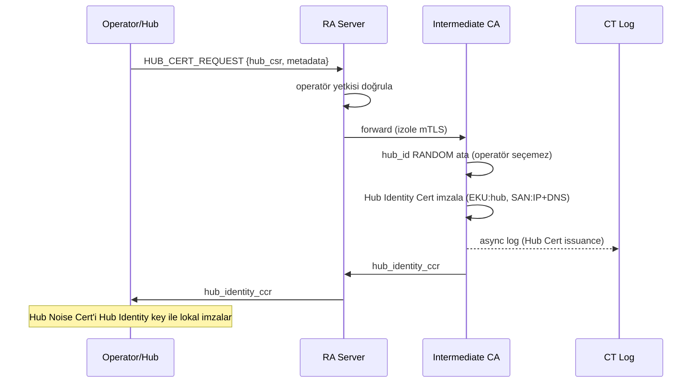
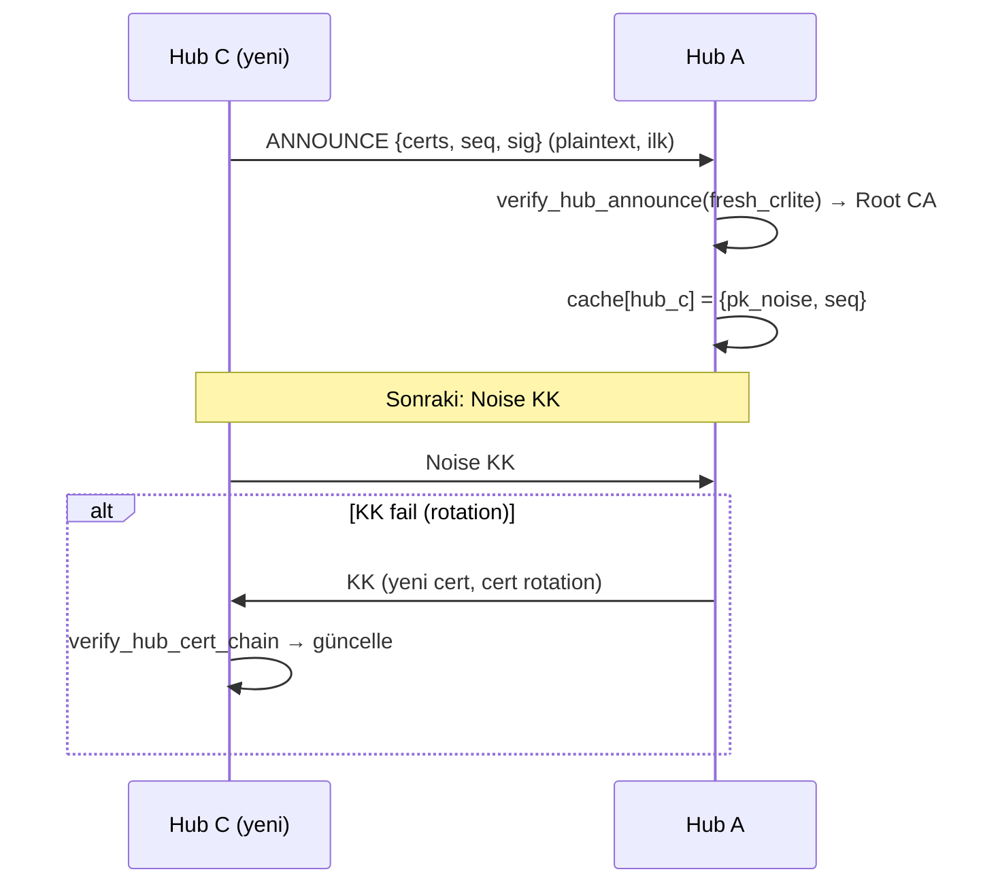

# Identity & Trust Model

> **YAMA KAYDI — 2026-10-04b [K3 + K5 — Abkarada kararı]:** §28 **OQ-14 KAPANDI**: onay/keepalive taşıyıcısı = boş batch `BatchPayload{submsg_count = 0}` (ccr); E2E `Control::Ack/Sack` ailesi silindi, ürün ACK'i engine ACK_V2 (D2 / Tema E kapandı). §16 provisional supersession: onaylanmayan oturumun ömrü artık **`PROVISIONAL_TTL`** (istemci sabiti; değeri `HALF_OPEN_TTL` ile aynı, ayrı ad). Üstü çizili metin silinmedi.

> **YAMA KAYDI — 2026-10-04 [DR-CONNECT-1 tamamlama — sahip kararı]:** §16 H6 **PROVISIONAL supersession** olarak yeniden yazıldı (2026-10-03 metni üstü çizili: bayat INIT sağlıklı oturumu öldürebiliyordu; artık yeni oturum provisional kurulur, eski oturum tam çalışır, onay = ilk AEAD-geçerli epoch-1 paketi, sonra N_g/T_g drain → `Closed(Superseded)`; alıcı Renew ile peer-restart'ı ayırt etmez) · §16'ya **eşzamanlı INIT (glare)** tie-break'i (dest_hash'i küçük olan kazanır) · `SESSION_MAX_AGE = 7 gün` (KS-AGE-1 KAPANDI) · §28 OQ-14'e not: provisional onayın kritik yolunda. Üstü çizili metin silinmedi.

> **YAMA KAYDI — 2026-10-03 [DR-CONNECT-1 — sahip kararı; indeks `docs/decisions/DR-CONNECT-1.md`]:** §16'ya "Oturum yaşam döngüsü" bloğu: INV-NO-IDLE-TEARDOWN + kapalı sonlandırma listesi (H1/H2) · peer-restart supersession (H6) · SESSION_MAX_AGE / KS-AGE-1 (H8) · T-18c ilişkisi (H11). §16 `SessionState.last_activity` "inaktivite timeout (30 gün)" ve §8 tablosundaki aynı ifade üstü çizildi (H1 ile doğrudan çelişiyordu); `pending_accept_deadline` niyet deadline'ı değil ephemeral ömrü olarak işaretlendi. §21 T-18c satırına H11 cümlesi. §28 OQ-14 AÇIK kalır notu (H13); OQ-16 kalibrasyonla KAPANDI (K = 1024). Üstü çizili metin silinmedi.

> **YAMA KAYDI — 2026-09-23 [D-GAP karar paketi]:** §15.5 `replay_precheck`'te far-future kapısı KALDIRILDI (D-GAP-1; ccr §35.8 ile birebir) — ileri sıçrama AEAD-geçerliyse kabul edilir, `commit`'te atlanan aralık bitmap'te temizlenir; underflow-safe eski-paket kuralı ve "AEAD'den önce güncellenmez" AYNEN kalır. §28.1-A kanıtına sonuç notu eklendi. OQ bakımı: OQ-09/10/11/13 KAPANDI; OQ-12/14/15 AÇIK; OQ-16 (extended-pn32 `FUTURE_GAP_MAX`) açıldı ve **PARK EDİLDİ** — KS-PN-1 `K ≤ 2^13` seçilirse konusuz kalır.


> **YAMA KAYDI — 2026-09-22 [N-mesaj ACK penceresi ÜÇE AYRILDI — sahip kararı]:** (1) KALIR: hub'ın gönderen→alıcı başına teslim edilmemiş öğe sınırı → **mailbox kotası** (app-rpc §8, `0x0505 MAILBOX_QUOTA_EXCEEDED`, N = hub politikası [KALİBRASYON]). (2) KALKTI: istemcide `ack_outstanding` + WAIT (E-9, CAD-45, §8 "Async outbound seq" satırı, §10.5 adım 8 sözde-kod, §10.5 adım 19, §12.3, §15.5 notu, §16 SessionState yapısı + kural, §25 test 24) — üstü çizildi, silinmedi; SESSION_DATA-ACK'in teslim-bilgisi rolü → AMP RECEIPT(delivered). (3) Yeniden yazıldı: T-16 (tespit = RECEIPT(delivered) + msg_id boşluğu, önleme residual), T-26 (hub mailbox kotası + cihaz başına gönderim hızı), AC-08 (§26), CAD-45 son cümlesi, §21.1 CAD-40 notu. (4) E-9'daki "SÖKÜLDÜ 16 Eyl" + `MAILBOX_PRUNE` atfı YANLIŞTI (o söküm repoya hiç girmedi; `MAILBOX_PRUNE` tanımlı değil) → bu karara referans. (5) KANIT, (6) TEYİT → §28.1 (karar içermez) + OQ-09..OQ-15. **Karar listesinde OLMAYAN, tutarlılık için dokunulan:** §10.5 adım 20 failover tetiği ("ACK gelmezse (N mesaj sonra)" → "RECEIPT(delivered) gelmezse", eşik OQ-15), §12.3 out-of-order MAX_SKIP notu, §12.9 sequence diyagramı notu, E-2 MAX_SKIP bağlamı, §2.1 kapsam özeti, §3 hub async trust notu, §9 hub "Async delivery ACK state" satırı (→ mailbox kotası), §9 hub async trust sınırı notu, §12.2 suppress notu.


> **YAMA KAYDI — 2026-09-20 [kripto implementasyon risk taraması]:** §15.5 P0-8 alım sırasında "reconstruct" → `counter_reconstruct` + FEC reconstruct'ın bu sıranın parçası olmadığı notu (INV-FEC-1) · replay penceresi "512-1024" aralıkları (§15.5 başlığı, CAD-45, §8 async replay satırı, T-19, E-9) → ccr §35.8 `REPLAY_WINDOW_SIZE = 1024`; CAD-45 `seq (u32)` → wire seq16 + `reconstructed_full_counter` u64 · E-9'daki N-mesaj-ACK penceresi cümlesi SÖKÜLDÜ olarak işaretlendi (16 Eyl sökümünün OTORİTER §0'da eksik kalmış izi).


> **YAMA KAYDI — 2026-09-18 [AMENDMENT-6]:** kanun bandı → transport-tdd §0 referansı + "oturum durum makinesi Crypto'nun içinde, yalnız Transport'un SessionControl'üyle sürülür; Application doğrudan çağırmaz" notu. P0 yamaları ve T-18a/b/c DEĞİŞMEDİ.


> **Katman grafiği:** transport-layer-tdd §0 INV-NEIGHBOR-1. Bu belge trust/validator semantiği otoritesidir; oturum durum makinesi (pending, candidate, epoch, renew) Crypto'nun içindedir ve yalnız Transport'un SessionControl komutlarıyla sürülür — Application onu DOĞRUDAN çağırmaz.

> **YAMA KAYDI — 2026-09-07b (CRYPTO-P0 MİNİ CERRAHİ PASS):** in-session rekey drift'i temizlendi (E-2 / CAD-40 / §Forward secrecy: `k_new=HASH(k_old)` Alpha'da YOK; otorite noise-wire §0.9/§5 cap→yeni handshake) · P0-2 tamamlandı (CAD-45, §10 adım-5, §15.5 yorumu, verify_session_init adım-11, T-19: hepsi `(validated sender device identity, init_counter)`) · §10.6'daki **stale AAD kopya tablosu** kaldırıldı → ccr §35.3.1/§35.5.1/§35.9/§35.10 referansı (A-8 tamamlandı) · 21e stale acceptance kriteri confirmation-safe grace'e çekildi (P0-9). Yeni karar YOK.


> **YAMA KAYDI — 2026-09-07 (CRYPTO-P0-FREEZE):** P0-1 (SSI1 wire-magic kaldırıldı + D1 exact) · P0-2 (INIT replay identity = validated sender identity + init_counter; 7 gün = retention horizon) · P0-3/P0-4 (RESPONSE: wire session_id_internal lookup kaldırıldı, SSR1 wire-magic kaldırıldı, pending_session caller-seçimli candidate, KS-DEMUX-1 OPEN) · P0-5 (D4/D5/D7 exact) · P0-6 (replay_precheck/replay_commit ayrımı) · P0-7 (underflow-safe aritmetik) · P0-8 (kanonik alım sırası) · P0-9 (confirmation-safe epoch transition) · P0-13 (zeroization sırası) · P0-14 (summary GO/HOLD sınırı). Yeni karar YOK, wire DEĞİŞMEDİ.


> **YAMA KAYDI — 2026-09-02 (S2 blocker kapatma, B4 — ccr §35.18 cross-doc reconciliation talebi):**
> - **Kapanış özeti** Session Model V3'e hizalandı: "Async Session V2" → "Session Model V3";
>   hot-path 18B; dh_epoch 0→1 FS upgrade; magic SSI1/SSR1/SSD1/SSC1; replay girdisi
>   `SESSION_INIT init_counter`.
> - **Validator adları §15.6 ile hizalandı:** `verify_async_init/accept/data` →
>   `verify_session_init / verify_session_init_response / verify_session_data`;
>   `verify_signed_control_message` → `verify_signed_control`.
> - **`check_async_data_replay` → `check_session_data_replay`** (8 isabet; fonksiyon zaten V3 için
>   aktifti, yalnız adı legacy'ydi). §15.5'e alias notu eklendi.
> - Kapanış özetine **CROSS-DOC RECONCILIATION** bloğu: Async Session V2 + `verify_async_*` ailesi
>   DEPRECATED / MUST NOT IMPLEMENT; aktif parser REJECT eder.
> - Deprecated Appendix (Section 27) içeriğine DOKUNULMADI (tarihsel kayıt korunur).
>
> **YAMA KAYDI — 2026-09-07 (Hasan tutarsızlık raporu / B4-EXT — E-13):**
> 09-02 yaması kozmetikti (özet + adlar). Bu yama **pseudocode gövdelerini** ccr'a çekiyor:
> - **A-3 (en yüksek interop riski):** `per-message key = HKDF(k_send, seq)` V2 zarfı KALDIRILDI →
>   tek `k_send` + reconstructed full counter; AAD → ccr §35.9 (28B). §10.5-8, §10.5-18, §15.6-data-7/8.
> - **A-2:** `session_root = HKDF(..., info=session_context_v1)` → `epoch_1_root = KDF(..., u16_be(1))`
>   (ccr §35.2.1 D4). `"SR-DATA-A2B-E0/E1"` label şeması → `"SR-SESSION-TRAFFIC-V3"` + direction (D2/D5).
>   `session_root` adı belge genelinde `epoch_1_root`'a çekildi.
> - **A-1:** §10.5-15 SSR1 wire'ından `session_id_internal` çıkarıldı (INV-SM3-WIRE); §15.6-init-9
>   "wire alanıyla karşılaştır" → "türet, bağ AAD üzerinden". **RESPONSE demux'u AÇIK KALEM olarak işaretlendi.**
> - **A-4:** SIGNED_CONTROL TBS → ccr §35.10 (counter + SHA-256(ciphertext) bağlı). Eski kısa TBS'in
>   replay / ciphertext-substitution açığı not olarak yazıldı.
> - **A-5:** §15.5 girdisi ham `seq` → `full_counter`; `highest_seq` → `highest_counter`; reconstruction
>   çağıran tarafta zorunlu kılındı (wrap-around replay kapandı).
> - **B-2:** "SESSION_INIT timestamp penceresi" → `(device_id, init_counter)` replay kümesi;
>   7 gün = ALICI alım zamanına göre budama ufku (wire'da timestamp YOK).


**Doküman:** `identity-and-trust-model.md`
**Versiyon:** v1.5 + **Haziran 2026 ERRATA** (statik X25519 mimari dönüşü — aşağıdaki errata otoriterdir)
**Durum:** SRS/TDD — implementation-ready (ccr-spec §35 reconciliation sonrası). Aktif async model: **Session Model V3**. Historical AsyncMessage / Async Session V2 terimleri deprecated, yalnızca appendix.
**Platform kapsamı:** Android (StrongBox/TEE)
**Bağımlı dokümanlar:** `discovery-architecture.md`, `rendezvous-dht-architecture.md`, `transport-layer-tdd.md`, `revocation-model.md`, `ccr-format-spec.md`

---

## 0. HAZİRAN 2026 ERRATA — Statik X25519 Mimari Dönüşü (OTORİTER)

> **Bu errata, aşağıdaki v1.5 gövdesindeki çelişen tüm ifadeleri GEÇERSİZ kılar.** Gövde tarihsel/referans olarak korunmuştur (cerrahi prensip: silme yok), ancak çelişki durumunda BU ERRATA bağlayıcıdır. Tüm implementasyon erratayı esas alır.

**E-1 — STATİK X25519 (SignedNoisePrekey KALDIRILDI):** Transport X25519 anahtarı artık Device Cert (CompactDeviceCert, ccr-spec §13) içinde **statik** taşınır (`pk_x25519`). `SignedNoisePrekey`, `PrekeyBundle`, `canonical_prekey_tbs`, prekey rotation/archive/refresh state machine, `record_sequence` vs `prekey.sequence` ayrımı, N=1 archive (CAD-32), prekey accept-grace — **HEPSİ KALDIRILDI.** Gövdedeki Section 7.10, 7.11 (PrekeyBundle), Section 12 (rotation), ilgili CAD-17/28/29/30/31/32/33 prekey kuralları DEPRECATED. **Gerekçe:** değişken prekey = her mesajda hub'dan taze prekey çekme = hub bağımlılığı = hostile ağda bağlantı kurulamama. Statik X25519 = tek-temassız asenkron mesaj + cache hiç bayatlamaz. **X25519 ROTATION YOK** (Device Cert 90 günde yenilenir, içindeki x25519 sabit kalır). KAYIP: oturum-başlangıcı forward secrecy (static sızarsa bekleyen async mesajlar) — kabul (cihaz ele geçirme kapsam dışı).

**E-2 — RATCHET YOK; ALPHA KEY LIFECYCLE = CAP → YENİ HANDSHAKE (Double Ratchet kullanılmıyor):**
~~Oturum-içi forward secrecy Noise'ın kendi rekey'i ile (`k_new=HASH(k_old)`, 0 wire byte).~~
**[DÜZELTİLDİ 2026-09-07 — CRYPTO-P0 mini pass]** `k_new = HASH(k_old)` in-session rekey Alpha'da
**YOKTUR** ve aktif normatif davranış DEĞİLDİR. Otorite `kama-noise-wire-tdd §0.9/§5`: Alpha'da
in-session key-phase YOK · KEY_UPDATE YOK · `SESSION_RENEW_REQUIRED` (session cap) → **tamamen yeni
handshake / yeni session**. Bu belge o kararı OKUR, yeniden seçmez. Yön değişmedi (Double Ratchet
hâlâ atılmış); değişen, oturum-içi FS mekanizmasının ne olduğudur. Signal Double Ratchet ATILDI (DH-ratchet'i her yön değişiminde 32B wire maliyeti getirir, 0.1 kbps bütçe kaldırmaz; verdiği post-compromise healing zaten kapsam dışı tehdide karşı). MAX_SKIP kavramı geçerli (Bob skipped key saklar, ~~N-mesaj-ACK penceresi bağlamında~~ [2026-09-22: o bağlam kalktı; MAX_SKIP sınırının sahibi AÇIK — OQ-09]).

**E-3 — ASENKRON-FIRST + SESSION MODEL V3:** Mesajlaşma+dosya = asenkron store-and-forward. Async messaging modeli **Session Model V3'dir** (ccr-spec §35, SESSION_INIT/SESSION_INIT_RESPONSE/SESSION_DATA/SIGNED_CONTROL — bkz. **E-12**, otoriter). Eski tek-yapı `AsyncMessage`/`SRAM`/`Noise N one-way`/per-message `sender_signature` modeli DEPRECATED (Section 27). Senkron (PTT/voice/video) = Beta, Noise pattern, WebRTC DTLS sökülür. Güven çapası: DiscoveryRecordV2 (sk_user_identity imzalı, static X25519 taşır). Ek HMAC kullanılmaz; bütünlük/orijinallik AEAD tag + `ss_s` possession auth (hot-path) + domain separation + recipient/link binding ile sağlanır; non-repudiation yalnızca SIGNED_CONTROL'da (Section 10.5).

**E-4 — CompactDeviceCert ~152B (SAN URI çıkarıldı):** Ağda dolaşan tek cert: `device_ed25519_pub(32)+device_x25519_pub(32 statik)+issuer_key_id(16)+not_after(8)+issuer_signature(64)`. İmzalayan = **Identity CA/User Identity Cert** (`issuer_signature = Ed25519_Sign(sk_user_identity, compact_device_cert_tbs)`) — Intermediate DEĞİL. SAN URI, deviceId extension, dest_hash/identity_hash alanları cert'ten ÇIKARILDI. **KRİTİK:** `identity_hash`/`dest_hash` device key'den TÜRETİLMEZ — yalnızca issuer Identity/User Cert'in `user_identity_ed25519_pub`'undan: `identity_hash=SHA-256(user_identity_ed25519_pub)`, `dest_hash=SHA-256(identity_hash)` (CAD-16). Device cert tek başına dest_hash vermez; doğrulayıcı issuer Identity cert'e bakar. Namespace: issuer Identity Cert nameConstraints dest_hash'i commit eder; CompactDeviceCert o Identity altında çünkü issuer_signature user_identity_ed25519_pub ile doğrulanır. Detay: ccr-spec §13.

**E-5 — PKI: HER KURUM KENDİ Intermediate+RA (Intermediate 5 YIL, namespace omurgası):** Intermediate CA operatör/kurum başına, **5 YIL** geçerli. Intermediate **business-license enforcement mekanizması DEĞİLDİR** — kurumun kriptografik namespace omurgasıdır (Identity CA, Hub Cert, RA Cert, Admin Cert, HubListRecord, CT/audit, CRLite issuer scope ona bağlı). Yıllık Intermediate CA rollover chain cache, HubListRecord validity, hub/admin sertifikaları, CT/audit sürekliliği ve client validation state üzerinde gereksiz operasyonel yük getirir → relatively stable, 5 yıl; yalnızca planned rollover veya compromise response ile değişir. Cross-contamination: her kurum ayrı Intermediate key + RA allowlist kapısı. **Lisans enforcement Intermediate'ten ÇIKARILDI → RA license gate + OrgEntitlementRecord + Identity Cert 1 yıl yenileme (E-11).** Süreler: Intermediate 5 yıl, Identity CA/User Cert **1 yıl**, Device Cert 90 gün.

**E-6 — REVOCATION 3-KATMAN:** (1) PUSH: RA revoke→Intermediate→tüm hub'lara push (hub mesh), hub blacklist tutar, revoke client'a routing yapmaz → anlık kesinti (iyi internette saniyeler). (2) KISA ÖMÜR: Device Cert 90 gün → revoke cert max expire'a kadar (hub güvenilmez backstop). (3) CLIENT CRL: client iyi internette CRLSet indirir (6saat-miss sorun değil, client'lar hep hub üzerinden), kötü hub'a karşı çift-katman. Device Cert 90 gün KALIR (dağda mission 1-2 ay, 90 günde 1-2 gün iyi internet).

**E-7 — RA PROXY + DENETLENEBİLİRLİK:** Client RA'ya DOĞRUDAN bağlanmaz → Client→Hub→RA (hub proxy, gerçek adres saklar; client'lara mTLS YOK). RA'da telefon→dest_hash+identity_hash loglanır (kurum "kim kayıtlı" denetler, savunma şartı; içerik E2E, KVKK dışı). Hub'lar kim-kimle metadata DEFAULT tutmaz (minimize). RA güvenilir (denetim zorunlu), hub güvenilmez.

**E-8 — BOOTSTRAP: Root pin app bundle'da, hub listesi RA'dan:** App bundle'da SADECE RoftCore Root CA pinli (sabit). Hub listesi = HubListRecord (ccr-spec §21.5, Intermediate-imzalı, IP SAN'lı), RA'dan onboarding'de gelir (app bundle'a gömülemez — her kurum farklı). Detay: Section 6.3.1.

**E-9 — ÇOK-HUB SELF-HEALING ~~+ N-MESAJ-ACK~~:** Client ~3 hub'a kayıtlı olabilir (primary/secondary/tertiary, failover). HubBinding (client-imzalı tek-hub) REDDEDİLDİ (self-healing'i öldürür). Split-brain zaten uygulama-düzeyi cert kontrolü + sk_device possession ile kapalı (kötü hub Bob'u register edemez). Mesajlaşma tek hub (primary)=1x bant. LWW+TTL. ~~N-mesaj-ACK penceresi: Alice ACK almadan N mesajdan fazla gönderemez (DoS + sessiz kayıp + MAX_SKIP tek mekanizma).~~ ~~**[SÖKÜLDÜ 2026-09-16; bu satıra işlenmemişti — 2026-09-20]**~~ ~~mailbox depolaması app-rpc `MAILBOX_PRUNE` (yalnız depolama yaşam döngüsü; gönderen durmaz).~~ **[DÜZELTME 2026-09-22: "16 Eylül sökümü" repoya hiç girmedi; `MAILBOX_PRUNE` app-rpc'de tanımlı değil. Geçerli olan ÜÇE-AYIRMA kararıdır — bkz. baştaki 2026-09-22 YAMA KAYDI:]** (1) hub tarafı sınır KALIR → **mailbox kotası** (app-rpc §8; `0x0505 MAILBOX_QUOTA_EXCEEDED`; N = hub politikası [KALİBRASYON]); (2) istemci gönderim penceresi / ACK bekleme KALKTI — Application'da ACK bekleme YOKTUR (yeniden gönderim ve akış Transport'un — transport-tdd §0 INV-NEIGHBOR-1); teslim bilgisi → AMP RECEIPT(delivered); (3) T-16 / T-26 / AC-08 buna göre yeniden yazıldı. Replay: counter+timestamp, sliding window bitmap (~~512-1024~~ 1024 = ccr §35.8), max_age 7 gün. Multi-device KAPSAM DIŞI.

**E-11 — LİSANS ENFORCEMENT (Intermediate expiry DEĞİL, 5 katman):** Business-license enforcement Intermediate CA expiry üzerinden YAPILMAZ (Intermediate 5 yıl, namespace omurgası). Bunun yerine: (1) **RA license gate** (sertifika isteğini Intermediate'e göndermeden önce org lisansı + seat limit; lisans yoksa Identity Cert vermez, Device enrollment onaylamaz, HubListRecord yenilemez, Admin taleplerini reddeder); (2) **OrgEntitlementRecord** (RoftCore imzalı lisans kaydı, Section 7.14); (3) **Identity CA/User Cert 1 yıl yenileme** (RA license gate + Admin approval); (4) **HubListRecord validity** (not_after <= license_not_after); (5) **CRLite/revocation** (erken termination). Kriptografik zincir: `IdentityCert.not_after <= OrgEntitlement.license_not_after`; `DeviceCert.not_after <= min(identity_cert.not_after, org_license_not_after)`; `HubListRecord.not_after <= license_not_after`. Lisans bitince Identity Cert yenilenmez (1 yıl) → Device Cert parent'ı aşamaz → routing durur; Intermediate (namespace) bozulmaz. Detay: Section 6.3.2 + 7.14.

**E-10 — MALİ MODEL + YÖNETİM MİMARİSİ (gelir kriptografiye gömülü):** E-5'in "Intermediate+RA kurumda" kararı mali modeli kırıyordu (kurum sınırsız sertifika basar → kullanıcı sayısı ölçülemez → ölçeklenebilir gelir yok). **DÜZELTME:** Root CA + Intermediate CA (kurum başına ayrı key) + RA **RoftCore'da** (RoftCore-kontrollü HSM-destekli CA/RA ortamı: erişim kontrolü + audit logging + separation of duties). Kurumda yalnızca **Admin Server** (yönetim) + **Hub'lar** (zero-trust). RA = kayıt + loglama, **3 gate:** (1) license gate (OrgEntitlementRecord + seat limit; aşılırsa/lisans yoksa Intermediate'e göndermez), (2) admin allowlist gate (Admin Server kullanıcıyı bildirdi mi? yoksa şüpheli işaretle), (3) device approval gate (SIM-swap mitigasyonu: SMS + Admin cihaz onayı). Otomasyon: Admin Server→RA (mTLS)→3 gate→Intermediate **otomatik** imzalar (düşük RTT, sürtünme yok). Detay: Section 6.3.2 + Section 6.3.3. Tam yetki matrisi (admin'e verilen/verilmeyen) Section 6.3.3.

**E-12 — SESSION MODEL V3 = CANONICAL ASYNC MESSAGING MODELİ (OTORİTER, E-3'ü GÜNCELLER):** Eski tek-yapı `AsyncMessage` / `SRAM` / `Noise N one-way` / `sender_signature = Ed25519_Sign(sk_device, msg_tbs)` modeli **DEPRECATED'dir** (her mesajda full dest_hash + ephemeral + cert + 64B imza ≈ 200B metadata → 0.025 kbps survival'da sürdürülemez). **Aktif canonical async messaging modeli Session Model V3'dir** (ccr-spec §35, CAD-54/55):

* `SESSION_INIT` — pahalı/bootstrap mesajı (self-contained, konuşma başına 1 kez; Bob online olmak zorunda değil; Alice Bob'un static X25519'unu discovery cache'ten bilir → handshake YOK). `session_id_internal` + `init_root` burada kurulur.
* `SESSION_INIT_RESPONSE` — stateful session activation (Bob INIT'i mailbox'tan alınca; Alpha default STRONGER, Bob ephemeral ZORUNLU → FS upgrade). `epoch_1_root` burada türetilir (ccr §35.2.1 D4).
* `SESSION_DATA` — düşük-overhead hot-path (≈18B app-envelope; SADECE `seq16 + ciphertext + AEAD tag`; hub_handle 4B L2 routing wire'da; session_id_internal/flags/len/recipient_dest_hash/cert/ephemeral/timestamp/imza YOK; length implicit). HER mesaj.
* `SIGNED_CONTROL` — nadir non-repudiation gereken mesaj (kritik komut, delivery receipt, audit) = SESSION_DATA + `sender_signature(64B)` + full sender context.

**Normatif kurallar:** (1) Normal chat/file/data hot-path **imzasızdır ve deniable'dır**. (2) Sender authentication normal hot-path'te **`ss_s = DH(sender_static_x25519, recipient_static_x25519)` possession + AEAD tag** ile sağlanır (ayrı per-message imza YOK). (3) Ed25519 `sk_device` imzası **yalnızca** `SIGNED_CONTROL` / delivery receipt / audit-control context'te kullanılır. (4) Public non-repudiation **bilinçli olarak yoktur** (yalnızca SIGNED_CONTROL). (5) `identity-and-trust-model.md` semantik otorite olduğundan, gövdedeki tüm aktif bölümler Session Model V3 ile uyumludur; eski `AsyncMessage/SRAM/Noise N/msg_tbs/verify_async_message_*/sender_signature` ifadeleri yalnızca **Deprecated Appendix (Section 27)**'de tarihsel referanstır, aktif protokol davranışı DEĞİLDİR. Key schedule: `session_context_v1` (Section 35.2; `message_type` AAD'de, `policy_sequence`/`recipient_discovery_record_hash` çıkarıldı, `recipient_static_x25519_hash` kullanılır). Anahtar kavramlar: `init_root`, `session_root`, `session_id_internal`, epoch-0 PRE-RESPONSE DATA (init_root), epoch-1 POST-RESPONSE DATA (`epoch_1_root`), `ss_s` possession auth, AEAD tag authentication.

**E-13 — SESSION MODEL V3 İSİMLENDİRME RECONCILE (OTORİTER, E-3/E-12'yi GÜNCELLER, Haziran 2026):** ccr-spec §35 wire/session canonical otorite olarak **Session Model V3**'e geçti. Bu belgedeki aktif "Session Model V3" semantiği DOĞRU; yalnızca İSİMLER reconcile edilir (wire byte'ları için ccr §35 otoriter):

| Eski (Session Model V3) | Yeni (Session Model V3) |
|---|---|
| `SESSION_INIT` | `SESSION_INIT` |
| `SESSION_INIT_RESPONSE` | `SESSION_INIT_RESPONSE` |
| `SESSION_DATA` | `SESSION_DATA` |
| `SIGNED_CONTROL` | `SIGNED_CONTROL` |
| magic `SSI1/SSR1/SSD1/SSC1` | `SSI1/SSR1/SSD1/SSC1` |
| `session_id_internal` (16B, wire+AAD) | **`session_id_internal`** (derived, wire'da YOK, AAD'de) + routing → **`hub_handle`** (4B, L2, hub-assigned, wire) |
| `SESSION_DATA` 39B app-envelope | **`SESSION_DATA` 18B** app-envelope (seq16 2B + tag16 16B; flags/len/session_id_internal YOK; length implicit) |
| HKDF label `"SR-SESSION-ID-V3"` | `"SR-SESSION-ID-V3"` |

**E-14 — FEDERATION DISCOVERY / SELECTOR (onboarding'de client → RA federasyon çözümü, KİLİTLİ):** App bundle'da yalnız RA public endpoint + RoftCore Root CA pinli (E-8); client federasyonu (kurum hub'ları, Admin Server) doğrudan **bilmez** — RA'dan öğrenir. Ama RA çok federasyona hizmet eder → hangi federasyon olduğunu ayırt etmeli. Çözüm:
- **`federation_selector` (PUBLIC):** her operatör/federasyonun client-facing seçicisi; RA'da `federation_selector → operator_id` map'lenir (operator_id = admin-plane kimliği, admin-control-plane-tdd). Onboarding'de client bunu bir **davet (QR/link)** ile verir. **NORMATİF: `federation_selector` HIGH-ENTROPY OPAQUE RANDOM identifier olmalı** — kurum adı, domain, operator adı veya tahmin edilebilir hash OLMAMALI (aksi halde enumeration/guessing yüzeyi açılır; PUBLIC ama tahmin-edilemez).
- **B2C default:** `federation_selector` boş/pass → RoftCore B2C operator_id otomatik (tüketici kapısı açık).
- **AUTHENTICATION DEĞİL:** `federation_selector` yalnız "hangi allowlist" sorusunu yanıtlar (coarse routing/pre-filter — tıpkı IP gibi; INV-BOOTSTRAP-CERT-BOUND disiplini: seçici auth factor DEĞİL). Asıl kapı **Gate-2 allowlist** (telefon/kimlik eşleşmesi). Yanlış/sızmış seçici HİÇBİR yetki vermez.
- **Davet ≠ yetkilendirme:** davet (QR/link) yalnız SEÇİCİYİ taşır; yetkilendirme admin'in telefonu allowlist'e eklemesidir (Gate-2, ADMIN_ALLOWLIST_SYNC). Davet sızsa bile allowlist'te olmayan geçemez.
- **UNIFORM RED (enumeration önleme, NORMATİF):** RA reddederken "federasyon yok" ile "yetkili değilsin"i **AYIRT ETTİRMEZ** — tek tip red. Saldırgan hangi federasyonların var olduğunu enumerate EDEMEZ (federasyon-üyeliği metadata'sı hassas). **Uniform red yalnız mesaj DEĞİL: response status kodu, timing (constant-time), ve retry davranışı da geçersiz-selector ile yetkisiz-kullanıcı arasında AYIRT ETTİRMEMELİ** (timing/status side-channel enumeration'ı da kapatır).
- **IP sızıntısı YOK:** yalnız RA IP public (pinli). Admin Server + hub IP'leri onboarding'de authentication'dan SONRA HubListRecord (E-8, cert-bound HubEntryV3) ile gelir — önden sızmaz.
- **İki katman:** B2C (RoftCore, açık kayıt) vs Enterprise (federasyon; allowlist+seat+cihaz-onayı gated). **B2C↔Enterprise izolasyon sınırı Beta'ya ERTELENDİ** (Alpha: enterprise-öncelik, B2C basit).
- **RA akışı:** `federation_selector → operator_id` çözümü **Gate-1/2/3'ten ÖNCE** (Gate-0); ardından 3 gate o operator_id'ye uygulanır (admin-control-plane-tdd §10). Davet link/QR formatı (`federation_selector` + expiry encode) **TBD — dondurulmadı.**

**KAVRAMSAL NETLİK (NORMATİF — "KK/IK" YANLIŞ ETİKETİ DÜZELTİLDİ):** Async key schedule **tek-yön authenticated**'dır: `ss_e = DH(sender_ephemeral, recipient_static)` (FS) + `ss_s = DH(sender_static, recipient_static)` (sender auth, possession). Bu **N-türevi tek-yön** (inline cert ≈ Noise X-benzeri, ref ≈ Noise K-benzeri) — **interaktif KK/IK DEĞİL**. İki tarafın aynı anda online olması GEREKMEZ: Alice tek SESSION_INIT gönderir, hub saklar, Bob offline olabilir; Bob online olunca `init_root`'u kendi static'iyle (ss_e+ss_s) çözer. `SESSION_INIT_RESPONSE` senkron handshake DEĞİL — Bob online olunca kendi ephemeral'ını ekleyen **asenkron FS-upgrade** (epoch-0 tek-yön init_root → epoch-1 çift-yön epoch_1_root). İlk mesaj RESPONSE olmadan da teslim+okunur. (Senkron Client↔Client / canlı PTT-voice-video için interaktif Noise IK/KK = Beta, ayrı konu.) **Wire byte otoritesi: ccr-spec §35.**

**SESSION MODEL V3 INVARIANTS (NORMATİF):**

| ID | Statement |
|----|-----------|
| INV-SM3-ASYNC | Bob, SESSION_INIT için online olmak zorunda DEĞİL. SESSION_INIT_RESPONSE ilk async mesajı okumak için GEREKLİ DEĞİL. |
| INV-SM3-NOT-IKKK | Session Model V3 standart Noise IK/KK DEĞİL — Kama-specific N-türevi authenticated one-way (ss_e + ss_s). |
| INV-SM3-WIRE | session_id_internal wire'da TAŞINMAZ (derived/AAD). SESSION_DATA app-envelope = seq16 + ciphertext + tag16 (18B); routing hub_handle (4B, L2). |
| INV-SM3-DENIABILITY | Normal SESSION_DATA deniable + imzasız. Yalnızca SIGNED_CONTROL Ed25519 non-repudiation imzası taşır. |
| INV-SM3-FS-LIMIT | Recipient static X25519 compromise, kuyruğa alınmış/geçmiş SESSION_INIT mesajlarını açığa çıkarabilir — kabul edilen Alpha tradeoff (hostile/offline operasyon için). |

---

## 1. Purpose / Amaç

Bu doküman Kama'nın kimlik, PKI, certificate chain, trust model, authentication, **statik X25519 transport modeli (Haziran 2026, bkz. Section 0 ERRATA)**, Noise kullanım sınırları, anahtar sahipliği, anahtar saklama ve revocation davranışını **implementation-ready** seviyede tanımlar.

Bu dokümanı okuyan bir geliştirici Identity/Trust altsistemini **yeni hiçbir protokol, trust, lifecycle, validation, fallback, revocation veya state-machine tasarım kararı vermeden** implemente edebilmelidir. Hangi veriyi saklayacağını, ne göndereceğini, neyi imzalayacağını, neyi doğrulayacağını, ne zaman fetch/cache/reject/rotate/delete edeceğini, ne zaman fail-closed/fail-open olacağını bilir.

Kama aşırı düşük bant genişliği, aşırı paket kaybı, yüksek gecikme, hostile network ve untrusted hub koşullarında çalışır.

---

## 2. Scope Boundaries

### 2.1 Bu Doküman Neyi Kapsar

Identity model, PKI hiyerarşisi, recursive chain validation, **CompactDeviceCert** (statik `pk_x25519` taşıyan tek on-wire cert), DeviceCertBundle, **DiscoveryRecordV2** (statik X25519 referanslı), **Session Model V3** (SESSION_INIT/SESSION_INIT_RESPONSE/SESSION_DATA store-and-forward, authenticated one-way) güven modeli, Client↔Hub / Client↔Client (async) / Hub↔Hub authentication, **Noise rekey** (oturum-içi forward secrecy; Double Ratchet kullanılmaz), **RA + Admin Server yönetim/mali modeli** (lisans gate + admin approval + cihaz onayı), **HubListRecord bootstrap**, Noise transport-layer ↔ application-layer PKI ayrımı, key storage, revocation (CRLite fail-closed, 3-katman), **replay protection** (per epoch+direction sliding bitmap + SESSION_INIT counter/timestamp), ~~**N-message ACK penceresi**~~ **mailbox kotası** (hub, app-rpc §8) [2026-09-22], CT Log (async audit).

### 2.2 Diğer Dokümanlara Ait

| Konu | Doküman |
|------|---------|
| VOPRF discovery mekanikleri, contact matching | `discovery-architecture.md` |
| DHT routing, rendezvous, store-and-forward mekanizması | `rendezvous-dht-architecture.md` |
| Custom ARQ/FEC/Noise adaptif transport pipeline | `transport-layer-tdd.md` |
| CRLite filter binary encoding | `revocation-model.md` |
| CompactDeviceCert + Session Model V3 (INIT/RESPONSE/DATA) + DiscoveryRecordV2 + HubListRecord byte-level serialization | `ccr-format-spec.md` |
| Authorization/policy | Ayrı (kapsam dışı) |

### 2.3 Offline Mode — Yoktur

`Confirmed (KAT1-P1-01 Option C ile güncellendi):` Yeni trust kararları için genel offline validation modu **yoktur**. Revocation freshness doğrulanamıyorsa: **unknown/never-validated contact → fail-closed** (yeni conversation başlamaz); **known contact** (daha önce fresh revocation altında doğrulanmış, hash-eşleşmeli cache) → bounded-stale revocation cache ile yeni SESSION_INIT'e izin verilebilir (risk-flag'li; revocation-model.md §7.5). Chain validation lokal ROOT_CA_SPKI_HASH (pinned) ile çalışır, ancak revocation tazeliği ağ erişimi gerektirir ve eksikse bağlantı bloke edilir (Section 18). NOT: Asenkron mesajlaşmada "iyi internet varsayımı" yalnızca kayıt/discovery anındadır (Section 6.3.1); discovery sonrası client hostile ağda cache ile çalışır.

---

## 3. System Actors

| Aktör | Tanım | Trust Rolü | Network Exposure |
|-------|-------|-----------|------------------|
| **Client** | Kullanıcının Android cihazındaki uygulama | Sadece sahibi | Public-facing |
| **Device** | Belirli cihaz; stable user identity altında | Sahibi | Public-facing |
| **Hub** | Federated routing + **Session Model V3 store-and-forward mailbox** + CRLite/HubList proxy/cache düğümü | **Untrusted** | Public-facing |
| **RA** | Onboarding, telefon doğrulama, kayıt + loglama (3 gate: license + admin allowlist + device approval); **RoftCore'da** | Trusted (Tier-0) | İzole (Hub→RA proxy; client doğrudan bağlanmaz) |
| **Admin Server** | Kurum yönetim düzlemi (kurum host'lar); kendi Intermediate-imzalı cert'i var (kurum yönetim identity) | Kurum yönetimi (PKI aktörü) | İç ağ + RA (mTLS) |
| **Intermediate CA** | **Kurum başına ayrı key; RoftCore'da** (E-10); Identity CA, Hub, RA, HubListRecord, Admin Server cert imzalar; **5 YIL (namespace omurgası, lisans mekanizması DEĞİL)** | Trusted (Tier-0) | İzole — sadece RA/otomasyon |
| **Identity CA / User Identity Certificate** | User-level cert; Device Cert imzalar; **1 yıl (RA license gate + Admin approval ile yenilenir)** | Client sahipliği (Intermediate imzalı) | Chain refresh (her session değil) |
| **Root CA** | RoftCore offline kök; pinned anchor; 20 yıl | Trust Anchor | Offline HSM |
| **CT Log** | Append-only şeffaflık kaydı (async) | **Audit / Transparency Service** — issuance transparency için trusted; **connection authorization için DEĞİL** | Public read |

> `Confirmed (A-01):` Hub'lar yalnızca CPU/RAM/network forwarding + **Session Model V3 store-and-forward** + CRLite/HubList proxy sağlayan untrusted execution environment'tır. Sistem keyfi sayıda hub'ın yalnızca paket iletmesi/mesaj saklaması durumunda güvenli kalmalıdır. Hub **prekey-store DEĞİLDİR** (statik X25519 ile prekey kavramı kaldırıldı).

> `Confirmed (A-02):` Hub → Intermediate CA doğrudan iletişim **yasaktır**. Tüm CA operasyonları RA üzerinden (otomasyon) yönlendirilir.

> `Confirmed (A-03 — RA proxy):` Client RA'ya **doğrudan bağlanmaz**. Client→Hub→RA (hub proxy, gerçek adresi saklar). Client'lara mTLS yok; RA mTLS yalnızca Hub↔RA ve Admin Server↔RA arasında.

> `Confirmed (CT trust rolü):` CT Log connection authorization otoritesi **değildir**. "Şimdi bağlanabilir miyim?" → **CRLite**. CT yalnızca "şüpheli issuance/revocation denetlenebilir miydi?" → audit. CT unavailable → session bloke etmez (Section 19).

> `Confirmed (Hub async trust):` Hub Session Model V3 mesajlarını store-and-forward eder ama içeriği **göremez** (AEAD), **değiştiremez** (session key/ss_s hub'da yok → AEAD tag fail). Hub yalnızca **suppress edebilir** (mesajı düşür/geciktir — availability residual). ~~Client N-message ACK penceresi ile sessiz kaybı yakalar (Section 16).~~ Sessiz kayıp tespiti: AMP RECEIPT(delivered) yokluğu + msg_id boşluğu (tespit; önleme residual) [2026-09-22].

### 3.1 Architectural Positioning / Non-Goals

Kama is **not** a permissionless Reticulum/RNS-style network. Kama deliberately chooses an enterprise-governed trust model:

- RoftCore Root/Intermediate/RA are trusted Tier-0 components.
- Organizations operate zero-trust hubs and an Admin Server.
- User enrollment, revocation, license enforcement, and auditability are RA/Admin mediated.
- Hubs are untrusted for content and identity forgery, but routing metadata is visible to them.
- RA sees registration metadata such as `phone_number → identity_hash/dest_hash` mapping.

This is a conscious tradeoff for regulated defense/enterprise deployments, not a fully permissionless mesh-network design. Permissionless announce/flood discovery, self-sovereign keys without organizational governance, and unmediated peer enrollment are explicit non-goals for Alpha/Beta.

### 3.2 RA Metadata Risk & Log Hardening

RA, enrollment denetimi için `phone_number → identity_hash/dest_hash` mapping tutar — bilinçli karar (savunma/kurumsal denetim şartı) ama güçlü metadata riski.

**RA registration logs (zorunlu kurallar):**
- encrypted at rest,
- tenant-separated (kurum başına izole),
- append-only,
- access-controlled,
- access itself audited (log erişimi de loglanır),
- retention policy defined per enterprise/legal requirement,
- never exposed to hubs,
- never contains message content,
- used only for enrollment audit, revocation, compliance, and admin visibility.

> **Kabul edilen risk:** RA metadata compromise, `phone_number ↔ identity_hash/dest_hash` eşlemelerini açığa çıkarabilir. Bu, kurumsal denetim tradeoff'u olarak kabul edilir ve hassas metadata olarak korunmalıdır (yukarıdaki kurallar). İçerik E2E olduğundan RA compromise mesaj içeriğini açığa çıkarmaz.

---

## 4. Confirmed Architectural Decisions

> **NOT:** CAD-28..CAD-34 (eski SignedNoisePrekey kararları) **DEPRECATED** — Section 0 ERRATA E-1 ile kaldırıldı. Aşağıda DEPRECATED damgasıyla tarihsel referans olarak bırakıldı; yerlerine CAD-36..CAD-56 (statik X25519 + Session Model V3 canonical kararları) geçer. Tam eski metin: Deprecated Appendix (Section 27).

| ID | Karar |
|----|-------|
| CAD-01 | Hiyerarşi: Root CA (20 yıl) → Intermediate CA (kurum başına ayrı key, RoftCore'da, **5 yıl, namespace omurgası**) → Identity CA/User Identity Cert (**1 yıl**) → Device Cert (90 gün). OrgEntitlementRecord (genelde 1 yıl) lisansı yönetir |
| CAD-02 | Device Cert, Identity CA/User Identity Cert tarafından **lokal** imzalanır |
| CAD-03 | Identity CA/User Cert, Intermediate CA tarafından (RA otomasyonu aracılığıyla) imzalanır |
| CAD-04 | Recursive chain her zaman pinned Root CA'da sonlanır (ROOT_CA_SPKI_HASH) |
| CAD-05 | Katmanlı yapı kasıtlı **optimizasyon** — güvenlik açığı değil |
| CAD-06 | **CompactDeviceCert** (~152B), ağda dolaşan **tek** normal client sertifikası (hash/ref ile cache, reference-first) |
| CAD-07 | Identity CA/User Cert her session'da dolaşmaz; chain refresh için (cache-dependent) |
| CAD-08 | **Device Cert validity: 90 gün** (içindeki statik `pk_x25519` rotation YOK) |
| CAD-09 | Expired Device Cert otomatik geçersiz; CRLite'a yazılmaz |
| CAD-10 | Erken revocation/compromise CRLite + push (3-katman, Section 18) |
| CAD-11 | `identity_sk` yeni cihaza **transfer edilmez**; multi-device **kapsam dışı** (Alpha+Beta, limit=1) |
| CAD-12 | Alpha bir Identity CA altında tek geçerli Device Cert (multi-device kapsam dışı) |
| CAD-13 | Kayıp/compromise cihaz revocation ile ele alınır, active-state enforcement ile değil |
| CAD-14 | CCR = **Kama-native canonical compact certificate** (X.509 TBS projection DEĞİL) |
| CAD-15 | Wire doğrulama canonical CCR TBS byte'ları üzerinde: `signature = Sign(issuer_sk, canonical_ccr_tbs)` |
| CAD-16 | **Stable routing identity Noise key'e bağlı DEĞİL.** `identity_hash = SHA-256(user_identity_ed25519_pub)` (32B); `dest_hash = SHA-256(identity_hash)` (32B); `routing_key = dest_hash[0:16]` (128-bit DHT key). Statik X25519 bunları etkilemez |
| CAD-17 | **Device Cert lifetime = 90 gün.** Statik `pk_x25519` Device Cert içinde; ayrı prekey validity kuralı YOK |
| CAD-18 | Noise = transport-layer; application-layer PKI ayrıca zorunlu |
| CAD-19 | CRLite zorunlu, <24h propagation, **fail-closed: unknown contact her zaman; known contact bounded-stale cache ile istisna (§15.3, revocation-model §7.5)** + RA→hub push (3-katman) |
| CAD-20 | CRLite freshness: primary + secondary + theatral hub; en yüksek geçerli sequence kazanır; connection başında **bir kez** alınır |
| CAD-21 | dest_hash routing metadata'dır; routing hub'ları görür (metadata hub'a güven, minimize) |
| CAD-22 | Hub cert yalnızca RA üzerinden; Hub Identity Cert sadece Hub Noise Cert + ANNOUNCE + RoutingRecord imzalar (tek key, üç rol; ayrı routing signing cert YOK) |
| CAD-23 | CT Log: Alpha minimal + asenkron; Audit/Transparency Service; unavailable → fail-open/degrade |
| CAD-24 | CRLite revocation otoritesidir; CT bunu geçersiz kılmaz |
| CAD-25 | Recovery SMS-based; BIP-39 mnemonic yok |
| CAD-26 | Platform: Android (StrongBox/TEE) |
| CAD-27 | OID/PEN Beta kararı; CCR native olduğu için Alpha bağımlı değil |
| ~~CAD-28~~ | ~~SignedNoisePrekey transport X25519 temsil eder~~ → **DEPRECATED (E-1)**: statik `pk_x25519` CompactDeviceCert içinde (CAD-36) |
| ~~CAD-29~~ | ~~SignedNoisePrekey bağımsız rotate~~ → **DEPRECATED (E-1)**: X25519 rotation YOK (CAD-37) |
| ~~CAD-30~~ | ~~Prekey self-auth ≠ freshness, hub suppress, highest_seen_prekey_sequence~~ → **DEPRECATED**: DiscoveryRecord sequence + AsyncMessage replay (CAD-42/45) |
| ~~CAD-31~~ | ~~Prekey PULL dağıtım~~ → **DEPRECATED**: DiscoveryRecord discovery'de tek-seferde fetch (CAD-41) |
| ~~CAD-32~~ | ~~N=1 archive, 14 gün grace~~ → **DEPRECATED**: archive yok (statik X25519) |
| ~~CAD-33~~ | ~~Prekey revocation yok~~ → **DEPRECATED**: Device Cert revoke 3-katman (CAD-40) |
| ~~CAD-34~~ | ~~IK-refresh = PrekeyBundle fetch~~ → **DEPRECATED**: AsyncMessage Noise N (handshake yok) (CAD-38) |
| CAD-35 | ~~Client↔Client auth simetrik (IK)~~ → **GÜNCELLENDİ (E-12)**: Client↔Client async = Session Model V3 (SESSION_INIT/SESSION_INIT_RESPONSE/SESSION_DATA); hot-path imzasız, ss_s possession auth (CAD-54/55) |
| **CAD-36** | **STATİK X25519:** Transport X25519 anahtarı CompactDeviceCert içinde statik (`pk_x25519`); routing türetimine girmez; Device Cert 90 günde yenilenir ama x25519 sabit kalabilir (rotation YOK). Gerekçe: hub bağımlılığı yok, cache bayatlamaz, tek-temassız async mesaj |
| **CAD-37** | **X25519 ROTATION YOK:** Forward secrecy oturum-içi Noise rekey + her async mesajda taze ephemeral ile sağlanır; static key rotation gerekmez. KAYIP: static sızarsa bekleyen async mesajlar (kabul, cihaz ele geçirme kapsam dışı) |
| ~~CAD-38~~ | ~~**ASYNCMESSAGE NOISE N:** `k=DH(sender_ephemeral, recipient_static_x25519)`; magic "SRAM"~~ → **DEPRECATED (E-12)**: Session Model V3 ile değiştirildi (SESSION_INIT amortize bootstrap → SESSION_DATA 18B hot-path). Stateless-per-message model 0.025 kbps survival'da sürdürülemezdi. Yeni model: CAD-54/55 (ccr-spec §35) |
| ~~CAD-39~~ | ~~**ASYNCMESSAGE AUTH:** per-message sender_signature = Ed25519_Sign(sk_device, msg_tbs)~~ → **DEPRECATED (E-12)**: per-message Ed25519 imza KALDIRILDI. Hot-path sender auth artık `ss_s = DH(sender_static, recipient_static)` possession + AEAD tag (imzasız, deniable). Ed25519 imza yalnızca SIGNED_CONTROL'da (CAD-55) |
| **CAD-40** | **[REVİZE 2026-09-07] ALPHA KEY LIFECYCLE (Double Ratchet YOK):** ~~Oturum-içi FS `k_new=HASH(k_old)`~~ → Alpha'da in-session rekey/key-phase/KEY_UPDATE **YOK**; cap → `SESSION_RENEW_REQUIRED` → yeni handshake (otorite: kama-noise-wire §0.9/§5). Double Ratchet atıldı (DH-ratchet 32B/yön maliyeti + healing kapsam dışı tehdide karşı). Post-compromise healing Alpha'da YOK (kabul). Session Model V3'de epoch-1 (POST-RESPONSE) ephemeral×ephemeral ile FS upgrade (CAD-54) |
| **CAD-41** | **DISCOVERY TEK-SEFERDE:** İyi internet varsayımı sadece kayıt/discovery anında. Discovery'de tüm bilgi (VOPRF telefon→dest_hash + DiscoveryRecordV2'ler static X25519 dahil) tek seferde çekilir+cache'lenir; sonra hostile ağda tekrar çekilmez. "Lazy discovery" yoktur |
| **CAD-42** | **DISCOVERYRECORDV2:** `current_device_x25519` (statik) taşır; `current_prekey_bundle` KALDIRILDI; **`home_hub_id` KONUM alanı da KALDIRILDI (CAD-53 — client konum bilmez)**. sk_user_identity imzalı; hub değiştiremez. Session Model V3'nin güven çapası (Alice Bob'un static X25519'unu buradan alır → SESSION_INIT ss_e/ss_s) |
| **CAD-43** | **PKI YERLEŞİMİ (E-10):** Root + Intermediate (kurum başına ayrı key) + RA RoftCore'da; Admin Server + Hub kurumda. Güvenlik-kritik her şey RoftCore-kontrollü HSM-destekli CA/RA ortamında (erişim kontrolü + audit logging + separation of duties); kurum hub egemenliği + Admin Server yönetimi |
| **CAD-44** | **MALİ MODEL (lisans gate, Intermediate expiry DEĞİL):** RA, sertifika isteğini Intermediate'e göndermeden önce OrgEntitlementRecord (lisans + seat limit) kontrol eder; aşılırsa/lisans yoksa imzalamaz. Lisans enforcement 5 katman (E-11): RA gate + OrgEntitlementRecord + Identity Cert 1 yıl yenileme + HubListRecord validity + CRLite. Lisans bitince Identity Cert yenilenmez → Device Cert parent'ı aşamaz (`DeviceCert.not_after <= min(identity.not_after, license_not_after)`) → routing durur; Intermediate (5 yıl namespace) bozulmaz |
| **CAD-45** | **REPLAY (Session Model V3):** SESSION_DATA per-epoch+direction ~~`seq` (u32)~~ wire `seq16` → `reconstructed_full_counter` **u64** (ccr §35.8) + sliding window bitmap (~~512-1024~~ **1024** = ccr §35.8 `REPLAY_WINDOW_SIZE`; hostile sırasız) [2026-09-20]; SESSION_INIT replay key **[REVİZE 2026-09-07/P0-2]** `(validated sender device identity, init_counter)` ~~(sender_identity_hash, session_id_internal, message_counter)` + timestamp max_age 7 gün; ilk INIT atomik counter check. ~~N-message ACK penceresi: Alice ACK almadan N mesajdan fazla gönderemez (DoS + sessiz kayıp + MAX_SKIP tek mekanizma); session/link-bazlı (`ack_outstanding[session_id_internal][dir]`)~~ **[2026-09-22 ÜÇE-AYIRMA]** tek mekanizmanın üç rolü ayrıldı: DoS → hub mailbox kotası (app-rpc §8, 0x0505) + cihaz başına gönderim hızı; sessiz kayıp → AMP RECEIPT(delivered) + msg_id boşluğu (tespit); MAX_SKIP sınırı → 2026-09-22 YAMA KAYDI madde 5 |
| **CAD-46** | **ÇOK-HUB SELF-HEALING:** Client ~3 hub'a kayıtlı olabilir (primary/secondary/tertiary, failover); HubBinding REDDEDİLDİ (self-healing'i öldürür); split-brain uygulama-düzeyi cert kontrolü + sk_device possession ile kapalı; mesajlaşma tek hub (primary)=1x bant; LWW+TTL |
| **CAD-47** | **BOOTSTRAP:** App bundle'da SADECE Root CA pin; HubListRecord (Intermediate-imzalı, IP SAN) RA'dan onboarding'de gelir; cache'lenir, hostile'da tekrar çekilmez |
| **CAD-48** | **ADMIN SERVER:** Kurum yönetim identity (Intermediate-imzalı cert); RA onu mTLS'te tanır; admin panel yetki matrisi (Section 6.3.3): sessiz cihaz ekleme YASAK (sk_device possession şart), log silme YASAK (append-only), sınırsız sertifika YASAK (lisans gate) |
| **CAD-49** | **SIM-SWAP MİTİGASYONU:** SMS doğrulama tek başına yetmez → Admin cihaz onayı (Kapı-3); admin onaylamadan cihaz aktif olmaz |
| **CAD-50** | **MULTI-DEVICE KAPSAM DIŞI:** Bir telefon = bir cihaz (limit=1 enforce); N-cihaz şifreleme bant patlatır (Alpha+Beta dışı) |
| **CAD-51** | **OrgEntitlementRecord (lisans kaydı):** RoftCore imzalı (org_id + intermediate_key_id + seat_limit + license_not_before/after + allowed_features + record_sequence + signature). RA issuance'da doğrular. Business model kriptografiye gömülü ama Intermediate ömrünü bozmaz (Section 7.14) |
| **CAD-52** | **INTERMEDIATE = NAMESPACE OMURGASI (lisans mekanizması değil):** Intermediate 5 yıl, relatively stable; planned rollover/compromise response dışında değişmez. Identity CA, Hub/RA/Admin cert, HubListRecord, CT/audit, CRLite scope ona bağlı → yıllık Intermediate rollover chain cache, HubListRecord validity, hub/admin cert, CT/audit sürekliliği ve client validation state'i üzerinde gereksiz operasyonel yük getirir. Lisans Intermediate expiry ile DEĞİL, Identity Cert 1 yıl + RA gate + OrgEntitlementRecord ile enforce edilir |
| **CAD-53** | **CLIENT KONUM BİLMEZ — ROUTING TAMAMEN HUB-MESH:** DiscoveryRecordV2 yalnızca kimlik taşır (dest_hash + cert + statik X25519); hub konum bilgisi (`home_hub_id`) KALDIRILDI. Client routing topolojisini bilmemeli: (a) metadata minimizasyonu (client peer'ın hangi hub'ta olduğunu öğrenmez → konum/social-graph sızıntısı yok), (b) konum dinamik (failover ile değişir), statik imzalı record'da bayatlar. Client yalnızca `dest_hash`'i KENDİ primary hub'ına verir; "hangi hub" sorusunu hub-mesh DHT RoutingRecord ile çözer (routing-rendezvous-architecture.md). **DiscoveryRecordV2 = kimlik (client okur); RoutingRecord = konum (hub okur, client GÖRMEZ).** Client'ın kendi primary/secondary/tertiary hub'ları (CAD-46 failover) ayrı kavram — o client'ın KENDİ bağlantısı, peer konumu değil |
| **CAD-54** | **SESSION MODEL V3 (MİMARİ FAZ DEĞİŞİMİ, E-12):** Stateless-per-message AsyncMessage → amortize link + always-on hub state. Üç tip: SESSION_INIT (self-contained bootstrap, konuşma başına 1×; `init_root`; session_id_internal DERIVED) → SESSION_INIT_RESPONSE (async FS-upgrade/bidirectional activation, Bob ephemeral ZORUNLU; `session_root`; epoch-1) → SESSION_DATA (18B hot-path, HER mesaj; `seq16+ct+tag16`; hub_handle 4B L2; session_id_internal AAD/derived, wire'da YOK). Epoch chain: epoch-0 PRE-RESPONSE (init_root, A→B tek yön, Bob offline'ken Alice devam edebilir) → epoch-1 POST-RESPONSE (session_root, çift yön, FS upgrade). Hot-path 200B→18B (%91 azalma). ccr-spec §35 |
| **CAD-55** | **AUTHENTICATED ONE-WAY KEY SCHEDULE + SIGNED_CONTROL:** Saf Noise N (anonim sender → ayrı 64B imza) YERİNE sender auth AEAD key derivation'a gömülür (`ss_s = DH(sender_static, recipient_static)` possession). Normal hot-path **imzasız + deniable**. `SIGNED_CONTROL` (magic "SSC1") = SESSION_DATA + `sender_signature(64B, Ed25519(sk_device, signed_control_tbs))` + full sender context; yalnızca non-repudiation gereken NADİR durumlar (kritik komut, delivery receipt, audit). Public non-repudiation bilinçli olarak yalnızca burada |
| **CAD-56** | **session_id_internal KORELASYON-DİRENÇLİ + session_context_v1:** `session_id_internal = Trunc128(HKDF("SR-SESSION-ID-V3", init_root, session_context_v1))` — dest_hash'ten TÜREMEZ (passive observer session_id_internal↔identity bağlayamaz). Key schedule binding `session_context_v1` (ver||profile||suite||sender_cert_ref||recipient_dest_hash||recipient_static_x25519_hash); `message_type` AAD'de (session-wide değil), `policy_sequence`+`recipient_discovery_record_hash` çıkarıldı (false decrypt fail önleme). session_id_internal güvenlik sırrı DEĞİL (internal/AAD session id, wire`da YOK; routing hub_handle ile); injection AEAD tag ile engellenir |

---


## 5. Identity Model

### 5.1 User Identity (Stable) — Routing Identity Türetimi

`Confirmed (CAD-16):` Stable kimlik ve routing identity **yalnızca stabil Identity key'inden** türer.

```
identity_hash = SHA-256(user_identity_ed25519_pub)   # 32 byte
dest_hash     = SHA-256(identity_hash)               # 32 byte
routing_key   = dest_hash[0:16]                      # 128-bit compact DHT key
```

Kurallar:
- `identity_hash` Identity CA/User Identity Cert ömrü boyunca (1 yıl, yenilenebilir) **stabildir** (yenilemede aynı user_identity_ed25519_pub korunursa identity_hash değişmez).
- `dest_hash` Identity CA/User Identity Cert ömrü boyunca **stabildir**.
- `routing_key` compact DHT key; canonical routing identity full `dest_hash`'tir.
- `routing_key` collision profili: 16 byte = **128-bit keyspace (2^128)**. Rastgele any-collision birthday bound ≈ **2^64** iş; belirli bir victim routing_key'e **targeted** collision/preimage ≈ **2^128** iş. (Targeted device spoofing 2^64 değil ~2^128 gerektirir.)
- Noise/X25519 key rotation `identity_hash`/`dest_hash`/`routing_key`'i **etkilemez**.
- `x25519_pub` türetime **dahil edilmez** — aksi halde rotation routing'i kırardı (katastrofik).

`Confirmed (A-03):` `identity_hash`/`dest_hash` cert TBS payload'ı olarak ağda taşınmaz; alıcı `user_identity_ed25519_pub`'tan hesaplar. (DiscoveryRecord bunları taşır — Section 7.11 — ama Alice yine türetimle çapraz-doğrular.)

### 5.2 Device Identity

`Confirmed:` CompactDeviceCert, stable user identity altındaki belirli cihazı temsil eder. `device_id` = random 128-bit (lookup etiketi, Section 15.14). Her cihazın kendi Ed25519 device key'i (`sk_device`) ve **statik X25519 transport key'i** (`pk_x25519`, CompactDeviceCert içinde — CAD-36) vardır. X25519 rotation YOK.

```
CompactDeviceCert (ccr-spec §13): device_ed25519_pub + device_x25519_pub(statik) + issuer_key_id + not_after + issuer_signature
SAN URI YOK → dest_hash issuer Identity/User Cert'ten türetilir (`SHA-256(SHA-256(user_identity_ed25519_pub))`), DEVICE key'den DEĞİL; deviceId cert'te YOK.
```

`Confirmed (CAD-50):` Multi-device **kapsam dışı** (Alpha+Beta): bir telefon = bir cihaz (limit=1). N-cihaz şifreleme bant patlatır.

### 5.3 Hub Identity

`Confirmed:` Service identity, operatör namespace'i altında. `hub_id` Intermediate CA tarafından **random** atanır (operatör seçemez — Information Eclipse direnci).

### 5.4 Stable vs Device vs Transport vs Session

| Katman | Kimlik / Anahtar | Ömür | Rotation routing'i etkiler mi |
|--------|------------------|------|-------------------------------|
| Stable (routing identity) | Identity CA/User Cert (ed25519_pub) → identity_hash, dest_hash | 1 yıl (yenilenir, key korunur) | — |
| Device | CompactDeviceCert (pk_ed25519 / pk_device) | 90 gün | Hayır |
| Transport (statik) | CompactDeviceCert içinde **statik `pk_x25519`** (CAD-36/37) | Device Cert ile (90 gün), **rotation YOK** | **Hayır** (CAD-16) |
| Session | Noise ephemeral key (async: her mesajda taze; FS) | Tek session / tek mesaj | Hayır |

### 5.5 Multi-Device Modeli — KAPSAM DIŞI

`Confirmed (CAD-50):` Multi-device **kapsam dışı** (Alpha + Beta). Bir telefon = bir cihaz, limit=1 enforce (Admin panel, Section 6.3.3). N-cihaz şifreleme her mesajı N kez (her cihazın static X25519'uyla) göndermeyi gerektirir → 0.025 kbps'de bant patlar. Gelecek (Beta sonrası) cihaz-grubu key modeli araştırılabilir ama şu an tanımlı değil.
- `identity_sk` cihazlar arası **transfer edilmez**.
- `identity_sk` kaybolursa SMS recovery **yeni kripto kimlik** oluşturur (Section 20); eski mesajlar kurtarılamaz.

### 5.6 Transport Key Model — Statik X25519 (CAD-36/37)

`Confirmed (CAD-36..CAD-42):` Transport X25519 key **statiktir** ve CompactDeviceCert içinde (`pk_x25519`) taşınır. Eski "SignedNoisePrekey" (Signal/X3DH-esinli değişken signed prekey) modeli **KALDIRILDI** (Section 0 ERRATA E-1; tam eski model: Deprecated Appendix Section 27).

**Statik X25519'un çözdüğü problem:**
1. Routing identity'yi kırmaz (`dest_hash` stabil, CAD-16; x25519 türetime girmez).
2. **Hub bağımlılığı YOK:** Değişken prekey her mesajda hub'dan taze prekey çekmeyi gerektirirdi → hostile ağda bağlantı kurulamazdı. Statik X25519 → Alice Bob'un X25519'unu discovery'de bir kez alır (DiscoveryRecordV2), 90 gün cache'ler, hostile'da tekrar çekmez.
3. **Tek-temassız asenkron mesaj:** Alice, Bob'un statik X25519'uyla handshake olmadan SESSION_INIT gönderir (zero-RTT, CAD-54).
4. **Cache bayatlamaz:** Statik key 90 gün (Device Cert ömrü) geçerli; rotation yok.

**Forward secrecy:** Alpha'da oturum-içi rekey YOKTUR (CAD-40 revize, 2026-09-07); oturum FS'i
`SESSION_RENEW_REQUIRED` (cap) → yeni handshake granülaritesindedir — yani **PCS = session-cap
granülaritesinde**, ratchet Beta konusudur. her async mesajda taze `sender_ephemeral_x25519` ile başlangıç FS'i (Bob static sızmadıkça). **KAYIP:** Bob static X25519 sızarsa bekleyen async mesajlar açılabilir (kabul — cihaz ele geçirme kapsam dışı). Post-compromise healing Alpha'da YOK (CAD-40).

Tam yapı ve validation: CompactDeviceCert (ccr-spec §13 + Section 7.4), Session Model V3 (ccr-spec §35 + Section 10.5), DiscoveryRecordV2 (Section 7.13 + 15.7), validators (Section 15).

**sk_x25519 async/sync key separation (NORMATİF):**
```
Alpha invariant:
  sk_x25519_static Session Model V3 recipient static key olarak kullanılır (ss_e/ss_s; SESSION_INIT).
  (Sync/voice/video Alpha kapsam dışı → çapraz-protokol key reuse Alpha'da oluşmaz.)

Beta+ sync/voice/video:
  Tercih edilen tasarım = key separation:
    sk_x25519_async_static  → Session Model V3 (ss_e/ss_s)
    sk_x25519_sync_static   → Sync/voice/video Noise pattern
  Aynı fiziksel key pattern'ler arasında reuse edilirse strict domain separation ZORUNLU:
    protocol_magic | version | cipher_suite_id | usage_context | prologue binding | transcript binding
```
> **Tercih edilen (final):** Beta+'da async ve sync protokolleri için **ayrı X25519 static key**. Bu, çapraz-protokol key reuse'u yapısal olarak engeller (security review temiz). Alpha'da yalnızca async olduğu için tek statik key yeterli ve güvenli.

---

## 6. PKI Model

### 6.1 Hiyerarşi (Confirmed)

```
RoftCore Root CA (Ed25519, offline HSM, 20 yıl, ROOT_CA_SPKI_HASH pinned)
   │  CA:TRUE, keyUsage: keyCertSign, cRLSign
   │
   └── Intermediate CA (Ed25519, operatör/kurum başına, 5 YIL)   ← NAMESPACE OMURGASI
         │  CA:TRUE, pathLen:1, EKU: id-kama-intermediate
         │  HER KURUMUN KENDİ Intermediate'i (cross-contamination yok)
         │  Lisans enforcement Intermediate expiry ile YAPILMAZ →
         │    OrgEntitlementRecord + RA license gate + Identity Cert renewal +
         │    HubListRecord validity + CRLite/revocation (E-11)
         │
         ├── Hub Identity Cert (Ed25519, 3 yıl)  → Section 7.5
         ├── RA Identity Cert (Ed25519, 3 yıl)
         ├── CT Log Signing Cert (Ed25519)        → Section 7.8
         ├── HubListRecord (Ed25519-imzalı, kurum hub bootstrap listesi, IP SAN'lı) → ccr-spec 21.5
         │
         └── Identity CA / User Identity Cert (Ed25519, 1 yıl, RA license gate ile yenilenir)
               │  CA:TRUE, pathLen:0, EKU: id-kama-identity
               │  nameConstraints: URI:kama://<dest_hash>/*  (türetilmiş dest_hash kontrol)
               │  issuer: Intermediate CA (RA üzerinden)
               │
               └── Device Cert / CompactDeviceCert (Ed25519, 90 gün, ~152B ağda tek cert)
                     CA:FALSE, EKU: id-kama-device
                     İÇERİR: pk_ed25519 + pk_x25519 (STATİK transport key) + issuer_key_id + not_after
                     SAN URI ÇIKARILDI → dest_hash issuer Identity Cert key'inden türetilir (ccr-spec §13)
                     issuer: Identity CA/User Identity Cert
                     issuer_signature: Ed25519_Sign(sk_user_identity, compact_device_cert_tbs) ← LOKAL
                     │  (statik pk_x25519 Device Cert TBS'inde DAHİL — imza korur)
                     │
                     └── [SignedNoisePrekey KALDIRILDI — Haziran 2026]
                           Statik X25519 ile prekey nesnesi gereksiz. Transport key
                           (pk_x25519) artık Device Cert içinde statik taşınır (yukarıda).
                           Session Model V3: ss_e=DH(sender_ephemeral, recipient_static_x25519), ss_s=DH(sender_static, recipient_static).
                           X25519 ROTATION YOK (Device Cert 90 günde yenilenir, x25519 sabit kalır).
```

### 6.2 Neden Identity CA Device Cert'i İmzalar (Optimizasyon)

`Confirmed (CAD-05):` Kasıtlı optimizasyon:
- Intermediate CA her yeni cihaz işlemini imzalamaz.
- Client onboarding sonrası sürekli online CA etkileşimi gerektirmez — Device Cert lokal imzayla üretilir/yenilenir (statik X25519 cert içinde, ayrı prekey üretimi yok).

> **Operasyon limiti (NORMATİF, KAT4-P2-03):** Device Cert (90 gün) client tarafından **lokal** yenilenir (ağ gerektirmez, hostile-OK). Ancak Identity CA/User Cert (1 yıl) yenileme RA license gate + Admin approval gerektirir (good-network). Bu nedenle **sürekli >1 yıl tam-offline deployment DESTEKLENMEZ** — yılda en az bir good-network renewal penceresi gerekir (bu, 90-günlük Device Cert varsayımının — E-6: "90 günde 1-2 gün iyi internet" — zaten çok içindedir). Identity Cert expire olursa Device Cert parent'ını aşamaz → routing durur (client yeniden onboarding gerektirir).
- Chain validation yine Root CA'ya ulaşır.

`nameConstraints` (URI:kama://<dest_hash>/*) Identity CA'nın yalnızca kendi namespace'inde Device Cert imzalamasını garanti eder. `dest_hash` stabil olduğu için (yalnızca `user_identity_ed25519_pub`'tan türer — `dest_hash = SHA-256(SHA-256(user_identity_ed25519_pub))`; statik X25519 ve device key DAHİL hiçbir şey etkilemez, CAD-16), Device Cert yenilense bile namespace/routing değişmez. CompactDeviceCert SAN URI taşımaz ve dest_hash device key'den türemez; doğrulayıcı issuer Identity Cert'in key'inden `dest_hash`'i türetip nameConstraints ile kontrol eder (ccr-spec §13).

### 6.3 Recursive Chain Validation

```
Session Model V3 (SESSION_INIT/SESSION_INIT_RESPONSE/SESSION_DATA) ← (ss_s possession + AEAD tag; SIGNED_CONTROL'de sk_device imzası, Section 35 ccr-spec)
   Device Cert / CompactDeviceCert ← Identity CA/User Identity Cert (sk_user_identity)
      ← Intermediate CA (5 yıl, namespace omurgası)
         ← Root CA (ROOT_CA_SPKI_HASH pinned)
```
[SignedNoisePrekey katmanı kaldırıldı — statik X25519 Device Cert içinde; ayrı prekey imzası yok.]

Pseudocode: Section 15.

### 6.3.1 Bootstrap & Hub Discovery (Trust Anchor + Hub Listesi)

> **Bootstrap trust problemi (KRİTİK — Haziran 2026 GÜNCELLENDİ):** IP listesi tek başına anlamsız — ağı yöneten biri o IP'ye sahip olursa hub gibi davranır. Çözüm: trust anchor (Root CA) app bundle'da pinli, hub listesi Intermediate-imzalı. **ESKİ MODEL** (tüm hub listesi + Intermediate cert'ler app bundle'daki `bootstrap.bin`'de gömülü) **DEĞİŞTİRİLDİ** çünkü her federated kurumun hub'ları farklıdır — RoftCore tüm kurumların hub'larını app bundle'a gömemez.

**YENİ MODEL (iki parça):**

```
PARÇA 1 — App Bundle (sabit, herkes için aynı):
  /assets/root_anchor.bin {
    version, issued_at, expires_at
    root_ca_cert : DER mirror (app-bundle/bootstrap uyumu; pinned RoftCore Root CA — ROOT_CA_SPKI_HASH)
    signature    : self-signed (Root CA)
  }
  → SADECE Root CA trust anchor. Hub listesi YOK.
  → App store imza doğrulaması + Root pin = trust anchor güvenli.

PARÇA 2 — RA'dan Onboarding'de (kuruma özel):
  Client → Hub → RA (onboarding): RA client'a verir:
    (a) client'ın kendi sertifika zinciri (Device Cert → Identity CA → Intermediate)
    (b) HubListRecord (ccr-spec §21.5): kurumun hub'ları, IP SAN'lı, INTERMEDIATE-İMZALI
  → Her kurum kendi Intermediate'iyle kendi hub listesini imzalar.
  → Client Root'a pinli (PARÇA 1) → HubListRecord'u Intermediate→Root zinciriyle doğrular.
```

> **CERT-BOUND BOOTSTRAP (NORMATİF — KAT5-DECISION-3/4):** Client-facing hub/RA transport static key'leri (hub Noise, RA Noise) **raw endpoint metadata'sından DEĞİL, cert-bound CCR zincirinden** türetilir. HubListRecord artık **cert-bound HubEntryV3** taşır (ccr §21.5): `hub_noise_x25519_pub = hub_noise_cert.public_key` (Hub Noise Cert → Hub Identity → Intermediate → Root pin). RA sunucuları BootstrapBundle (ccr §21.8) içinde **RAServerEntry** olarak gelir: `ra_noise_x25519_pub = ra_noise_cert.public_key` (RA Noise Cert → RA Identity → Intermediate → Root pin). Böylece client-facing key'ler ile hub-mesh ANNOUNCE / RA Noise cert'leri **tek nesnedir** (iki ayrı authoritative raw-key temsili yok → raw-key divergence eliminated).
>
> **INV-BOOTSTRAP-CERT-BOUND:** Client-facing hub/RA transport static key = ilgili Noise Cert.public_key (Hub Noise / RA Noise), sırasıyla Hub Identity / RA Identity-imzalı ve Intermediate → Root pin zincirine bağlı. Raw endpoint metadata'sından key ALINMAZ.
>
> **Hub enrollment (NORMATİF):** Hub Identity Cert issuance IP ownership'e DEĞİL, **hub Ed25519 SPKI fingerprint allowlist + CSR proof-of-possession**'a bağlıdır (pki-ca-ra-hsm-tdd.md §5.6). IP/SAN operational guardrail'dir, authentication factor değildir. BGP hijack / on-path / stale cloud IP reuse saldırganı allowlisted hub private key'e sahip değilse cert alamaz.
>
> **YASAK (cert-bound bootstrap wording):**
> - "client Hub Noise key'i raw hub_noise_x25519_pub alanından alır"
> - "hub static key handshake'te gelir"
> - "HubEntry raw key authoritative source'tur"
> - "RA Noise key endpoint metadata'dan alınır"
> - "IP ownership hub cert issuance için yeterlidir"

**Doğrulama akışı:**

```
İlk açılış:
  1. root_anchor.bin oku, Root CA self-signed imza doğrula → trust anchor pin
Onboarding (RA'dan, iyi internet):
  2. HubListRecord al → Intermediate imza doğrula → Intermediate chain → Root (pinned)
  3. operator_id, Intermediate namespace ile tutarlı mı (cross-operator hub reddi)
  4. her HubEntryV3 için cert-bound validation yap (ccr §21.5.4):
     - Hub Identity Cert chain doğrula: Hub Identity → Intermediate → Root pin
     - Hub Noise Cert doğrula: Hub Noise Cert → Hub Identity Cert (issuer binding)
     - Hub Noise Cert public_key_alg == X25519 ve key_usage == keyAgreement olmalı
     - Hub Identity Cert SAN/address policy, HubEntryV3 addresses ile eşleşmeli
     - hub_ed25519_pub      = hub_identity_cert.public_key olarak türet
     - hub_noise_x25519_pub = hub_noise_cert.public_key olarak türet
     - raw endpoint metadata'dan key ALMA
Bağlantı kurulurken:
  5. Hub seç (hub_priority sırası) → IP:port'a bağlan (custom ARQ transport)
  6. Noise IK: client responder static = HubEntryV3.hub_noise_cert.public_key olarak türetilen hub_noise_x25519_pub.
     Bu key, Hub Noise Cert → Hub Identity Cert → Intermediate → Root pin zinciriyle doğrulanmıştır.
     Key handshake sırasında GELMEZ; IK "K"=known responder static.
     ClientHint prologue = ECDH(client_ephemeral, hub_noise_x25519_pub).
  7. Hub, hub_noise_x25519_pub'a karşılık gelen sk_noise'a sahipse handshake tamamlanır;
     MITM sk_noise'a sahip olmadığından handshake FAIL → bağlantı DROP (key pinli, enjekte edilemez)
  8. ANNOUNCE/hub cert validity + CRL kontrol (hub_ed25519_pub identity binding)
```

**Saldırı kapanışı:**

```
DNS zehirleme / ağ MITM:
  Saldırganın Intermediate private key'i yok → geçerli HubListRecord üretemez.
  Hub Noise Cert, Hub Identity Cert tarafından imzalı değilse → DROP.
  Hub Noise Cert public key için sk_noise possession Noise handshake'te kanıtlanamazsa → DROP.
  Hub Identity Cert SAN/address policy HubEntryV3 addresses ile eşleşmezse → DROP ✓
Sahte HubListRecord (kötü hub enjekte):
  Intermediate imzası tutmaz (saldırganda sk_intermediate yok) → reject ✓
Sahte root_anchor.bin (app değiştirme):
  App store imzası + Root self-signed imza geçersiz → app çalışmaz ✓
Hub listesi güncelleme (yeni hub eklendi/eski kapandı):
  RA yeni HubListRecord verir (sequence+1, LWW). Hub değiştiremez (Intermediate imzalı).
  Client iyi internette güncel listeyi RA'dan çeker (nadir, hub topolojisi değişince).
Lisans bitti (OrgEntitlementRecord expire — Intermediate DEĞİL):
  OrgEntitlementRecord expire olur → RA yeni Identity Cert vermez, Device enrollment onaylamaz,
    HubListRecord yenilemez (HubListRecord.not_after <= license_not_after → hub bootstrap lisansı aşamaz).
  IdentityCert.not_after <= license_not_after; DeviceCert.not_after <= min(identity.not_after, license_not_after).
  Routing KADEMELİ durur (Identity Cert 1 yıl içinde expire → Device Cert parent'ı aşamaz).
  Intermediate CA expire ETMEZ — aynı 5 yıllık namespace korunur (CA rollover yok).
  Lisans yenilenirse yeni OrgEntitlementRecord imzalanır → aynı Intermediate namespace altında devam.
```

> **device_id / dest_hash:** HubListRecord hub bootstrap içindir (kullanıcı kimliği değil). Kullanıcı discovery'si (telefon→dest_hash) ayrıdır → `discovery-architecture.md` (VOPRF). Hub listesi onboarding'de bir kez alınır + cache; client hostile/degraded network ortamına girdikten sonra tekrar çekmez (HubListRecord not_after'a kadar geçerli).

### 6.3.2 Yönetim Mimarisi: RA + Admin Server + Mali Model (ERRATA E-10)

> **Gelir modeli kriptografiye gömülü (KRİTİK):** Sertifika basma yetkisi = kullanıcı sayısı kontrolü = gelir kontrolü. Bu yetki RoftCore'da kalır. Hub'lar (zero-trust) kuruma verilir — onları vermek güvenlik kaybı değildir. RA/CA = mali + güvenlik kontrolü → RoftCore'da.

**Üç bileşen, net sorumluluk ayrımı:**

```
ROFTCORE (güvenlik bizim sorumluluğumuzda):
  Root CA (offline, pinned)
  Intermediate CA (HER FİRMA İÇİN AYRI private/public key) + imzalama OTOMASYONU
  RA (kayıt + loglama — 2 sorumluluk, 3 gate)

KURUM / ASELSAN (host'lar ama güvenlik-kritik değil):
  Admin Server (yönetim düzlemi — kurum host'lar + güvenliğini sağlar)
  Hub'lar (zero-trust — istedikleri kadar güvenilmeyen hub)
  → Kurum key kaybederse / Admin Server saldırıya uğrarsa sistem güvenli kalır
    (hub'a zaten güven yok; Root/Intermediate/RA kurumda DEĞİL)
```

**RA'nın 2 sorumluluğu + 3 gate'i (sadeleştirilmiş, tek-amaçlı):**
```
RA responsibilities:
  1. Enrollment / issuance gatekeeping
  2. Registration logging / audit push
RA gates:
  1. License gate (OrgEntitlementRecord + seat limit)
  2. Admin allowlist gate
  3. Device approval / SIM-swap mitigation gate
```


```
SORUMLULUK 1 — Kayıt:
  KAPI 1 (lisans limiti — MALİ KONTROL, OrgEntitlementRecord + Identity Cert 1 yıl):
    Sertifika isteği gelir → RA: OrgEntitlementRecord (Section 7.14) doğrula:
      - RoftCore imzalı mı? license_not_after geçmemiş mi? seat dolu mu?
    10'luk paket, 11. kayıt VEYA lisans bitmiş → RA Intermediate'e GÖNDERMEZ → hata döner.
    Lisans yoksa: Identity Cert vermez, Device enrollment onaylamaz, HubListRecord yenilemez,
                  Admin Server taleplerini reddeder.
    Lifetime clamp (issuance'da):
      IdentityCert.not_after <= license_not_after
      DeviceCert.not_after  <= min(identity_cert.not_after, license_not_after)
      HubListRecord.not_after <= license_not_after
    → Mali model kriptografik AMA Intermediate ömrünü bozmaz (Intermediate 5 yıl namespace omurgası).
    → Lisans Identity Cert 1 yıl yenileme + OrgEntitlementRecord ile enforce (E-11), Intermediate expiry DEĞİL.
  KAPI 2 (Admin onayı — YETKİLENDİRME):
    RA: bu kayıt olan kişiyi Admin Server bana bildirdi mi (allowlist)?
    Bildirdiyse → SMS doğrulama → onay → Intermediate otomatik imzalar.
    Bildirmediyse → telefon + IP + konum'u Admin Server'a gönder + ŞÜPHELİ işaretle.
  KAPI 3 (cihaz onayı — SIM-SWAP MİTİGASYONU):
    SMS tek başına yetmez (SIM swap riski). Kayıt sonrası Admin Server cihazı onaylar
    ("bu cihaz gerçekten X mi"). Admin onaylamadan cihaz aktif olmaz.

SORUMLULUK 2 — Loglama (RA → Admin Server PUSH):
  RA kayıt bilgilerini Admin Server'a gönderir:
    telefon_numarası + dest_hash + identity_hash + kayıt_zamanı + konum
  → Kurum kendi RA-push log'unu tutar (denetlenebilirlik: "kim kayıtlı", savunma şartı).
  → İÇERİK ALINMAZ (E2E, KVKK dışı). Sadece kayıt metadata'sı.
```

**Otomasyon (sürtünme yok):**

```
Admin Server → RA (mTLS, Admin Server kendi Intermediate-imzalı cert'iyle):
  "şu kullanıcı/hub için sertifika"
RA: 3 gate kontrol (license + admin allowlist + device approval)
  uygunsa → Intermediate CA OTOMATİK imzalar (server-to-server, düşük RTT, iyi internet
  varsayımı serverlar arası — client'ın hostile link'i DEĞİL)
imzalı cert / HubListRecord → kuruma döner
→ Round-trip var ama otomatik + düşük RTT → operasyonel sürtünme YOK, güvenlik RoftCore'da.
```

**Admin Server kimliği:** Admin Server kendi cert'ine sahiptir (Intermediate-imzalı, kurum yönetim identity'si) — rastgele bir sunucu değil, PKI'nin bir aktörü. RA, Admin Server'ı mTLS'te bu cert ile tanır. Sahte Admin Server RA'ya bağlanamaz (Intermediate-imzalı cert gerekir, RoftCore verir).

**HubListRecord imzalama:** Admin Server hub listesini hazırlar → RoftCore Intermediate **otomatik** imzalar (kontrol RoftCore'da; alt-key delegasyonu YOK, Intermediate hep bizde). Hub değişiminde Admin Server→RA→otomatik imza→güncel HubListRecord (LWW sequence).

> **Cross-contamination (E-5 gerekçesi) Model A'da nasıl korunur:** Her firma için AYRI Intermediate key (RoftCore'da). Düşman RoftCore RA'ya bağlansa bile, kuruma kayıt için Admin Server onayı (Kapı 2) gerekir → kurum allowlist'i olmadan o kurumun Intermediate'inden cert alamaz. Kalan merkezi risk (RA ele geçirme) RoftCore'un profesyonel güvenliğiyle yönetilir (Root offline, HSM, erişim kontrolü) — kurumların kendi RA'larını güvende tutma kapasitesi şüphesi (önceki endişe) ortadan kalkar.

### 6.3.3 Admin Panel Yetki Matrisi (Verilen / Verilmeyen)

> Admin Server kurumun yönetim düzlemidir. Yetkiler güvenlik sınırlarıyla kısıtlıdır: kötü/ele geçirilmiş bir admin bile içerik okuyamaz, kullanıcı adına sessiz cihaz ekleyemez, log silemez.

**VERİLEN yetkiler:**

| Yetki | Açıklama / Mekanizma |
|-------|----------------------|
| Kullanıcı davet | Admin Server → RA allowlist (Kapı 2 besler) |
| Kullanıcı suspend / deactivate | Admin Server → Hub (routing durdur) + RA (kayıt dondur) |
| Cihaz onaylama / revoke | **SIM-swap + cihaz hırsızlığı mitigasyonu** (Kapı 3); revoke → Katman-1 push |
| Kullanıcı cihaz limiti | Multi-device kapsam dışı → limit=1 enforce |
| Departman / grup oluşturma | Org yapısı (Admin Server-local policy) |
| Role-based access policy (RBAC) | Yetki yönetimi (Admin Server'da, RA'da değil) |
| Hub listesi yönetimi | HubListRecord hazırla → RoftCore Intermediate imzalar |
| Federation allowlist / denylist | Cross-operator kontrolü (hangi kurumlarla iletişim) |
| CRLite freshness durumu | Read-only monitoring |
| RA health durumu | Read-only monitoring |
| License seat kullanımı | Kurum kendi kullanımını görür (kaç / kaç seat) |
| Audit log **görüntüleme** | Denetim şartı (görüntüleme, silme YOK) |
| Emergency revoke | Revocation Katman-1 (push) tetikler — anlık kesinti |
| SSO / LDAP / SCIM | Kurumsal AD entegrasyonu (enterprise onboarding) |

**VERİLMEYEN yetkiler (yapısal / güvenlik):**

| Yasak | Neden |
|-------|-------|
| Mesaj içeriği okuma | E2E — Admin'in key'i yok, yapısal imkansız |
| User / device private key export | Key'ler cihazda (StrongBox/TEE), export edilemez |
| User identity private key reset | Kimlik ele geçirme vektörü olurdu |
| **Sessiz cihaz ekleme** | sk_device possession şart — kötü admin bile kullanıcı adına cihaz EKLEYEMEZ |
| Sınırsız sertifika basma | Lisans limiti RA'da (Kapı 1) — mali model |
| Root / Intermediate trust policy değiştirme | Intermediate RoftCore'da, admin dokunamaz |
| Crypto downgrade | Downgrade attack vektörü |
| Revocation log silme | Append-only — denetim bütünlüğü |
| Audit log silme | Append-only — denetim bütünlüğü |

> **Savunma sanayi konumlandırması:** Güvenilmeyen hub'lar kurumun ağında çalışır (egemenlik + KVKK trafik yurt içi). Güvenlik-kritik bileşenler (Root/Intermediate/RA) RoftCore-kontrollü HSM-destekli ortamda korunur. Kurum kendi kullanıcılarını denetler (Admin Server'da kayıt görünürlüğü, davet/suspend/revoke) ama kritik anahtar yönetimi yükünü taşımaz. Kurum anahtar kaybı veya Admin Server compromise durumunda sistem güvenli kalır (hub'lar zaten zero-trust; Root/Intermediate/RA kurumda değil).


| Alan | Değer |
|------|-------|
| Algorithm | Ed25519 |
| basicConstraints | CA:TRUE, pathLen:0 |
| keyUsage | keyCertSign, cRLSign, digitalSignature |
| EKU | id-kama-identity |
| nameConstraints | URI:kama://<dest_hash>/* |
| issuer | Intermediate CA (RA aracılığıyla) |
| Ömür | **1 yıl** (RA license gate + Admin approval ile yenilenir) |
| Ağda dolaşır | Chain refresh (her session değil) |

### 6.5 Hub Certificate Path

`Confirmed (CAD-22):` Hub sertifikası yalnızca RA üzerinden: Hub/Operator → RA → Intermediate CA → RA → Hub. Hub Intermediate CA ile **doğrudan konuşmaz**.

```
Hub Identity Cert (Ed25519, 3 yıl)
   CA:TRUE, pathLen:0, EKU: id-kama-hub
   nameConstraints: DNS:<hub-fqdn>, IP:<hub-ip>
   SAN: IP+DNS (zorunlu), issuer: Intermediate CA
   │
   └── Hub Noise Cert (X25519, 1 yıl)
         CA:FALSE, keyUsage: keyAgreement, issuer: Hub Identity Cert
```

`Confirmed (CAD-22):` Hub Identity Cert **yalnızca** Hub Noise Cert + ANNOUNCE payload + RoutingRecord imzalar (routing-rendezvous-architecture.md). Başka rol yok. Tek Hub Identity key bu üç rolü kapsar — ayrı Hub Routing Signing cert tanımlanmaz.

### 6.6 Neden Intermediate CA Her Sertifikayı İmzalamaz

Intermediate CA yalnızca üst-seviye delegasyon sertifikalarını imzalar: Identity CA/User Cert, Hub Identity Cert, RA Identity Cert, CT Log Signing Cert, HubListRecord, Admin Server cert. Operasyonel anahtarlar (Device Cert lokal, Hub Noise Cert) alt seviye tarafından imzalanır. Statik X25519 ayrı imzalanmaz — CompactDeviceCert içinde.

---

## 7. Certificate ve Bundle Yapıları

> **Encoding notu:** Tüm canonical TBS encoding deterministiktir (sabit alan sırası, sabit tip boyutu, no length-prefix belirsizliği). Byte-level layout `ccr-format-spec.md`'ye delege edilir; ancak bu doküman alan sırası, anlamı, tip boyutu, imzaya dahil/hariç alanlar ve validation kurallarını tam tanımlar.

### 7.1 Root CA Certificate

| Alan | Değer |
|------|-------|
| Algorithm | Ed25519 |
| basicConstraints | CA:TRUE (pathLen yok) |
| keyUsage | keyCertSign, cRLSign |
| Ömür | 20 yıl |
| Encoding | CCR (native) + X.509 DER (audit/mirror) |
| Ağda dolaşır | Hayır (SPKI hash pinned: ROOT_CA_SPKI_HASH) |
| Saklama | Offline HSM |

### 7.2 Intermediate CA Certificate

| Alan | Değer |
|------|-------|
| Algorithm | Ed25519 |
| basicConstraints | CA:TRUE, pathLen:1 |
| EKU | id-kama-intermediate |
| Ömür | 5 yıl |
| Encoding | CCR (native) |
| Ağda dolaşır | Evet (zincir doğrulama, cache miss'te) |
| Saklama | HSM (online, izole) |

### 7.3 Identity CA / User Identity Certificate

| Alan | Değer |
|------|-------|
| Algorithm | Ed25519 |
| basicConstraints | CA:TRUE, pathLen:0 |
| EKU | id-kama-identity |
| nameConstraints | URI:kama://<dest_hash>/* |
| issuer | Intermediate CA (RA aracılığıyla) |
| Ömür | **1 yıl** (RA license gate + Admin approval ile yenilenir) |
| Ağda dolaşır | Chain refresh (her session değil) |
| Saklama | Lokal cache; sk → Android Keystore |

> **Identity key ≠ Identity Cert lifetime (NORMATİF):** Identity **key material kalıcıdır**; Identity **Cert 1 yıl** geçerlidir ve RA license gate + Admin approval üzerinden yenilenir. Identity Cert lifetime ile identity key rotation **aynı şey değildir** — key normalde rotate edilmez; yenilemede aynı `user_identity_ed25519_pub` korunursa `identity_hash` ve `dest_hash` stabil kalır (routing değişmez). Yeni identity key yalnızca compromise/recovery durumunda oluşur (cross-certification ile geçiş, Section 12.8).

### 7.4 Device Certificate (CompactDeviceCert)

> Ağda dolaşan tek client sertifikası. Byte-level format: ccr-spec §13. Statik X25519 İÇERİR; SAN URI YOK.

| Alan | Değer |
|------|-------|
| Algorithm | Ed25519 (pk_ed25519 = pk_device) |
| basicConstraints | CA:FALSE |
| keyUsage / semantic usage | `pk_ed25519 → digitalSignature, nonRepudiation`; `pk_x25519 → keyAgreement`. **X.509 mirror/audit projection: usage mapping Ed25519 keyAgreement ima ETMEMELİ** (pk_ed25519 imza, pk_x25519 DH — ayrı keyler) |
| EKU | id-kama-device |
| SAN | **YOK** — `dest_hash` issuer Identity/User Cert key'inden türetilir (`SHA-256(SHA-256(user_identity_ed25519_pub))`, CAD-16; device key'den DEĞİL); namespace: issuer Identity Cert nameConstraints |
| device_id | **cert'te YOK** — ayrı taşınır (lookup etiketi, Section 15.14) |
| **pk_x25519** | **STATİK X25519 transport key (CAD-36); cert İÇİNDE; rotation YOK** |
| issuer | Identity CA/User Identity Cert (`issuer_key_id` ile cache lookup) |
| issuer_signature | Ed25519_Sign(sk_user_identity, compact_device_cert_tbs) — **lokal** (Identity CA/User Cert imzalar; Intermediate DEĞİL) |
| **Ömür** | **90 gün** (statik x25519 sabit kalır) |
| Ağda dolaşır | **Evet — normal dolaşan tek client cert** (~152B; reference-first: ilk temas tam, sonra device_cert_hash 32B) |
| CT'ye yazılır | **Hayır** (Section 19) |
| Saklama | Lokal cache; sk → Android Keystore (StrongBox/TEE) |

`Confirmed:` Device Cert revoke edilirse o cihaz geçersiz olur (CRLite + push, 3-katman, Section 18). Statik X25519 ayrı revoke edilmez — cert revoke = transport key dahil her şey geçersiz.

> **CCR semantic usage vs X.509 projection (NORMATİF):** CompactDeviceCert iki ayrı key taşır, her birinin ayrı semantic usage'ı vardır:
> ```
> CCR semantic usages:
>   pk_ed25519 → digitalSignature (imza: Device Cert chain, SIGNED_CONTROL sender_signature)
>   pk_x25519  → keyAgreement     (DH: Session Model V3 ss_e/ss_s / Noise IK)
> X.509 mirror/audit projection:
>   usage mapping Ed25519 keyAgreement İMA ETMEMELİ — pk_ed25519 yalnızca imza,
>   pk_x25519 yalnızca key agreement. İki key fiziksel olarak ayrı; tek bir keyUsage
>   bitstring'i iki key'e birden atfedilmemeli (audit yanlış okuma riski).
> ```

### 7.5 Hub Identity Certificate

| Alan | Değer |
|------|-------|
| Algorithm | Ed25519 |
| basicConstraints | CA:TRUE, pathLen:0 |
| EKU | id-kama-hub |
| nameConstraints | DNS:<hub-fqdn>, IP:<hub-ip> |
| SAN | IP, DNS (zorunlu) |
| issuer | Intermediate CA (RA aracılığıyla) |
| İmzalama rolü | **Sadece** Hub Noise Cert + ANNOUNCE |
| Ömür | 3 yıl |
| Ağda dolaşır | Evet (ANNOUNCE) |
| Saklama | Disk; sk → HSM/KMS |

### 7.6 Hub Noise Certificate

| Alan | Değer |
|------|-------|
| Algorithm | X25519 |
| basicConstraints | CA:FALSE |
| keyUsage | keyAgreement |
| issuer | Hub Identity Cert |
| Ömür | 1 yıl |
| Ağda dolaşır | Evet (ANNOUNCE, bootstrap) |
| Saklama | Disk; sk → HSM/KMS |

### 7.7 RA Certificate

| Alan | Değer |
|------|-------|
| RA Identity | Ed25519, CA:TRUE pathLen:0, EKU:id-kama-ra, nameConstraints DNS+IP, 3 yıl, Intermediate imzalı |
| RA Noise | X25519, CA:FALSE, keyAgreement, 1 yıl, RA Identity imzalı |
| Ağda dolaşır | Bootstrap bundle (pinned) |
| Saklama | Hardened server; sk → HSM/KMS |

### 7.8 CT Log Signing Certificate

| Alan | Değer |
|------|-------|
| Algorithm | Ed25519 |
| Usage | Signed checkpoint/STH imzalama |
| issuer | Root CA veya Intermediate CA (CT Log Signing Cert ile yetkilendirilir) |
| Ömür | Root/Intermediate CA'dan kısa |

> `TODO(IMPL): CT Log signing key lifetime ve rotation ceremony → revocation-model.md ek.`

### 7.9 CCR — Kama-Native Compact Certificate

`Confirmed (CAD-14, CAD-15):` CCR, **Kama-native canonical compact certificate** formatıdır. X.509 TBS projection **değildir**.

```
İmza: signature = Ed25519_Sign(issuer_sk, canonical_ccr_tbs)
Doğrulama: Ed25519_Verify(issuer_spki, canonical_ccr_tbs, ccr.signature)
X.509 DER yalnızca audit/mirror; wire source-of-truth DEĞİL

> **DER clarity (NORMATİF, audit):** Root anchor app-bundle/bootstrap uyumu için DER mirror içerebilir. DER, primary hostile-wire sertifika formatı DEĞİLDİR. Tüm protokol doğrulaması CCR/SPKI-hash canonical kurallarını kullanır (ccr-spec). ASN.1 DER ne primary wire format ne de canonical signing input olarak kullanılır.
```

Parser sertleştirme zorunlu: libFuzzer.

> `TODO(IMPL): CCR binary layout → ccr-format-spec.md.`

### 7.10 SignedNoisePrekey — ⚠️ KALDIRILDI (MUST NOT IMPLEMENT)

> **KALDIRILDI (ERRATA E-1, CAD-36):** SignedNoisePrekey nesnesi tamamen kaldırıldı. Transport X25519 artık CompactDeviceCert içinde statik (`pk_x25519`, Section 7.4 + ccr-spec §13). Tam eski struct/TBS/validation tarihsel referans olarak **Deprecated Appendix (Section 27.1)**'de — "MUST NOT IMPLEMENT" damgasıyla. Yeni implementasyon prekey nesnesi üretmez/doğrulamaz/saklamaz. Async mesaj Session Model V3 kullanır (Section 10.5 + ccr-spec §35).

### 7.11 PrekeyBundle — ⚠️ KALDIRILDI (MUST NOT IMPLEMENT)

> **KALDIRILDI (ERRATA E-1):** PrekeyBundle (SignedNoisePrekey container) kaldırıldı. Alice, Bob'un statik X25519'unu DiscoveryRecordV2'den (`current_device_x25519`, Section 7.13) alır — ayrı prekey bundle fetch yok. Tam eski yapı: Deprecated Appendix (Section 27.2). MUST NOT IMPLEMENT.

### 7.12 DeviceCertBundle

`Confirmed:` Device Cert chain materyali (cache miss'te fetch).

```
DeviceCertBundle {
  compact_device_cert_v1 : CompactDeviceCertV1   # 152B sabit (aktif wire device cert; generic device_ccr DEĞİL)
  identity_ccr           : CCR                     # Identity/User Cert (issuer)
  intermediate_ccr       : CCR                     # optional_if_cached
  device_cert_hash       : bytes32                 # = SHA-256(canonical_compact_device_cert)
}
```

> **Terminoloji (NORMATİF):** Aktif Alpha wire path'inde **"device_cert" = CompactDeviceCertV1**. **"device_ccr" terimi yalnızca generic CCR/audit-only temsil için ayrılmıştır ve Session Model V3 hot-path'inde KULLANILMAZ** (generic Device CCR ile karışmayı önlemek için). DeviceCertBundle aktif alanı `compact_device_cert_v1`'dir.

**Kurallar:**
- `device_cert_hash == SHA-256(canonical_compact_device_cert)`
- `compact_device_cert_v1` issuer_signature → `identity_ccr` (user_identity_ed25519_pub ile doğrulanır)
- `identity_ccr` → Intermediate CA
- Intermediate CA → Root CA
- Root CA SPKI hash == pinned `ROOT_CA_SPKI_HASH`
- CRLite fresh olmalı ve `device_cert_hash` içermemeli (hash-based; CompactDeviceCert serial taşımaz)
- **`compact_device_cert_v1.device_x25519_pub` (statik transport key, CAD-36)** — DiscoveryRecordV2 `current_device_x25519` ile EŞLEŞMELİ (Section 7.13/15.7 binding)

### 7.13 DiscoveryRecordV2

`Confirmed (CAD-42):` Discovery'de Alice'in Bob'u bulması için kalıcı kayıt + Bob'un **statik X25519'u** (`current_device_x25519`). Async mesajın güven çapası: Alice bunu doğrulayıp Bob'un static X25519'unu güvenle alır (sk_user_identity imzalı, hub değiştiremez). Byte-level: ccr-spec §21 (DiscoveryRecord).

```
DiscoveryRecord {
  version                   : uint8
  identity_hash             : bytes32
  dest_hash                 : bytes32
  routing_key               : bytes16
  user_identity_ed25519_pub : bytes32
  current_device_id         : bytes16
  current_device_cert_hash  : bytes32
  current_device_x25519     : bytes32      # ERRATA E-1: statik X25519 (Device Cert'ten); current_prekey_bundle KALDIRILDI
  record_sequence           : uint64
  valid_until               : uint64
  ra_attestation            : bytes      # Intermediate CA imzalı (phone→identity bağı)
  user_signature            : bytes64    # Ed25519_Sign(sk_user_identity, DR_tbs)
}
```

**Kurallar:**
- Plaintext phone **içermez**.
- Plain phone hash **içermez** (VOPRF — `discovery-architecture.md`).
- `identity_hash == SHA-256(user_identity_ed25519_pub)`.
- `dest_hash == SHA-256(identity_hash)`, `routing_key == dest_hash[0:16]`.
- `current_device_x25519`, referans verilen Device CCR'ın `pk_x25519`'una EŞİT olmalı (Alice Device CCR'ı cache/DeviceCertBundle ile alıp doğrular — binding, CAD-42).
- `current_device_x25519` geçerli X25519 public key (all-zero → reject).
- **KONUM TAŞIMAZ (CAD-53):** DiscoveryRecordV2 hub konum bilgisi (`home_hub_id`) TAŞIMAZ. Client routing topolojisini bilmemeli — routing tamamen hub-mesh + DHT'de. Client yalnızca `dest_hash`'i kendi primary hub'ına verir; "hangi hub" sorusunu hub-mesh çözer. DiscoveryRecordV2 = kimlik (client okur), RoutingRecord = konum (hub okur, client GÖRMEZ). Eski `home_hub_id` alanı KALDIRILDI.
- `user_signature`, `user_identity_ed25519_pub` ile doğrulanır (DR_tbs = signature hariç tüm alanlar; magic "SRDR" dahil — ccr-spec §21).
- `ra_attestation`, Intermediate CA tarafından phone→identity bağına tanıklık eder. **user_signature `current_device_x25519`'a COMMIT EDER** (imza alanı kapsar) — statik transport key DiscoveryRecord imzasıyla authenticate (ayrı prekey imzası YOK).
- Alice SESSION_INIT göndermeden önce DiscoveryRecordV2'yi doğrular (handshake yok; static X25519 buradan).
- `current_device_cert_hash` için Device CCR cache'te yoksa, Alice DeviceCertBundle fetch edip doğrular + `pk_x25519 == current_device_x25519` kontrol eder.

### 7.14 OrgEntitlementRecord / LicenseRecord (Lisans Kaydı)

`Confirmed (CAD-51):` Business model'i kriptografiye gömer ama **Intermediate CA ömrünü bozmaz** (Intermediate 5 yıl, namespace omurgası). Lisans enforcement bu kayıt + RA gate + Identity Cert 1 yıl yenileme ile yapılır (E-11), Intermediate expiry ile DEĞİL.

```
OrgEntitlementRecord {
  version              : uint8
  org_id               : bytes16
  intermediate_key_id  : bytes16     # hangi Intermediate namespace
  seat_limit           : uint32      # maksimum aktif kullanıcı (RA enforce eder)
  license_not_before   : uint64
  license_not_after    : uint64      # lisans dönemi (genelde 1 yıl)
  allowed_features     : bytes        # bitset (feature flags)
  record_sequence      : uint64      # monoton (lisans güncelleme; LWW)
  signature            : bytes64       # Ed25519_Sign(sk_roftcore, canonical_entitlement_tbs)
}
```

**Kurallar:**
- **RoftCore tarafından imzalanır** (org değil — gelir kontrolü RoftCore'da).
- RA issuance sırasında doğrular (apply_license_gate, Section 15.11).
- `IdentityCert.not_after <= OrgEntitlementRecord.license_not_after`.
- `DeviceCert.not_after <= min(identity_cert.not_after, OrgEntitlementRecord.license_not_after)`.
- `HubListRecord.not_after <= OrgEntitlementRecord.license_not_after`.
- Seat limit RA tarafından enforce edilir (lisans seat dolu → yeni Identity Cert vermez).
- `record_sequence`: lisans yenileme/güncelleme sırası (LWW; yüksek sequence kazanır).
- Erken termination: CRLite/revocation (lisans iptali beklemeden).

> **Lisans yaşam döngüsü:** Lisans yenilenince RoftCore yeni OrgEntitlementRecord imzalar (yeni license_not_after, record_sequence++). RA yeni Identity Cert'leri yeni license_not_after'a kadar verir. Lisans yenilenmezse: mevcut Identity Cert'ler 1 yıl içinde expire olur → Device Cert'ler parent'ı aşamaz → routing kademeli durur. Intermediate (5 yıl) etkilenmez — yeni lisans alınınca aynı Intermediate namespace altında devam edilir (CA rollover gerekmez).


---

## 8. Client-Held Data

| Data | Amaç | Üreten | Saklama | Persistence | Hassasiyet | Rotation | Ağ |
|------|------|--------|---------|-------------|-----------|----------|-----|
| `sk_user_identity` (Ed25519) | Identity + Device Cert imzalama | Client (TEE) | Android Keystore | Kalıcı | **Kritik** | Normalde rotate edilmez; compromise/recovery'de yeni identity (cert 1 yıl yenilenir) | **Asla** |
| `pk_user_identity` | identity_hash kaynağı (stable public identity) | Client | Keystore + Identity Cert | Kalıcı | Public | Identity Cert 1 yıl yenilenir; key korunursa identity_hash stabil | Evet (cert) |
| `sk_device` (Ed25519) | Device Cert + SIGNED_CONTROL imzalama | Client (TEE) | Android Keystore | Kalıcı | **Kritik** | 90 gün | **Asla** |
| `pk_device` (= pk_ed25519) | Device + SIGNED_CONTROL doğrulama | Client | Keystore + CompactDeviceCert | Kalıcı | Public | 90 gün | Evet (CompactDeviceCert) |
| `sk_x25519` (STATİK transport) | Session Model V3 key agreement (ss_e/ss_s recipient static key, Alpha); sync/voice → Beta+ separate key TBD (madde 4) | Client (TEE) | Android Keystore | Kalıcı | **Kritik** | **rotation YOK** (Device Cert ile 90 gün, key sabit) | **Asla** |
| `pk_x25519` (statik transport pub) | CompactDeviceCert içinde; DiscoveryRecordV2 current_device_x25519 | Client | Keystore + CompactDeviceCert | Kalıcı | Public | rotation YOK | Evet (cert + DiscoveryRecordV2) |
| CompactDeviceCert | Cihaz sertifikası (~152B) | Identity CA (lokal) | Lokal cache | Kalıcı | Public | 90 gün | Evet (reference-first: hash 32B / miss'te full 152B) |
| Identity CCR | Chain materyali | Intermediate CA | Lokal cache | Kalıcı | Public | 1 yıl | Chain refresh (license gate) |
| HubListRecord | Kurum hub bootstrap (IP SAN) | Intermediate CA (RoftCore) | Lokal cache | not_after'a kadar | Public | Hub topolojisi değişince | RA'dan (onboarding, once) |
| CRLite filter cache | Revocation | Intermediate CA | Lokal cache | valid_until'a kadar | Public | <24h | Alınır (once/connection, iyi internette) |
| **Async outbound seq** (per link, per dir) | SESSION_DATA seq ~~+ N-msg-ACK penceresi (ack_outstanding)~~ [2026-09-22: istemci penceresi kaldırıldı] | Client | Lokal DB | Session (link) | Hassas | per-message artar | — |
| **Async inbound replay state** (per link, per epoch+dir) | highest_counter (u64) + sliding bitmap (~~512-1024~~ 1024 = ccr §35.8); **SESSION_INIT replay identity = (validated sender device identity, `init_counter`)** — [P0-2] sender identity DOĞRULANMIŞ sertifika bağlamından gelir; `init_counter` gerçek wire alanıdır; `message_counter` / wire `session_id_internal` / wire timestamp KULLANILMAZ (V2 kalıntısı). İlk-insert ATOMİKtir, duplicate → reject | Client | Lokal DB | Session (7 gün = replay-entry **retention/pruning horizon**, ALICININ local receive-time'ına göre; **wire timestamp validation DEĞİLDİR**, wire'da timestamp alanı YOK — P0-2) | Hassas | per-message | — |
| **SessionState** (per link) | init_root/epoch_1_root + epoch chain keys (Section 16) | Client | Lokal şifreli DB | Uzun (~~inaktivite timeout 30 gün~~ [DR-CONNECT-1 2026-10-03: zamanla silinmez — INV-NO-IDLE-TEARDOWN; yaş sınırı SESSION_MAX_AGE/KS-AGE-1 oturumu yeniler, öldürmez — §16]) | **Kritik** | epoch geçişi (PRE→POST SESSION_INIT_RESPONSE) | — |
| CT checkpoint cache (STH) | Şeffaflık audit | CT Log | Lokal cache | Kalıcı | Public | — | Opportunistic |
| PeerTrustCache | Peer doğrulama state (Section 16) | Client | Lokal şifreli DB | Kalıcı | Hassas (sosyal graf) | — | Hayır |
| Message storage | Mesaj geçmişi | Client | Lokal şifreli DB | Kalıcı | **Hassas** | — | Hayır |

> **KALDIRILAN client state (ERRATA E-1):** `sk_enc current prekey`, `pk_enc`, `Prekey archive (N=1)`, `highest_seen_prekey_sequence`, `current_prekey_hash` — statik X25519 ile hepsi gereksiz. Yerlerine: statik `sk_x25519`/`pk_x25519` + SessionState (session_id_internal/epoch/replay_window, Section 16).

`Confirmed (CAD-25):` BIP-39 mnemonic **YOK**. `Confirmed (CAD-11):` `identity_sk` transfer **edilmez**.

> `Confirmed (A-07):` Tüm private key'ler (sk_user_identity, sk_device, **sk_x25519** statik, Noise session secrets) Android Keystore / RAM policy altında donanım-destekli (StrongBox/TEE); ağda asla, plaintext diske asla. sk_enc/prekey archive YOKTUR (statik X25519).

---

## 9. Hub-Held Data

| Data | Amaç | Üreten | Saklama | Persistence | Hassasiyet | Compromise Etkisi |
|------|------|--------|---------|-------------|-----------|-------------------|
| Hub `sk_identity` (Ed25519) | Hub kimlik, ANNOUNCE imza | Operatör | HSM/KMS | Kalıcı | **Kritik** | Integrity (namespace içinde hub impersonation) |
| Hub `sk_noise` (X25519) | Noise static | Operatör | HSM/KMS | Kalıcı | **Kritik** | Confidentiality (o hub oturumları) |
| Hub Identity/Noise CCR | Kimlik | Intermediate CA | Disk | Kalıcı | Public | Yok |
| Client registry (`(identity_hash, device_id)` index) | Pattern seçimi, DiscoveryRecord store | Hub | Disk | Kalıcı | Metadata | **Metadata privacy** (kim kayıtlı) |
| DiscoveryRecordV2 store | Discovery serving (static X25519 dahil) | Client (sk_user_identity imzalı) | Disk | valid_until | Public (imzalı) | **Suppress edebilir, üretemez** |
| **Async mailbox** (per recipient) | Store-and-forward (Bob offline): SESSION_INIT/SESSION_INIT_RESPONSE/SESSION_DATA | Sender (ss_s possession + AEAD) | Disk | TTL (7 gün) | **E2E şifreli (AEAD)** | **Suppress edebilir, içerik göremez/değiştiremez** |
| **Async delivery ACK state** | Teslim takibi (~~N-msg penceresi~~ mailbox kotası, app-rpc §8 [2026-09-22]) | Hub | Disk | TTL | Metadata | Suppress (availability) |
| DHT routing table (`routing_key/dest_hash → hub_id`) | Rendezvous | Hub | Disk-backed | Kalıcı | **Routing metadata** | Metadata (routing graph + lookup interest) |
| Peer hub cache (`hub_id → pk_noise`) | Hub-to-hub Noise | Hub | Disk | Cert validity | Public | Yok |
| CRLite filter | Revocation taşıma | Intermediate CA | Disk | <24h | Public | Yok (imzalı; suppress → Section 18) |
| CT checkpoint mirror | Şeffaflık | CT Log | Disk | — | Public | Yok |
| Store-and-forward queue | Geçici erişilemez alıcı için şifreli payload | Hub | Disk | TTL | **E2E şifreli** | Yok |

> `Confirmed (A-08):` Hub plaintext telefon **öğrenmez/saklamaz**. Plain phone hash'e dayanmaz.

> `Confirmed (A-09):` Hub asla saklamaz: client private key, plaintext içerik, plaintext telefon, Intermediate CA private key, dest_hash↔phone mapping.

> **Hub async trust sınırı (CAD-42/54):** Hub DiscoveryRecordV2'yi (sk_user_identity imzalı) ve Session Model V3 mesajlarını (ss_s possession + AEAD şifreli) saklar/sunar ama **freshness/content otoritesi değildir**. Hub üretemez/değiştiremez (session key/ss_s hub'da yok → AEAD tag fail); yalnızca suppress edebilir → client DiscoveryRecord sequence (rollback) ~~+ N-message ACK penceresi (sessiz kayıp)~~ + RECEIPT(delivered) yokluğu / msg_id boşluğu (sessiz kayıp TESPİTİ) [2026-09-22] ile mitige eder. Hub içeriği göremez (AEAD).

---

## 10. Certificate Issuance Flows

### 10.1 User Onboarding + Identity Issuance

```mermaid
sequenceDiagram
    participant C as Client
    participant RA as RA Server
    participant ICA as Intermediate CA
    participant H as Primary/Secondary/Theatral Hub
    participant CT as CT Log

    Note over C,RA: Noise NK (custom ARQ transport), rs = RA noise cert (bundle)
    C->>RA: REGISTER_INIT {phone_number}
    RA->>RA: telefon sahipliği doğrula (SMS)
    RA->>C: server_nonce
    Note over C: Lokal keypair (TEE): sk_user_identity, sk_device, sk_x25519_static
    C->>C: identity_hash=SHA-256(pk_user_identity); dest_hash; routing_key
    C->>C: identity_csr_tbs, user_sig
    C->>RA: {identity_csr_tbs, user_sig}
    RA->>ICA: ATTEST_REQUEST (izole mTLS)
    ICA->>ICA: user_sig + chain doğrula, Identity CA/User Cert imzala (CCR)
    ICA->>ICA: DiscoveryRecord ra_attestation imzala (phone→identity)
    ICA-->>CT: async log (Identity Cert issuance) [full Device Cert DEĞİL]
    ICA->>RA: {identity_ccr, ra_attestation}
    RA->>C: {identity_ccr, ra_attestation}
    Note over C: CompactDeviceCert lokal issuance (10.2; statik X25519 cert içinde)
    C->>C: DiscoveryRecord oluştur (user_signature)
    C->>H: PUBLISH {DiscoveryRecordV2} → primary/secondary/tertiary (registration)
    H->>H: verify Device Cert + sk_device possession + DiscoveryRecordV2, store by (identity_hash, device_id)
```

> Telefon doğrulama onboarding/discovery konusudur (Section 17). Hub plaintext telefon görmez. CT yalnızca Identity issuance loglar, full Device Cert değil.

### 10.2 Device Cert Local Issuance

```mermaid
sequenceDiagram
    participant C as Client
    participant KS as Android Keystore

    Note over C: Onboarding sonrası — RA/CA gerektirmez
    C->>KS: sk_device üret (TEE)
    C->>C: device_id = random 128-bit
    C->>KS: sk_x25519 (STATİK transport) üret (TEE)
    C->>C: CompactDeviceCert TBS (pk_ed25519 + pk_x25519 statik + issuer_key_id + not_after, 90 gün)
    C->>KS: Ed25519_Sign(sk_user_identity, compact_device_cert_tbs)
    C->>C: device_cert_hash = SHA-256(canonical_compact_device_cert)
    Note over C: CompactDeviceCert hazır — statik pk_x25519 İÇERİR; SAN URI YOK
```

CompactDeviceCert TBS alanları (ccr-spec §13): device_ed25519_pub, device_x25519_pub (statik transport), issuer_key_id, not_after (+90 gün), issuer_signature (Identity CA/User Cert imzalar — Intermediate DEĞİL). SAN URI YOK (dest_hash issuer Identity key'inden türetilir, device key'den DEĞİL). Ayrı prekey üretimi YOK — statik X25519 cert içinde tek seferde üretilir.

### 10.3 Statik X25519 — Ayrı Üretim YOK (ERRATA E-1)

> **KALDIRILDI:** "İlk SignedNoisePrekey Generation" flow'u kaldırıldı. Statik `sk_x25519`/`pk_x25519` Device Cert üretimi sırasında (Section 10.2) tek seferde üretilir ve CompactDeviceCert içine gömülür. Ayrı prekey nesnesi, ayrı imza, sequence, rotation YOK. Bob'un statik X25519'u DiscoveryRecordV2 ile yayımlanır (registration, Section 11.2).

### 10.4 Hub Certificate Issuance (RA üzerinden)



### 10.5 Session Model V3 — SESSION_INIT / SESSION_INIT_RESPONSE / SESSION_DATA Send / Store / Receive / ACK Flow (CAD-54/55, E-12)

> Asenkron store-and-forward'ın uçtan-uca akışı (Session Model V3). Wire format ve key schedule: ccr-spec §35. Bu, Alpha'nın ana mesajlaşma modelidir. Eski tek-yapı `AsyncMessage`/`SRAM` modeli DEPRECATED (Section 27).

**BOOTSTRAP — SESSION_INIT (Alice, hostile ağ, handshake YOK, konuşma başına 1 kez):**
```
1. Önkoşul (discovery'de, iyi internette alınmış): Bob'un DiscoveryRecordV2'si doğrulanmış,
   bob_static_x25519 + Bob CompactDeviceCert cache'te (verify_discovery_record_v2 geçti).
2. sender_ephemeral = X25519_keygen()   (taze; forward secrecy)
   session_context_v1 = ver||profile||cipher_suite_id||sender_cert_ref||recipient_dest_hash||
                        recipient_static_x25519_hash   (ccr-spec §35.2)
3. ss_e = DH(sender_ephemeral_sk, bob_static_x25519);  ss_s = DH(alice_static_x25519_sk, bob_static_x25519)
   init_root = HKDF("SR-SESSION-INIT-V3", ss_e || ss_s, session_context_v1)        # ss_s = sender AUTH
   session_id_internal   = Trunc128(HKDF("SR-SESSION-ID-V3", init_root, session_context_v1))     # dest_hash'ten TÜREMEZ
4. k_init = KDF("SR-SESSION-INIT-DATA-V3", init_root, 0x01, 32)          # ccr §35.2.1 D6
   nonce = nonce96(0); AAD = SESSION_INIT_AAD (ccr §35.3.1)
   ciphertext = AEAD_seal(k_init, nonce, AAD, plaintext)
   # "per-message key" ifadesi V2 kalıntısıydı (E-13): burada mesaj-başına türetme YOK,
   # her init_root TAM OLARAK BİR SESSION_INIT mühürler (ccr INV-INIT-KEY-1).
   # AEAD tag = İKİ kanıt: integrity + ss_s possession (sender_signature YOK — CAD-55)
5. sender_cert = cert_mode 0=ref(32B) | 1=inline-compact(152B) | 2=bundle(chain)   [reference-first]
6. SESSION_INIT = {magic "SSI1"(AAD), flags, recipient_dest_hash, sender_ephemeral, sender_cert(ref/inline/bundle), init_counter, ct, tag16}
   # session_id_internal DERIVED (wire'da YOK); hub_handle SESSION_INIT'te YOK — hub işleyince L2 control ile ATAR (ccr §35.3)
7. Hub'a (Bob'un dest_hash'i → primary hub) bırak → Alice işini bitirdi (Bob offline olabilir)
   SessionState[session_id_internal] = {epoch=PRE_RESPONSE, init_root, k_send_A2B_e0}
```

**PRE-RESPONSE DATA — epoch-0 (Alice, Bob henüz cevap vermeden devam edebilir, amortization):**
```
8. Alice SESSION_INIT_RESPONSE beklemeden SESSION_DATA (epoch-0, A→B tek yön) gönderebilir:
   k_send_A2B_e0 = KDF("SR-SESSION-TRAFFIC-V3", init_root, 0x01, 32)        # ccr §35.2.1 D2 (direction 0x01 = A→B)
   # PER-MESSAGE HKDF YOKTUR (V2 kalıntısıydı — E-13): tek k_send + reconstructed full counter.
   # nonce96 = 0x00×4 || LE64(full_counter)   ·   AAD = ccr §35.9 (28B, "SSD1"||ver||suite||direction||epoch||seq16||session_id_internal)
   SESSION_DATA = {hub_handle(4B,L2) | seq16(2B), ciphertext, tag16(16B)}   # 18B app-envelope; flags/len/session_id_internal/cert/imza/ephemeral YOK; length implicit (ccr §35.6)
   # [KALDIRILDI 2026-09-22 — ÜÇE-AYIRMA] ~~if ack_outstanding[session_id_internal][A2B] >= N: WAIT (N-message ACK penceresi, CAD-45)~~
   # Alice beklemez; hub tarafı sınır = mailbox kotası (app-rpc §8, 0x0505 MAILBOX_QUOTA_EXCEEDED).
```

**STORE (Hub, untrusted mailbox):**
```
9.  Hub recipient_dest_hash'e göre mailbox[(identity_hash, device_id)] kuyruğuna koyar (TTL 7 gün)
10. Hub içeriği GÖREMEZ (AEAD), DEĞİŞTİREMEZ (AEAD tag + ss_s possession) — yalnızca saklar/iletir/suppress
11. Bob başka hub'da ise hub-mesh DHT ile relay (hub link-layer çıkarır → şifreli app-envelope kalır; hop-bazlı)
```

**ACTIVATE — SESSION_INIT_RESPONSE (Bob, INIT'i mailbox'tan alınca, konuşma başına 1 kez):**
```
12. Bob hub'a bağlanır (Client↔Hub Noise transport) + mailbox'tan SESSION_INIT + epoch-0 SESSION_DATA'ları çeker
13. verify_session_init(init, local_identity, fresh_crlite)   # Section 15.6 (chain + ss_s possession + session_id_internal)
14. bob_ephemeral = X25519_keygen()   (Alpha STRONGER: ZORUNLU → FS upgrade)
    ss_e2 = DH(bob_ephemeral_sk, alice_init_ephemeral_pub) || DH(bob_ephemeral_sk, alice_static_x25519_pub)   # 64B
    epoch_1_root = KDF("SR-SESSION-EPOCH-V3", init_root || ss_e2, u16_be(1), 32)     # ccr §35.2.1 D4 (info = u16_be(1))
    # Eski ad "session_root" ve info=session_context_v1 kullanımı V2 kalıntısıydı (E-13) — ccr otoriter.
15. SESSION_INIT_RESPONSE = {magic "SSR1"(AAD), flags, bob_ephemeral, response_counter, ct(k_resp-derived), tag16} → Alice mailbox
    # session_id_internal wire'da TAŞINMAZ (INV-SM3-WIRE; ccr §35.5) — AAD'de türetilmiş olarak bağlıdır (ccr §35.5.1).
    # [A-1 KAPANDI — 2026-09-19] Demux Crypto'nun içinde, pending kümesi üzerinde cap'li deneme (KM-SEAM-TC-001 K7);
    #   wire alanı eklenmedi; Transport envelope_type ile yönlendirir (app-rpc AMENDMENT-7).
16. Bob epoch-1 session state oluşturur (k_send_B2A_e1, k_send_A2B_e1); epoch-0 DATA'ları init_root ile açar
```

**ESTABLISHED — epoch-1 DATA (çift yön hot-path):**
```
17. Alice SESSION_INIT_RESPONSE'i alınca: verify_session_init_response → epoch_1_root türet → init_ephemeral_sk SİL (FS)
    epoch-1'e geç: k_A2B_e1 = KDF("SR-SESSION-TRAFFIC-V3", epoch_1_root, 0x01, 32)   # ccr §35.2.1 D5
                   k_B2A_e1 = KDF("SR-SESSION-TRAFFIC-V3", epoch_1_root, 0x02, 32)   # "SR-DATA-*-E1" label'ı V2 kalıntısıydı (E-13)
18. Bundan sonra TÜM mesajlar SESSION_DATA epoch-1: 18B app-envelope (seq16+ct+tag16; hub_handle L2; session_id_internal AAD'de)
    tek k_send_dir_e1 + reconstructed full counter (per-message HKDF YOK);
    replay = ccr §35.8 full-counter reconstruction + sliding bitmap (per epoch+dir)
```

**ACK + failover:**
```
19. [KALDIRILDI 2026-09-22 — ÜÇE-AYIRMA] ~~Bob mesajı alıp doğrulayınca SESSION_DATA-ACK (epoch-1, B→A) döner; Alice ack_outstanding[session_id_internal][A2B]--~~
    Teslim bilgisi: Bob uygulama record'unu işleyince AMP RECEIPT(delivered) gönderir (application-message-protocol §3, 0x08; hop ACK'ten TÜREMEZ).
    Alice sayaç tutmaz, beklemez. SESSION_DATA-ACK'in tel tanımı yoktu; epoch onayı ona DAYANMAZ — epoch 0→1 onayı örtüktür:
    ilk AEAD-geçerli epoch-1 paketi (noise-wire §4 adım 2–3).
20. ~~ACK gelmezse (N mesaj sonra)~~ RECEIPT(delivered) gelmezse [eşik: KALİBRASYON — 2026-09-22 kararında TANIMLANMADI, sahip kararı]: Alice "teslim olmuyor" anlar → (a) Alice KENDİ hub'ı sorunluysa
    secondary/tertiary hub'ına geçer (CAD-46) + aynı dest_hash'i tekrar verir (hub-mesh peer konumunu
    DHT'den bulur — Alice peer konumu bilmez, CAD-53); (b) cert bayatsa (90 gün, nadir) DiscoveryRecordV2
    re-fetch (cert hash güncellenir, KONUM için DEĞİL); (c) link state kaybı → LINK_ROUTE_MISS → SESSION_INIT_REF rebind
    (yeni SESSION_INIT_REF ile session yeniden kurulur, ccr-spec §35.16; Alpha'da ayrı resume frame YOK)
```

**Kritik komutlar (idempotent olmayan, ör. "ateş et"):** `SIGNED_CONTROL` (magic "SSC1", CAD-55) = SESSION_DATA + `sender_signature = Ed25519_Sign(sk_device, signed_control_tbs)` + full sender context. Uygulama-düzeyi ACK-mod — Bob explicit "aldım+uyguladım" ACK'ı dönene kadar Alice komutu teyitli saymaz. Non-repudiation yalnızca burada.

### 10.6 Session Model V3 Integrity & Authenticity (HMAC kullanılmaz, hot-path imzasız)

Ek HMAC kullanılmaz. Mesaj bütünlüğü ve orijinalliği şunlarla sağlanır:
1. **AEAD authentication tag** — ciphertext ve associated data üzerinde (her mesaj),
2. **`ss_s` possession auth** — SESSION_INIT'te `ss_s = DH(sender_static, recipient_static)` üretmek sender static key gerektirir (hub'da yok); AEAD tag doğrulanırsa sender possession KANITLANIR (Ed25519 imza GEREKMEZ — bu N-türevi authenticated one-way schedule'dır — interaktif IK/KK DEĞİL),
3. **strict domain separation** — message-type magic (`SSI1`/`SSR1`/`SSD1`/`SSC1`) AAD'de + `session_context_v1` HKDF binding'de,
4. **recipient binding** — `recipient_dest_hash` (INIT AAD + session_context_v1) + `session_id_internal` (internal/AAD session id — wire'da YOK).

> **Hot-path deniable + imzasız (NORMATİF, CAD-55):** Normal SESSION_DATA chat/file/data per-message imza TAŞIMAZ. k AEAD'yi Bob da üretebildiği için mesaj üçüncü tarafa Alice'i bağlamaz (Signal/OTR deniability modeli). **Public non-repudiation bilinçli olarak yoktur** — yalnızca `SIGNED_CONTROL` (Section 35.9) Ed25519 imza taşır.

**AEAD Associated Data (AAD) — OTORİTE ccr-spec §35 (bu belgede KOPYA TABLO TUTULMAZ, A-8):**
```
SESSION_INIT_AAD          → ccr §35.3.1   (exact alan listesi ve sırası)
SESSION_INIT_RESPONSE_AAD → ccr §35.5.1
SESSION_DATA_AAD          → ccr §35.9     (28B; "SSD1" wire'da YOK, AAD-only)
SIGNED_CONTROL TBS        → ccr §35.10    (counter ve SHA-256(ciphertext) BAĞLI olan biçim)
```
> **[2026-09-07 — CRYPTO-P0 mini pass]** Buradaki eski kopya tablo KALDIRILDI: `message_counter`
> ve `timestamp` gibi **wire'da bulunmayan** alanları AAD'de gösteriyordu, SSD1'i 25B (doğrusu 28B)
> ve SIGNED_CONTROL TBS'ini counter/ciphertext bağlamayan kısa biçimde veriyordu. Tek otorite ccr §35.
> Bu binding sayesinde: hub mesajı başka alıcıya yönlendiremez (recipient_dest_hash INIT AAD + session_context'te → farklı k → AEAD fail), downgrade yapamaz (cipher_suite_id AAD'de + Alpha sabit), cross-epoch/cross-direction replay engellenir (epoch+direction SESSION_DATA flags'te AAD'de), INIT forge edemez (ss_s possession yok → AEAD fail).

---

## 11. Client ↔ Hub Authentication

### 11.1 Akış

`Confirmed:` Noise — Client→Hub: IK (yeni kayıt, sk_device possession) / KK (kayıtlı).

**Client hub'ı doğrular (offline, bağlantı öncesi):**
```
fresh_crlite = get_or_refresh_crlite_once_per_connection()   # Section 15.1 (iyi internette)
verify_hub_cert_chain(hub_*_ccr, fresh_crlite)               # Section 15.2/15.9
+ EKU:id-kama-hub, SAN eşleşme, validity
+ rs = HubEntryV3.hub_noise_cert.public_key (HubListRecord cert-bound, ccr §21.5.4;
       Hub Noise Cert → Hub Identity → Root pin — raw alan DEĞİL, KAT5-P1-02)
+ provisioned hub carve-out (§11.3): fresh per-connection hub-revocation fetch YOKSA
  client kendi hub bağlantısını KESMEZ — validated HubListRecord ile bağlanır,
  hub revocation Layer-1 mesh push + HubListRecord re-issue ile enforce edilir
  (peer/contact device cert revocation freshness AYRI — §7.5 bounded-stale)
```

**Hub client'ı doğrular (REGISTER):**
```
verify_device_cert_chain(device_bundle, org_entitlement, fresh_crlite)   # Section 15.3
+ sk_device possession kanıtı (Noise IK: client static x25519 private'ını kanıtlar)
  → kötü hub Bob'u register EDEMEZ (sk_device yok) → sahte RoutingRecord üretemez (CAD-46)
+ DiscoveryRecordV2 sk_user_identity imzalı (hub doğrular, üretemez/değiştiremez)
+ DiscoveryRecordV2.record_sequence: hub mevcut store'dan düşük ise REDDET (rollback, CAD-42)
registry[(identity_hash, device_id)] = DiscoveryRecordV2 (static X25519 dahil)
(multi-device YOK — CAD-50; limit=1)
```

`Confirmed:` `dest_hash` cleartext gönderilmez — Noise prologue AEAD-şifreli ClientHint (key = ECDH(client_ephemeral, hub_noise_x25519_pub); hub_noise_x25519_pub HubListRecord'dan PİNLİ, handshake öncesi bilinir — in-band değil).

### 11.2 DiscoveryRecordV2 Publish (Registration — ZORUNLU)

`Confirmed (CAD-41/42/46):` Registration = DiscoveryRecordV2 publish **zorunlu** (RA'dan geçmiş client'ın DiscoveryRecord'u yayımlanmış varsayılır). Client DiscoveryRecordV2'sini ~3 hub'a (primary/secondary/tertiary, çok-hub self-healing) publish eder. Hub:
- DiscoveryRecordV2'yi `sk_user_identity` imzasıyla doğrular (hub üretemez/değiştiremez).
- `record_sequence` mevcut store'dan **yüksek** olmalı; düşük → REDDET (rollback koruması).
- `(identity_hash, device_id)` ile saklar; Bob offline olsa bile record hub'da kalır (static X25519 dahil → Alice tek-temassız SESSION_INIT gönderebilir).
- **Suppress edebilir ama forge edemez** (sk_user_identity imzalı). Hub değişimi ağ iyiyken announce edilir (CAD-46); en güncel TTL/sequence kazanır (LWW).
- Prekey kavramı YOK — DiscoveryRecordV2 statik X25519 taşır, ayrı prekey publish/update yoktur.

### 11.3 Fail-Closed Davranış

| Durum | Davranış |
|-------|----------|
| HubListRecord chain geçersiz veya Intermediate→Root pin doğrulanamaz | DROP |
| Hub Noise Cert public_key (HubEntryV3.hub_noise_cert) missing / all-zero / low-order | DROP |
| Client↔Hub Noise handshake pinned hub_noise_x25519_pub için sk_noise possession kanıtlayamaz | DROP |
| Device cert geçersiz | REGISTER reddedilir |
| DiscoveryRecordV2 imza/binding geçersiz | Registration reddedilir |
| SESSION_INIT ss_s possession / AEAD tag geçersiz | Mesaj reddedilir (CAD-55) |
| Peer/recipient revocation state stale + unknown/never-validated contact | FAIL-CLOSED |
| Peer/recipient revocation state stale + known contact + exact cached binding + not-revoked cached snapshot | ALLOW_WITH_STALE_REVOCATION_FLAG (§15.3 / revocation §7.5) |
| Client'ın kendi provisioned hub bağlantısı + hostile ortamda fresh per-connection hub-revocation fetch yok | SELF-DISCONNECT YOK; validated HubListRecord ile bağlan, bounded-rebind + failover |
| CT unavailable | Devam et, degrade + alert, bloke YOK |

> **NORMATİF — provisioned hub revocation carve-out (KAT4-P2-02):** Client, kendi provisioned hub'larına validated HubListRecord'daki HubEntry'ler üzerinden bağlanır. Hostile ortamda fresh per-connection hub-revocation state fetch edemedi diye kendini hub'sız bırakmaz. Hub revocation client-side per-connection CRLite ile değil, Layer-1 mesh push + HubListRecord re-issue ile enforce edilir. Stale-cached revoked hub'ın residual etkisi suppression'dır; E2E içerik korunur, hub forge/decrypt/impersonate yapamaz. KAT-3 bounded rebind + AHS/HubList priority failover bu residual'ı sınırlar. Bu carve-out yalnız client'ın kendi altyapı hub bağlantısı içindir; peer device cert / contact trust revocation freshness §7.5 bounded-stale policy'ye tabidir.

### 11.4 Sequence Diagram

```mermaid
sequenceDiagram
    participant C as Client
    participant H as Hub

    Note over C: HubListRecord validated: Intermediate signature → Root pin
    Note over C: HubEntryV3 contains Hub Identity Cert + Hub Noise Cert (keys derived, not raw)
    Note over C: hub_noise_x25519_pub is pinned before handshake
    Note over C: no in-band hub static key learning in IK
    Note over C: hostile mode: no self-disconnect only because fresh per-connection hub-revocation fetch is unavailable

    C->>H: Noise IK using responder static = pinned hub_noise_x25519_pub
    C->>H: ClientHint prologue AEAD = ECDH(client_ephemeral, hub_noise_x25519_pub)
    H->>H: decrypt ClientHint using sk_noise; registry lookup
    H->>C: Noise response proves possession of sk_noise for pinned hub_noise_x25519_pub
    C->>C: accept only if handshake completes against pinned hub_noise_x25519_pub

    alt İlk REGISTER
        C->>H: DeviceCertBundle + DiscoveryRecordV2 encrypted inside Client↔Hub Noise
        H->>H: verify_device_cert_chain(fresh revocation if available / policy)
        H->>H: verify sk_device possession + DiscoveryRecordV2 signature
        H->>H: record_sequence > stored sequence?
        H->>C: REGISTER_OK
    else Kayıtlı / cached hub
        C->>H: KK / resumed path using cached pinned hub_noise_x25519_pub if supported
        H->>C: SESSION_OK
    end

    alt Hub noise key rotated
        C->>H: old pinned key handshake fails
        C->>C: fetch newer HubListRecord if good-network is available
        C->>C: otherwise fail over to next authorized HubEntry by priority/AHS
    end
```

> **NORMATİF — Client↔Hub Noise bootstrap (KAT4-P1-01):** Client hub'ın Noise static public key'ini IK sırasında in-band almaz. Hub Noise static key, HubListRecord'daki HubEntryV3.hub_noise_cert.public_key alanından türetilir (raw hub_noise_x25519_pub alanı authoritative DEĞİL — KAT5-P1-02; Hub Noise Cert → Hub Identity → Intermediate → Root pin). HubListRecord Intermediate-imzalıdır ve Root pin'e kadar doğrulanır. ClientHint prologue, ECDH(client_ephemeral, hub_noise_x25519_pub) ile şifrelenir; bu yüzden key handshake başlamadan önce bilinmelidir. Handshake yalnız hub'ın sk_noise possession'ını kanıtlar; identity/trust binding HubListRecord + Hub Identity/Hub Noise cert modelinden gelir.

> **NORMATİF — Hub Noise key rotation:** Hub Noise static key rotate edilirse HubListRecord sequence+1 ile re-issue edilir. Eski ve yeni hub_noise_x25519_pub için overlap/grace period önerilir; böylece in-flight KK/IK bağlantıları kırılmaz. Client eski key ile handshake kuramazsa: (1) good-network varsa yeni HubListRecord fetch eder; (2) hostile/good-network yoksa mevcut validated HubListRecord içindeki başka authorized hub'a priority/AHS ile failover eder. Client, doğrulanmamış in-band key ile recovery yapmaz.

---

## 12. Client ↔ Client Authentication (Asenkron — Session Model V3)

### 12.0 Session Model V3 Security Properties (NORMATİF özet)

| Özellik | Durum |
|---------|-------|
| **Recipient authentication** | Evet. Alice recipient Identity/User Cert + DiscoveryRecordV2 + CompactDeviceCert + recipient_static_x25519 binding doğrular. |
| **Sender authentication** | Evet. Bob sender CompactDeviceCert'i doğrular + `ss_s = DH(sender_static, recipient_static)` possession + AEAD tag ile kanıt. |
| **Offline delivery** | Evet. Bob SESSION_INIT için online olmak zorunda değil. |
| **Sender non-repudiation** | Normal SESSION_DATA: HAYIR. Yalnızca SIGNED_CONTROL: EVET. |
| **Deniability** | Normal SESSION_DATA: EVET. SIGNED_CONTROL: açıkça non-deniable. |
| **Recipient-static compromise PFS (queued INIT)** | HAYIR. Recipient static X25519 sonradan compromise olursa kuyruktaki/geçmiş SESSION_INIT açığa çıkabilir — kabul edilen Alpha tradeoff. |
| **Post-response FS upgrade** | Evet. SESSION_INIT_RESPONSE Bob ephemeral ekler; epoch-0 init_root → epoch-1 session_root. |
| **Post-compromise healing** | Alpha'da HAYIR. |

> **NORMATİF:** SESSION_INIT_RESPONSE ilk async mesajı decrypt/okumak için GEREKLİ DEĞİLDİR; session'ı epoch-0 tek-yön init_root'tan epoch-1 çift-yön session_root'a yükseltir.

`Confirmed (CAD-54/55, E-12):` Client↔Client iletişimi **asenkron store-and-forward**'dur (Session Model V3). Alice, Bob'un statik X25519'unu (DiscoveryRecordV2'den) bildiği için **handshake olmadan** SESSION_INIT gönderir; session aktive olunca hot-path SESSION_DATA (18B). Eski tek-yapı `AsyncMessage`/`Noise N one-way`/per-message `sender_signature` modeli DEPRECATED (Section 27). Eski simetrik Noise IK + prekey fetch modeli de KALDIRILDI (ERRATA E-1). Senkron Client↔Client (canlı PTT/voice/video, Noise IK/KK) = **Beta** (Alpha kapsam dışı).

### 12.1 Async Session Kurmadan Önce — Alice Bob'u Doğrular

`Confirmed:` Alice, SESSION_INIT göndermeden **önce** (discovery aşamasında, iyi internette) Bob'un DiscoveryRecordV2'sini doğrular. Sonra hostile ağda cache ile tek-temassız gönderir.

```
DISCOVERY (iyi internet, bir kez — CAD-41):
  1. Alice DiscoveryRecordV2_bob alır (discovery-architecture.md, VOPRF)
  2. verify_discovery_record_v2(record)                       # Section 15.7
  3. bob_static_x25519 = record.current_device_x25519
  4. Device CCR cache kontrol (current_device_cert_hash ile)
  5. Cache miss → DeviceCertBundle fetch + verify + pk_x25519 == current_device_x25519 (binding)
  6. fresh_crlite = get_or_refresh_crlite_once_per_connection()
  7. CRLite: bob device serial revoke değil
  8. Cache + TOFU pin (PeerTrustCache)

SESSION MODEL V3 (hostile ağ, handshake YOK — CAD-54):
  9. session_context_v1 + ss_e = DH(alice_ephemeral, bob_static); ss_s = DH(alice_static, bob_static)
  10. init_root, session_id_internal türet → SESSION_INIT oluştur (ccr-spec §35): ct(init_root) + cert ref/inline/bundle
  11. Hub'a bırak (store-and-forward) → Alice işini bitirdi (Bob offline olabilir)
  12. (opsiyonel) epoch-0 SESSION_DATA ile devam (Bob SESSION_INIT_RESPONSE'ten önce); SESSION_INIT_RESPONSE gelince epoch-1 FS upgrade
```

### 12.2 Async Sender Authentication (Alice → Bob, imzasız hot-path)

Alice'in **SESSION_INIT**'i (ccr-spec §35) şunları içerir (sender authentication):
- `recipient_dest_hash` (Bob, routing — hub görür)
- `sender_ephemeral_x25519` (Alice'in taze ephemeral'ı, FS)
- `ciphertext` (init_root-derived AEAD)
- `sender_cert`: cert_mode 0=ref(32B) | 1=inline-compact(152B) | 2=bundle (reference-first)
- **`sender_signature` YOK** — auth `ss_s = DH(alice_static, bob_static)` possession + AEAD tag ile (CAD-55)

> **NORMATİF:** `session_id_internal` bir **internal/AAD session id**'dir; SESSION_INIT (ve hiçbir mesaj) wire'ında TAŞINMAZ — her iki uç `init_root` + `session_context_v1`'den türetir (yalnızca AAD/session-state binding). **Routing handle DEĞİLDİR.** Wire routing/demux hub-assigned `hub_handle` (4B, L2) ile yapılır (ccr §35.3/35.7).

**Bob, SESSION_INIT'i alınca Alice'i doğrular (Section 15.6 → `verify_session_init`):**
```
fresh_crlite = get_or_refresh_crlite_once_per_connection()
1. sender_cert çöz (ref ise cache; cache-miss → FAIL-CLOSED, hub fetch / Alice'ten inline/bundle)
2. verify_compact_device_cert(alice_cert, fresh_crlite)        # Section 15.3, chain→Root
3. ss_e/ss_s türet → init_root → ciphertext AEAD tag doğru → ss_s possession KANIT (sender auth, imza YOK)
4. session_id_internal == Trunc128(HKDF("SR-SESSION-ID-V3", init_root, session_context_v1))   # internal/AAD session id (DERIVED — wire'da YOK)
5. replay: **(validated sender device identity, `init_counter`)** — [P0-2] `session_id_internal`
   TÜRETİLMİŞ değerdir, wire replay identifier olarak parse EDİLMEZ; `message_counter` ve wire
   timestamp YOKTUR. 7 gün = alıcının local receive-time'ına göre replay-entry retention/pruning
   horizon'ıdır (wire timestamp validation DEĞİL). İlk-insert ATOMİK, duplicate → reject.
6. TOFU/contact policy (PeerTrustCache); SessionState[session_id_internal] oluştur
```
> Saldırgan Bob'un public cert'ini hash'leyip sahte INIT koyamaz (`ss_s` için alice_static_x25519_sk gerekir → hub'da yok → AEAD tag fail). Hub retarget edemez (recipient_dest_hash session_context'te → farklı k). Hub sadece suppress edebilir (availability; ~~N-msg-ACK yakalar~~ RECEIPT(delivered) + msg_id boşluğu TESPİT eder [2026-09-22]).

### 12.3 ACK ve Forward Secrecy (epoch chain)

`Confirmed (CAD-54/55/45):`
- **~~ACK~~ Teslim bilgisi [2026-09-22 ÜÇE-AYIRMA]:** ~~Bob mesajı alıp doğrulayınca Alice'e SESSION_DATA-ACK döner (epoch-1, B→A). Alice N mesajda bir ACK bekler; gelmezse "teslim olmuyor" anlar (sessiz kayıp yakalama) + N-message ACK penceresi (`ack_outstanding[session_id_internal][dir]`).~~ Bob uygulama record'unu işleyince AMP RECEIPT(delivered) gönderir (application-message-protocol §3, 0x08). Sessiz kayıp tespiti = RECEIPT(delivered) yokluğu + alıcıda msg_id boşluğu. Alice gönderimi durdurmaz (istemci penceresi yok). Epoch onayı bu role dayanmaz (örtük: ilk AEAD-geçerli epoch-1 paketi, noise-wire §4).
- **Forward secrecy (epoch chain):** epoch-0 PRE-RESPONSE (init_root, ss_e ile başlangıç FS) → SESSION_INIT_RESPONSE'te Bob ephemeral ile epoch-1 POST-RESPONSE (`session_root = HKDF(init_root || ss_ee2 || ss_se2)`, ephemeral×ephemeral FS upgrade). Alice SESSION_INIT_RESPONSE gelince init_ephemeral_sk'i SİLER. Double Ratchet YOK; post-compromise healing YOK (kabul).
- **Out-of-order:** Bob skipped seq saklar (MAX_SKIP; ~~N-msg-ACK penceresi doğal sınır~~ [2026-09-22: bu doğal sınır istemci penceresiyle birlikte kalktı; yerine geçen sınır AÇIK — §28.1-A, OQ-09]). Mesajlar sırasız gelebilir (hostile + S&F) → sliding window bitmap per epoch+direction (Section 15.5).

### 12.4 Device → User Identity Bağı

```
DiscoveryRecordV2.user_identity_ed25519_pub  (ra_attestation + user_signature)
       ║ identity_hash = SHA-256(user_identity_ed25519_pub)   ← YALNIZCA user identity key'den
       ║ dest_hash = SHA-256(identity_hash); routing_key = dest_hash[0:16]
       ▼
CompactDeviceCert: issuer == Identity CA/User Cert; issuer_signature = Sign(sk_user_identity, tbs)
       ║ CompactDeviceCert dest_hash TÜRETMEZ; issuer Identity Cert key'inden gelir
       ║ Chain: CompactDeviceCert → Identity/User Cert → Intermediate → Root
       ║ device_ed25519_pub: SIGNED_CONTROL imza doğrulama (hot-path imzasız); device_cert_hash = SHA-256(canonical_compact_device_cert)
       ║ device_x25519_pub (STATİK transport) cert İÇİNDE; DiscoveryRecordV2.current_device_x25519 ile eşleşir
       ▼
Session Model V3 sender auth: ss_s = DH(sender_static_x25519, recipient_static_x25519) possession + AEAD tag
       ║ (per-message Ed25519 imza YOK — yalnızca SIGNED_CONTROL'da, CAD-55)
       ▼
SESSION_INIT: ss_e = DH(sender_ephemeral, recipient_static_x25519); init_root → session_id_internal → SESSION_DATA (18B)
```

### 12.5 Statik X25519 — Rotation YOK (eski Rotation State Machine kaldırıldı)

> **KALDIRILDI (ERRATA E-1, CAD-37):** "SignedNoisePrekey Rotation State Machine" (CURRENT→PREVIOUS_ARCHIVED→EXPIRED→DELETED), N=1 archive, 14 gün grace — hepsi kaldırıldı.
>
> **X25519 ROTATION YOK (canonical):** Normal Device Cert renewal (90 gün) sırasında `pk_x25519` **KORUNUR** (yeni cert aynı statik X25519 ile üretilir → DiscoveryRecordV2 değişmez, Alice cache geçerli kalır). Yeni X25519 **yalnızca explicit compromise/recovery** durumunda üretilir — bu normal rotation DEĞİLDİR: eski Device Cert revoke edilir + yeni CompactDeviceCert üretilir + DiscoveryRecordV2 güncellenir (yeni current_device_x25519, record_sequence++). "transport key rotation" / "prekey rotation" kavramları YOKTUR. Tam eski state machine: Deprecated Appendix Section 27.3.

### 12.6 Cache-Miss Recovery (Stale Device Cert)

> **KALDIRILDI (ERRATA E-1, CAD-38):** "IK-refresh / Stale Prekey Recovery" kaldırıldı (prekey yok). Yeni model: Alice'in cache'lediği Bob cert'i bayatsa (Bob 90 günde Device Cert yeniledi → yeni device_cert_hash), Bob "stale cert" NACK döner → Alice DiscoveryRecordV2'yi yeniden çeker (iyi internette, nadir — 90 günde bir) ve güncel DeviceCert hash/chain ile tekrar gönderir. **`pk_x25519` normal Device Cert renewal'da AYNI kalır** (statik X25519, rotation yok) → çoğu zaman Alice'in cache'lediği static X25519 hâlâ geçerli, yalnızca cert hash/chain güncellenir. Bu "mesaj öncesi fetch" değil; sadece cert yenilenince (nadir). Yeni `pk_x25519` yalnızca compromise/recovery path'inde mümkündür (Section 15.13).

### 12.7 Çoklu Cihaz — KAPSAM DIŞI (CAD-50)

`Confirmed (CAD-50):` Multi-device kapsam dışı (Alpha+Beta), limit=1. Bir `identity_hash` = bir aktif Device Cert. N-cihaz async şifreleme (her cihazın static X25519'uyla ayrı mesaj) bant patlatır.

### 12.8 Identity Key Rotation (MITM önleme)

`Confirmed:` Bob **Identity** rotate ederse (1 yıllık Identity Cert; key değişirse) cross-certification (RFC 5280 §3.3, Beta) — identity_hash/dest_hash değişir. **Device Cert** yenileme (90 gün) identity_hash/dest_hash'i değiştirmez (statik routing identity, CAD-16). **Statik X25519** hiç rotate olmaz. TOFU: identity_hash değişirse otomatik kabul yok, kullanıcı uyarısı (PeerTrustCache.tofu_state).

### 12.9 Sequence Diagram (Asenkron)

```mermaid
sequenceDiagram
    participant A as Alice
    participant HA as Hub A
    participant HB as Hub B (Bob primary)
    participant Bob as Bob

    Note over A,HB: DISCOVERY (iyi internet, bir kez)
    A->>HA: VOPRF discovery (telefon→dest_hash)
    HA-->>A: DiscoveryRecordV2_bob (static X25519 dahil)
    A->>A: verify_discovery_record_v2 + DeviceCertBundle binding (pk_x25519==current_device_x25519)
    A->>A: cache + TOFU pin
    Note over A,Bob: SESSION MODEL V3 (hostile ağ, handshake YOK, zero-RTT)
    A->>A: ss_e=DH(alice_eph, bob_static); ss_s=DH(alice_static, bob_static); init_root + session_id_internal
    A->>HA: SESSION_INIT bırak (store-and-forward, ss_s auth, imzasız) — Alice işini bitirdi
    HA->>HB: relay (routing_key→hub_id via DHT)
    Note over HB: Bob offline olabilir → record + mesaj hub'da bekler
    Bob->>HB: bağlan + mesaj çek
    HB-->>Bob: SESSION_INIT (+ varsa epoch-0 SESSION_DATA)
    Bob->>Bob: verify_session_init (cert chain + ss_s possession + session_id_internal + replay) → decrypt
    Bob->>HB: SESSION_INIT_RESPONSE (bob_ephemeral, session_root → epoch-1 FS upgrade)
    HB->>HA: relay SESSION_INIT_RESPONSE
    HA-->>A: SESSION_INIT_RESPONSE → epoch-1; sonra SESSION_DATA (18B) çift yön
    Note over A,Bob: RECEIPT(delivered) — E2E teslim bilgisi, AMP 0x08 [2026-09-22; eski: ~~SESSION_DATA-ACK / N-msg penceresi~~]
```

---

## 13. Hub ↔ Hub Authentication

`Confirmed:` Hub↔Hub Noise — XX (ilk) / KK (cached). Async client modeli Hub↔Hub'a **uygulanmaz** (Hub Noise Cert as-is). Her hub diğerinin cert zincirini bağımsız doğrular. Hub mesh düşük-gecikme/düşük-kayıp datacenter ortamında (client'ın hostile link'i değil).

### 13.1 ANNOUNCE Doğrulama

```
ANNOUNCE {hub_id, addresses, sequence_number, timestamp,
          hub_identity_ccr, hub_noise_ccr, signature}
verify_hub_announce(announce, fresh_crlite)   # Section 15.9
Geçersiz → sessizce reddet (IP ban YOK)
```

### 13.2 Hub Identity Sorumlulukları

`Confirmed (CAD-22):` Hub Identity Cert yalnızca: Hub Noise Cert + ANNOUNCE payload imzalar.

### 13.3 Trust Domain Boundaries

`Confirmed:` Cross-operator iletişim Alpha'da YOK. Hem Root hem Intermediate CA pinned. nameConstraints cross-namespace forgery'yi engeller. Beta: cross-certification opt-in.

### 13.4 Sequence Diagram



---

## 14. Noise Usage

### 14.1 Pattern'ler (Confirmed)

| Bağlantı | Pattern |
|----------|---------|
| Client → Hub (async, registration) | IK (yeni) / KK (kayıtlı) — sk_device possession kanıtı |
| Client → Client (ASYNC mesaj) | **Session Model V3** (SESSION_INIT/SESSION_INIT_RESPONSE/SESSION_DATA; handshake YOK, authenticated one-way key schedule, CAD-54/55) |
| Client → Client (senkron PTT/voice) | IK / KK — **Beta** (Alpha kapsam dışı) |
| Hub → Hub | XX (ilk) / KK (cached) |

`Confirmed (CAD-54/55):` Async Client↔Client = Session Model V3. SESSION_INIT `ss_e = DH(sender_ephemeral, recipient_static_x25519)` (FS) + `ss_s = DH(sender_static, recipient_static)` (auth, possession); handshake yok; SESSION_DATA hot-path imzasız (18B). Bu **Noise "X" pattern'inin one-way authenticated** halidir (saf Noise N + ayrı imza DEĞİL). IK-refresh/prekey fetch KALDIRILDI. Senkron Client↔Client (IK/KK) Beta.

### 14.2 Noise = Transport-Layer Security

Noise, custom ARQ-tabanlı transport (KCP çıkarıldı — transport-layer-tdd.md §4) üzerinde şifreleme, bütünlük, peer authentication (key-possession) sağlar. Transport static key **CompactDeviceCert içindeki statik `pk_x25519`** ile temsil edilir (CAD-36; ayrı prekey nesnesi yok).

### 14.3 Noise Yalnızca Key-Possession Kanıtlar

Noise: "Karşı taraf belirli bir X25519 static key'in private kısmına sahip." Tek başına yalnızca "bu taraf bu key'i kontrol ediyor."

### 14.4 Neden Application-Layer PKI Zorunlu

> **Confirmed (CAD-18):**
> Noise transport authentication peer'ın key-possession'ını kanıtlar. Recursive certificate-path validation, organizational identity, PKI hiyerarşisi, revocation semantiği, uzun-vadeli kimlik yaşam döngüsü **sağlamaz**.
> Bu nedenle Noise session key'leri application-layer kimliklere bağlanır: Session Model V3 sender auth (`ss_s` possession + AEAD tag; SIGNED_CONTROL'de `sk_device` imzası) + statik pk_x25519 (CompactDeviceCert içinde) → Device Cert → Identity CA → Root.

### 14.5 Transport Key ↔ Identity Bağı (Statik X25519)

`Confirmed (CAD-36/42):` Transport statik X25519 (`pk_x25519`), CompactDeviceCert içinde Identity CA imzasıyla bağlanır; `identity_hash`/`dest_hash` türetimine **katılmaz** (CAD-16). Ayrı prekey imzası YOK — Device Cert imzası `pk_x25519`'u zaten korur.

```
compact_device_cert_tbs = domain_sep("SR_CDC_V1") || device_ed25519_pub || device_x25519_pub || issuer_key_id || not_after
issuer_signature = Ed25519_Sign(sk_user_identity, compact_device_cert_tbs)
  (Device Cert LOKAL: Identity CA/User Cert private key sk_user_identity imzalar — Intermediate DEĞİL;
   trust path: CompactDeviceCert → Identity/User Cert → Intermediate → Root)

Doğrulama:
  verify_compact_device_cert(cert, identity_cert, fresh_crlite)   # issuer_signature → Identity key; chain → Root, CRLite
  AND device_x25519_pub == Session Model V3 recipient static key (DiscoveryRecordV2 binding)
  AND DiscoveryRecordV2.current_device_x25519 == cert.device_x25519_pub
  AND issuer Identity Cert key == DiscoveryRecordV2.user_identity_ed25519_pub
```

DiscoveryRecordV2'nin `user_signature`'ı `current_device_x25519`'a commit eder (domain separation: magic "SRDR"). Statik X25519 Device Cert ile (90 gün) yenilenir ama **rotation yok** (yeni cert üretilirken yeni key olabilir, state machine yok).

---

## 15. Validation Algorithms

> **NOT:** Eski prekey validators (verify_signed_noise_prekey, verify_prekey_bundle, select_best_prekey_bundle, check_prekey_sequence_rollback, apply_prekey_handover, prekey_compromise_response) **KALDIRILDI** (ERRATA E-1). Tam eski pseudocode: Deprecated Appendix Section 27.4. Yeni canonical validator seti aşağıda (15.2-15.13).

> Tüm fonksiyonlar `fresh_crlite`'ı **parametre** alır (connection başında bir kez alınır — bant optimizasyonu, CAD-20).

### 15.1 get_or_refresh_crlite_once_per_connection

```
get_or_refresh_crlite_once_per_connection() -> filter | FAIL_CLOSED:
  # cache hit
  if cached_crlite != None AND cached_crlite.valid_until > now:
    return cached_crlite

  sources = [primary_hub, secondary_hub, theatral_hub]
  candidates = []; per_source = {}
  for hub in sources:
    f = hub.get_latest_crlite()
    per_source[hub] = f
    if f is None: continue
    if NOT Ed25519_Verify(intermediate_ca.spki, canonical(f.tbs), f.signature):
      continue
    if f.valid_until <= now: continue          # stale
    candidates.append(f)

  if candidates is empty:
    return FAIL_CLOSED                          # TÜM kullanıcılar, yeni conversation bloke

  best = max(candidates, key = f.sequence_number)
  for hub, f in per_source:
    if f != None AND f.sequence_number < best.sequence_number:
      log_suspect_suppression(hub, f.sequence_number, best.sequence_number)
  cached_crlite = best
  return best
```

**CRLite fail-closed policy sınıflandırması (NORMATİF — KAT1-P1-01 Option C ile GÜNCELLENDİ):**
```
New trust decision — UNKNOWN / never-validated contact:
  CRLite fresh DEĞİLSE → FAIL-CLOSED (mesaj/conversation bloke).

New trust decision — KNOWN contact (revocation-model.md §7.5 tanımı: daha önce FRESH revocation
state altında doğrulanmış DiscoveryRecordV2 + DeviceCertBundle + cache entry TAM hash-eşleşmeli):
  CRLite fresh DEĞİLSE → BOUNDED-STALE ALLOW (ALLOW_WITH_STALE_REVOCATION_FLAG):
    - cached snapshot revoked diyorsa → REJECT (her durumda)
    - cert expired → REJECT
    - device_cert_hash cached entry ile eşleşmiyorsa / yeni-rotated cert → REJECT (fresh şart)
    - imza + chain doğrulaması yine ZORUNLU (bypass yok)
    - karar STALE_REVOCATION_TRUST_DECISION audit event üretir
    - ağ düzelince revocation refresh ZORUNLU

Existing already-verified peer (devam eden oturum):
  Mevcut bounded-grace kuralları DEĞİŞMEDİ (kurulu SESSION_DATA akmaya devam eder).
```
> **Alpha kararı (GÜNCEL):** Unknown contact = strict fail-closed. Known contact = bounded-stale
> revocation cache (revocation-model.md §7.5 matrix). Gerekçe: revocation refresh yalnızca iyi-ağ
> anında mümkün; >24h blackout'ta TÜM yeni known-contact konuşma yeteneğinin ölmesi hostile-network
> değer önerisini kırar. Unknown contact fail-closed kaldığı için impersonation yüzeyi büyümez;
> known-contact riski, son-snapshot-sonrası-revoke bounded penceresiyle sınırlı ve audit'lidir.

**Bounded-stale invariant'ları (NORMATİF):**
| Invariant | Kural |
|---|---|
| INV-REV-KNOWN-CONTACT | "Known contact" telefon rehberi kaydı DEĞİLDİR — revocation freshness geçerliyken cache'lenmiş, kriptografik olarak doğrulanmış DiscoveryRecordV2 + DeviceCertBundle + revocation snapshot tuple'ıdır. |
| INV-REV-NO-SILENT-NEW-DEVICE | current_device_cert_hash DEĞİŞTİYSE contact fresh revocation state gerektirir. Bounded-stale cache GÖRÜLMEMİŞ device cert'i ASLA yetkilendiremez. |
| INV-REV-UNKNOWN-FAIL-CLOSED | Unknown contact, fresh revocation state yokken HER ZAMAN fail-closed. |

### 15.2 verify_chain_to_root

> **Terminoloji:** `ROOT_CA_SPKI_HASH` = bootstrap'a gömülü pinned hash. Ed25519 verify public key gerektirir; önce Root CCR SPKI'si hash'lenip pin ile karşılaştırılır, sonra imza doğrulanmış public key ile verify edilir.

> **DoS sertleştirmesi:** Chain-walking bounded ve cycle-safe'tir. `MAX_CHAIN_DEPTH = 5` (normal chain en fazla 4 sertifika: Device → Identity CA → Intermediate → Root; bir güvenli margin). Tekrarlanan `subject_key_id` → cycle → reject. Aşırı derinlik veya cycle stack exhaustion / DoS'u engeller.

```
MAX_CHAIN_DEPTH = 5

verify_chain_to_root(ccr, ROOT_CA_SPKI_HASH) -> bool:
  depth = 0
  current = ccr
  visited = set()                         # subject_key_id cycle detection

  while TRUE:
    if depth > MAX_CHAIN_DEPTH:
      return FALSE                         # derinlik aşımı → reject (DoS guard)

    if current.subject_key_id in visited:
      return FALSE                         # cycle → reject
    visited.add(current.subject_key_id)

    tbs = canonical_ccr_tbs(current)

    if current.issuer == ROOT:
      # pin: spki_encoding(alg||key) üzerinden (ccr-format-spec Section 23 ile tutarlı)
      if SHA-256(spki_encoding(current.issuer_alg, current.issuer_spki))
         != ROOT_CA_SPKI_HASH:
        return FALSE                       # pin
      return Ed25519_Verify(current.issuer_spki, tbs, current.signature)

    issuer_ccr = resolve_issuer(current)
    if issuer_ccr is None:
      return FALSE
    if NOT Ed25519_Verify(issuer_ccr.spki, tbs, current.signature):
      return FALSE

    current = issuer_ccr
    depth += 1
```

### 15.3 verify_device_cert_chain (DeviceCertBundle wrapper)

```
# DeviceCertBundle = { compact_device_cert_v1, identity_ccr, intermediate_ccr (opsiyonel cache), device_cert_hash }
# Aktif wire device cert = CompactDeviceCertV1 (ccr-spec §13); generic Device CCR audit-only, hot-path'te KULLANILMAZ.
verify_device_cert_chain(device_bundle, org_entitlement, fresh_crlite) -> validated | FALSE:
  compact_cert  = device_bundle.compact_device_cert_v1     # 152B sabit (NOT generic device_ccr)
  identity_cert = device_bundle.identity_ccr               # Identity/User Cert (issuer)

  # device_cert_hash tutarlılık (hash-based; serial YOK)
  if device_bundle.device_cert_hash != SHA-256(canonical_compact_device_cert(compact_cert)):
    return FALSE

  # CompactDeviceCertV1 doğrulama (issuer_signature → Identity/User key; chain → Root; CRLite hash-based)
  validated = verify_compact_device_cert(compact_cert, identity_cert, org_entitlement, fresh_crlite)
  if validated is FAIL: return FALSE
  return validated   # { device_ed25519_pub, device_x25519_pub, device_cert_hash, issuer_identity_hash, issuer_dest_hash }
```

> **NORMATİF:** Eski generic Device CCR path (`device_ccr.san`, `san_within_constraints`, `canonical_ccr(device_ccr)`, `device_ccr.serial`) KALDIRILDI. Aktif path CompactDeviceCertV1'dir (§15.4 verify_compact_device_cert): namespace issuer Identity Cert nameConstraints ile (CompactDeviceCert SAN taşımaz), revocation device_cert_hash ile (serial yok), imza Identity/User Cert key ile (Intermediate değil). Generic Device CCR yalnızca audit/mirror; Session Model V3 hot-path sender cert OLARAK KULLANILMAZ (ccr-spec §13, §17).

### 15.4 verify_compact_device_cert

```
verify_compact_device_cert(compact_cert, identity_cert, org_entitlement, fresh_crlite) -> validated | FAIL:
  # compact_cert = CompactDeviceCertV1 (ccr-spec §13): EXACT 152B
  #   device_ed25519_pub(32) + device_x25519_pub(32) + issuer_key_id(16) + not_after(8) + issuer_signature(64)
  # 1-3. Parse: tam 152B; malformed length veya trailing byte → reject
  if len(compact_cert) != 152: return FAIL
  # 4. device_ed25519_pub geçersiz Ed25519 key (kütüphane destekliyorsa) → reject
  # 5. device_x25519_pub all-zero → reject
  if is_all_zero(compact_cert.device_x25519_pub): return FAIL
  # 6. low-order X25519 (kütüphane destekliyorsa) → reject; en azından DH all-zero shared secret → reject
  # 7. issuer_key_id ile Identity/User Cert çöz (cache lookup hint)
  if identity_cert is None: identity_cert = resolve_identity_cert(compact_cert.issuer_key_id)
  if identity_cert is None: return FAIL
  # issuer_key_id, Identity Cert subject_key_id[0:16] ile tutarlı mı (lookup doğrulaması)
  if compact_cert.issuer_key_id != identity_cert.subject_key_id[0:16]: return FAIL
  # 8. Identity/User Cert chain doğrula: Identity/User Cert → Intermediate → Root (pinned)
  if NOT verify_chain_to_root(identity_cert, fresh_crlite): return FAIL
  # 9. issuer_signature, Identity/User Cert key'i ile doğrula (INTERMEDIATE DEĞİL — KRİTİK)
  tbs = domain_sep("SR_CDC_V1") || compact_cert.device_ed25519_pub || compact_cert.device_x25519_pub
        || compact_cert.issuer_key_id || compact_cert.not_after
  if NOT Ed25519_Verify(identity_cert.user_identity_ed25519_pub, tbs, compact_cert.issuer_signature):
    return FAIL
  # 10. now <= not_after
  if now > compact_cert.not_after: return FAIL
  # 11. not_after <= identity_cert.not_after (parent containment)
  if compact_cert.not_after > identity_cert.not_after: return FAIL
  # 12. OrgEntitlementRecord context'te ise: not_after <= license_not_after
  if org_entitlement != None AND compact_cert.not_after > org_entitlement.license_not_after: return FAIL
  # 13. device_cert_hash = SHA-256(canonical_compact_device_cert)  (152B tümü)
  device_cert_hash = SHA-256(canonical_compact_device_cert(compact_cert))
  # 14. CRLite/CRLSet: revocation_id = device_cert_hash (SERIAL DEĞİL — CompactDeviceCert'te serial yok)
  if fresh_crlite.contains(device_cert_hash): return FAIL    # fail-closed
  # 15. issuer kimlik türetimi — YALNIZCA Identity/User Cert key'inden (DEVICE key'den DEĞİL)
  issuer_identity_hash = SHA-256(identity_cert.user_identity_ed25519_pub)
  issuer_dest_hash     = SHA-256(issuer_identity_hash)
  return validated {
    device_ed25519_pub:   compact_cert.device_ed25519_pub,    # SIGNED_CONTROL imza doğrulama (hot-path imzasız)
    device_x25519_pub:    compact_cert.device_x25519_pub,     # Session Model V3 recipient static key (ss_e/ss_s)
    device_cert_hash:     device_cert_hash,
    issuer_identity_hash: issuer_identity_hash,               # routing identity (user'dan)
    issuer_dest_hash:     issuer_dest_hash
  }
```

> **KRİTİK (NORMATİF):** `issuer_identity_hash`/`issuer_dest_hash` `device_ed25519_pub`'tan TÜRETİLMEZ — yalnızca issuer Identity/User Cert'in `user_identity_ed25519_pub`'undan (CAD-16). Device key sadece imza doğrulama key'idir, routing identity üretmez. `issuer_signature`'ı **sk_user_identity** üretir (Identity CA/User Cert), **sk_intermediate DEĞİL**. Trust path: CompactDeviceCert → Identity/User Cert → Intermediate → Root. `intermediate_sig` terimi CompactDeviceCert'te KULLANILMAZ (yalnızca HubListRecord gibi gerçekten Intermediate-imzalı yapılarda).

### 15.5 Replay State Machine — `replay_precheck` / `replay_commit` (Session Model V3 — per epoch+direction sliding window)

> **Ad ve yapı değişikliği [B4 + P0-6, 2026-09-07]:** Eski ad `check_async_data_replay` (Async Session V2 döneminden), ara ad `check_session_data_replay`. **P0-6 ile tek fonksiyon İKİYE AYRILDI:** `replay_precheck` (PURE) + `replay_commit` (mutating, yalnız AEAD success sonrası). Eski tek-fonksiyonlu biçim AEAD'den ÖNCE state mutate ediyordu → **replay-state poisoning**. v1.5 öncesi metinlerde eski adlar geçebilir; aktif kontrat yalnız bu ikisidir.

```
# [P0-6 — İKİ FAZ, NORMATİF] Replay kontrolü PURE precheck ile MUTATING commit'e AYRILIR.
# Canonical invariant (ccr + kama-noise-wire ortak): unauthenticated / AEAD-FAILED bir paket
# replay penceresini ASLA ilerletemez. Eski tek-fonksiyonlu biçim (kontrol + mutasyon aynı çağrıda,
# AEAD'den ÖNCE) replay-state poisoning'e açıktı — KALDIRILDI.
#
# GİRDİ full_counter'dır — ham seq16 DEĞİL. Çağıran önce ccr §35.8 reconstruction'ı uygular
# (3 aday, argmin; backward tie → düşük, forward tie → yüksek).
# session_state.replay_window[epoch][direction]: highest_counter (u64) + bitmap (REPLAY_WINDOW_SIZE = 1024, ccr §35.8)

replay_precheck(full_counter, epoch, direction, session_state) -> bool:     # PURE — MUTASYON YOK
  WINDOW         = 1024                                    # ccr §35.8 REPLAY_WINDOW
  # ~~MAX_FUTURE_GAP = 4096  (ccr §35.8)~~  [D-GAP-1 2026-09-23] far-future kapısı KALDIRILDI
  if epoch not in session_state.acceptable_epochs[direction]: return FALSE  # P0-9: grace'e tabi
  w = session_state.replay_window[epoch][direction]
  highest = w.highest_counter
  # [P0-7] UNDERFLOW-SAFE: "highest - WINDOW" YAZILMAZ (u64 wrap replay kararını etkileyemez).
  if full_counter > highest:
    # ~~if full_counter - highest > MAX_FUTURE_GAP: return FALSE   # future-gap → reddet~~
    # [D-GAP-1 2026-09-23] Kapı kaldırıldı: ileri sıçrama ne kadar büyük olursa olsun KABUL edilir.
    #   Gerekçe: sahte far-future paket AEAD'de düşer ve precheck PURE olduğu için state'i ilerletmez (P0-6)
    #   → kapı hiçbir saldırıyı engellemiyordu; meşru trafikte kalıcı oturum ölümü üretiyordu (§28.1-A).
    #   commit'te: highest sıçrar + atlanan aralık bitmap'te TEMİZLENİR (o sayaçlar "görülmedi" olur).
    #   Yapısal sınır (kapı değil): |full_counter − expected| < 2^15 — gönderen kısıtı D-GAP-2 / KS-PN-1.
    return TRUE                                                # ileri → kabul (commit'te kaydırılır)
  if full_counter + WINDOW <= highest:  return FALSE            # window'dan eski → reddet
  if bitmap_test(w.bitmap, full_counter): return FALSE          # zaten görüldü → REPLAY reddet
  return TRUE                                                   # sırasız ama geçerli

replay_commit(full_counter, epoch, direction, session_state) -> void:      # YALNIZ AEAD SUCCESS sonrası
  w = session_state.replay_window[epoch][direction]
  if full_counter > w.highest_counter:
    slide_window(w, full_counter)                          # highest advance + pencere kaydır
                                                           # [D-GAP-1] sıçrama büyükse atlanan aralık TEMİZLENİR
  bitmap_set(w.bitmap, full_counter)

# Kanonik alım sırası (P0-8): demux → counter_reconstruct → replay_precheck → key → nonce → AAD →
#   AEAD_open → SUCCESS → replay_commit → plaintext handoff.
# [2026-09-20] counter_reconstruct = seq16 → full_counter geri kazanımı (ccr §35.8, A-5). FEC reconstruct bu
#   sıranın parçası DEĞİLDİR: Transport'undur ve seam.open'dan SONRA, yalnız doğrulanmış shard'larla çalışır
#   (INV-FEC-1; engine-spec §0.2 AMENDMENT-5). "reconstruct"u FEC sanıp decoder'ı AEAD'den önce koymak INV-FEC-1'i kırar.
# AEAD failure'da crypto/replay state BYTE-FOR-BYTE değişmeden kalır.

# SESSION_INIT replay (session henüz yok): key = (validated sender device identity, init_counter)   # [P0-2]
#   + timestamp MAX_AGE 7 gün (S&F TTL); ilk INIT atomik counter init (sonraki aynı counter reddedilir).
```

> ~~N-message ACK penceresi (CAD-45) ile uyumlu: Alice ACK almadan N mesajdan fazla gönderemez (`ack_outstanding[session_id_internal][dir]`) → seq window doğal sınırlanır, MAX_SKIP korunur.~~ [2026-09-22 ÜÇE-AYIRMA: istemci penceresi kalktı; seq window'u doğal sınırlayan mekanizma artık YOK — sınırın sahibi AÇIK, §28.1-A / OQ-09.] epoch+direction AAD'de (ccr-spec §35.2) → cross-epoch/cross-direction replay engellenir.

### 15.6 Session Model V3 Validators (verify_session_init / verify_session_init_response / verify_session_data / verify_signed_control)

> Eski `verify_async_message_envelope` + `verify_async_message_sender` + `check_async_replay` (msg_tbs "SRAM" + per-message Ed25519 imza modeli) **KALDIRILDI** (E-12). Tam eski pseudocode: Deprecated Appendix (Section 27). Yeni canonical validator seti:

```
verify_session_init(init, local_identity, fresh_crlite) -> validated_init | FAIL:
  # init = SESSION_INIT — ccr-spec §35.3 canonical wire:
  #   flags || recipient_dest_hash || sender_ephemeral || cert_field || init_counter || ct || tag16
  #   "SSI1" WIRE ALANI DEĞİLDİR — yalnız SESSION_INIT_AAD domain separator'ıdır (ccr §35.3.1).
  1. outer/carrier frame class == SESSION_INIT (transport packet_class / app-rpc envelope_type 0x01);
     wire payload'da "SSI1" ARAMA (P0-1).
     flags canonical bit allocation'a göre validate (cert_mode ∈ {0,1,2}; reserved nonzero → reject).
     protocol_version / cipher_suite_id aktif profile + session context'ten gelir, wire'dan parse edilmez.
  2. init.recipient_dest_hash == local dest_hash                  # recipient confusion önleme
  3. sender_cert çöz: cert_mode 0=ref→cache (miss→FAIL_CLOSED/defer; çıplak device_id GÜVENİLMEZ)
                      1=inline CompactDeviceCert (152B); 2=DeviceCertBundle (chain material)
  4. verify_compact_device_cert: CompactDeviceCert → Identity/User Cert → Intermediate → Root (recursive);
     CRLite fresh/fail-closed; device_cert_hash doğrula                # Section 15.3/15.4
  5. sender_static_x25519    = validated.device_x25519_pub
     recipient_static_x25519 = local device_x25519_pub
     recipient_static_x25519_hash = SHA-256(recipient_static_x25519)
  6. session_context_v1 reconstruct (ccr-spec §35.2):
     ver||profile||cipher_suite_id||sender_cert_ref||recipient_dest_hash||recipient_static_x25519_hash
  7. ss_e = DH(init.sender_ephemeral, recipient_static); ss_s = DH(sender_static, recipient_static)
     (her iki DH all-zero/low-order → reject)
  8. init_root = KDF("SR-SESSION-INIT-V3", ss_e || ss_s, session_context_v1, 32)   # ccr §35.2.1 D1 (exact)
     # Başka HKDF invocation biçimi YASAK (INV-KDF-1).
  9. session_id_internal = KDF("SR-SESSION-ID-V3", init_root, session_context_v1, 16)   # ccr §35.2.1 D3
     # TÜRETİLİR — wire'da TAŞINMAZ (INV-SM3-WIRE). Karşılaştırılacak bir wire alanı YOKTUR;
     # bağ, AAD üzerinden kurulur (ccr §35.3.1): AAD yanlışsa AEAD adım 10'da zaten fail eder.
  10. k_init = KDF("SR-SESSION-INIT-DATA-V3", init_root, 0x01, 32)              # ccr §35.2.1 D6
      nonce = nonce96(0); AAD = SESSION_INIT_AAD (ccr §35.3.1 — exact alan listesi)
      AEAD decrypt/verify → BAŞARI = ss_s possession KANIT (sender auth)
  11. replay: key = (validated sender device identity, init.init_counter)   # [P0-2] exact
      # `session_id_internal` TÜRETİLİR (adım 9), wire replay identifier DEĞİLDİR.
      # `message_counter` ve wire timestamp YOKTUR (ccr §35.3 layout).
      # 7 gün = ALICININ local receive-time'ına göre replay-entry retention/pruning horizon'ı;
      #         wire timestamp validation DEĞİL. İlk-insert ATOMİK; duplicate → reject.
  12. pending/inbound mailbox SessionState[session_id_internal] oluştur (epoch=PRE_RESPONSE, init_root)
  return validated_init

verify_session_init_response(response, pending_session, fresh_crlite) -> session_state | FAIL:
  # response = SESSION_INIT_RESPONSE — ccr-spec §35.5 canonical wire:
  #   flags || responder_ephemeral || response_counter || ct || tag16
  #   "SSR1" WIRE ALANI DEĞİLDİR — yalnız SESSION_INIT_RESPONSE_AAD domain separator'ıdır (ccr §35.5.1).
  #
  # KONTRAT (P0-3): `pending_session`, ÇAĞIRAN tarafından ÖNCEDEN seçilmiş CANDIDATE session'dır.
  #   Bu validator candidate'ın DOĞRU olup olmadığını kriptografik olarak doğrular
  #   (candidate.init_root → türetilen session_id_internal → AAD → D4/D7 → AEAD).
  #   Candidate'ın NASIL seçileceği bu validator'ın işi DEĞİLDİR.
  1. outer/carrier frame class == SESSION_INIT_RESPONSE; wire payload'da "SSR1" ARAMA (P0-4).
     flags canonical validate (bit0 = 0; reserved nonzero → reject; ccr §35.5 C-4).
     response_counter monotonluk kontrolü (eşit/geri → reject).
  2. response.responder_ephemeral all-zero / low-order → reject (Alpha STRONGER zorunlu)
  3. ss_e2 = DH(alice_init_ephemeral_sk, response.responder_ephemeral)     # ephemeral×ephemeral (FS upgrade)
          || DH(alice_static_x25519_sk,   response.responder_ephemeral)     # static×ephemeral (Alpha ZORUNLU)
     # Responder tarafındaki bayt dizisiyle AYNI:
     #   DH(bob_ephemeral_sk, alice_init_ephemeral_pub) || DH(bob_ephemeral_sk, alice_static_x25519_pub)
     (her iki DH all-zero/low-order → reject; biri eksikse fail-closed)
  4. epoch_1_root = KDF("SR-SESSION-EPOCH-V3", pending_session.init_root || ss_e2, u16_be(1), 32)  # D4
  5. k_resp = KDF("SR-SESSION-RESP-DATA-V3", epoch_1_root, 0x02, 32)                               # D7
     nonce = nonce96(0); AAD = SESSION_INIT_RESPONSE_AAD (ccr §35.5.1; session_id_internal =
     pending_session'dan TÜRETİLMİŞ değer — wire'dan okunmaz)
  6. AEAD decrypt/verify → başarısız → reject
     # Başarısızlık = "bu candidate yanlış" VEYA "paket bozuk". Ayrım yapılmaz; pending_session
     # state'i DEĞİŞMEZ (P0-6 ilkesi RESPONSE'a da uygulanır).
  7. epoch-1 traffic state:                                                                        # D5
       k_A2B_e1 = KDF("SR-SESSION-TRAFFIC-V3", epoch_1_root, 0x01, 32)
       k_B2A_e1 = KDF("SR-SESSION-TRAFFIC-V3", epoch_1_root, 0x02, 32)
     send_epoch[A→B] = 1  (Alice artık epoch-1 gönderir; ilk fırsatta geçerli bir epoch-1 paketi yollar
                           → Bob'un implicit confirmation'ı bununla oluşur, noise-wire §4)
     recv: epoch-0 receive state'i BURADA DISCARD EDİLMEZ (P0-9; grace noise-wire §4'e tabidir)
    # [P0-9 confirmation-safe transition — noise-wire §4 OTORİTER, özet]:
    #   Bob RESPONSE'u GÖNDERDİĞİNDE Alice'in aldığı VARSAYILMAZ → Bob A→B epoch-0 kabulünü SÜRDÜRÜR,
    #     grace BAŞLAMAZ.
    #   Alice RESPONSE'u doğruladığında send_epoch[A→B]=1 ve ilk fırsatta GEÇERLİ epoch-1 paketi yollar.
    #   Bob ilk GEÇERLİ (AEAD-doğrulanmış) epoch-1 paketini alınca implicit confirmation oluşur →
    #     ANCAK O ZAMAN: epoch-0 receive grace BAŞLAR ve send_epoch[B→A]=1.
    #   Grace bitince epoch-0 receive cipher/state DISCARD → sonrasında epoch-0 REJECT.
    #   AEAD-GEÇERSİZ epoch-1 paketi implicit confirmation OLUŞTURAMAZ, grace BAŞLATAMAZ (security-critical).
    #   RESPONSE kaybolursa: Alice epoch-0'da kalır, Bob epoch-0 kabulünü korur → session ÖLMEZ.
  8. ZEROIZATION SIRASI (P0-13): `alice_init_ephemeral_sk` YALNIZ (a) adım 6 AEAD başarılı,
     (b) epoch_1_root türetildi, (c) epoch-1 traffic state kuruldu — ÜÇÜ de tamamlandıktan sonra
     zeroize edilir. AEAD failure'da SİLİNMEZ (RESPONSE cached-retry semantiği korunur).
  return session_state (epoch=POST_RESPONSE)

  # [KS-DEMUX-1 KAPANDI — 2026-09-19, KM-SEAM-TC-001 K7]
  #   Candidate seçimi CRYPTO'nun İÇİNDEDİR: AcceptResponse{wire} kendi pending kümesini en-yeni-önce, cap'li
  #   (PENDING_RESPONSE_TRIAL_CAP, ccr §35.15 KS-DOS-1 — değer [KARAR]) dener; wire alanı EKLENMEDİ; sonuç opak
  #   (yanlış candidate ≡ bozuk paket). Transport RESPONSE zarfını DELIVER/MailboxItem envelope_type'ından tanıyıp
  #   SessionControl'e verir (app-rpc AMENDMENT-7). Bu validator artık 'pending_session' argümanını çağırandan DEĞİL,
  #   kendi iterasyonundan alır; imza semantiği aynı kalır.

verify_session_data(data, session_state) -> plaintext | FAIL:
  # data = SESSION_DATA (18B; SSD1 wire'da YOK, AAD-only)
  1. outer frame_type == DATA (transport packet_class); wire'da SSD1 ARAMA
  2. session demux: hub_handle (L2) → session_state. SESSION_DATA wire'ında session_id_internal YOKTUR
     (18B zarf: seq16+ct+tag16). Eşleşme yoksa → LINK_ROUTE_MISS (kriptografik accept DEĞİL)
  3. epoch/direction wire'da TAŞINMAZ; session_state'ten gelir ve AAD'ye + anahtar seçimine girer
     (ccr §35.9; INV-NONCE-DIR-1 / INV-NONCE-EPOCH-1). Grace penceresindeyse {current, previous} denenir
  4. epoch-1 mesajı ama session henüz SESSION_INIT_RESPONSE almadı (epoch-1 chain yok) → reject/defer
  5. epoch-0 mesajı: **RESPONSE gönderimi/alımı TEK BAŞINA epoch-0'ı KAPATMAZ** (P0-9).
     Old-epoch retirement `kama-noise-wire §4 confirmation-safe transition`'a tabidir:
     implicit confirmation (ilk GEÇERLİ epoch-1 paketi) + bounded grace tamamlanana kadar
     epoch-0 receive KABUL EDİLİR. Yalnız grace bitip epoch-0 receive state DISCARD edildikten
     sonra → reject. State DIRECTION-LOCAL tutulur.
  6. full_counter = reconstruct_counter(session_state.expected[epoch][direction], data.seq16)  # ccr §35.8
     replay_precheck(full_counter, epoch, direction, session_state)   # PURE — Section 15.5, MUTASYON YOK
  7. k = traffic_key(epoch, direction)   # TEK anahtar; per-message HKDF YOKTUR — V2 kalıntısıydı, E-13
     nonce96 = 0x00 0x00 0x00 0x00 || LE64(full_counter)                    # ccr §35.8 / noise-wire §4.5
     # seq16 NONCE DEĞİLDİR; nonce sayacı reconstructed FULL counter'dır.
  8. AAD = ccr §35.9 (28B): "SSD1" || protocol_version || cipher_suite_id || direction
           || u16_be(dh_epoch) || seq16 || session_id_internal
  9. plaintext = AEAD_open(k, nonce96, AAD, ciphertext, tag) → başarısız → reject
     # AEAD FAIL ⇒ replay state BYTE-FOR-BYTE DEĞİŞMEDEN kalır (P0-6).
  10. replay_commit(full_counter, epoch, direction, session_state)   # YALNIZ AEAD SUCCESS sonrası
  11. plaintext handoff
  return plaintext

verify_signed_control_message(msg, session_state, sender_cert) -> plaintext | FAIL:
  # msg = SIGNED_CONTROL (magic "SSC1", ccr-spec §35.9)
  1. SESSION_DATA gibi AEAD verify (session_id_internal, seq, replay) → plaintext
  2. signed_control_tbs = ccr §35.10 (OTORİTER — counter ve ciphertext BAĞLI):
       "SSC1" || version || sender_device_cert_hash || session_context_hash || direction || epoch
       || reconstructed_full_counter || command_type || application_command_id || SHA-256(ciphertext)
     # Eski kısa TBS'ler (identity flags/seq biçimi ve ccr §30.4b) V2 kalıntısıydı (E-13): counter'ı ve
     # ciphertext'i BAĞLAMIYORLARDI → imzalı-komut replay'i ve ciphertext substitution mümkündü.
     Ed25519_Verify(sender_cert.device_ed25519_pub, signed_control_tbs, msg.sender_signature) → başarısız → reject
  3. yalnızca explicit critical command / delivery receipt / audit context için kabul edilir (non-repudiation)
  return plaintext
```

### 15.6b verify_discovery_record_v2

```
verify_discovery_record_v2(record, device_bundle, fresh_crlite) -> bool:
  # record = DiscoveryRecordV2 (ccr-spec §21)
  if record.magic != "SRDR": return FALSE
  # derivation (phone bağımlılığı YOK — yapısal)
  if record.identity_hash != SHA-256(record.user_identity_ed25519_pub): return FALSE
  if record.dest_hash != SHA-256(record.identity_hash): return FALSE
  if record.routing_key != record.dest_hash[0:16]: return FALSE
  # user_signature (DR_tbs magic "SRDR" dahil; current_device_x25519'a commit eder)
  if NOT Ed25519_Verify(record.user_identity_ed25519_pub, dr_tbs(record), record.user_signature):
    return FALSE
  # static X25519 BINDING: Device CCR'daki pk_x25519 ile eşleşmeli
  if device_bundle is not None:
    validated = verify_device_cert_chain(device_bundle, org_entitlement, fresh_crlite)
    if validated is FALSE: return FALSE
    if device_bundle.device_cert_hash != record.current_device_cert_hash: return FALSE
    if device_bundle.compact_device_cert_v1.device_x25519_pub != record.current_device_x25519: return FALSE  # CAD-42 binding
    # issuer identity == record user key (CompactDeviceCert'i imzalayan Identity cert == bu record'un user'ı)
    if device_bundle.identity_ccr.user_identity_ed25519_pub != record.user_identity_ed25519_pub: return FALSE
    # ve dest_hash, CompactDeviceCert'i imzalayan Identity key'inden türetilen ile aynı
    if record.dest_hash != validated.issuer_dest_hash: return FALSE
  else:
    # Device CCR cache'te yoksa: DeviceCertBundle fetch et, sonra yukarıdaki binding'i uygula (fail-closed)
    schedule_device_cert_bundle_fetch(record.current_device_cert_hash)
  if is_all_zero(record.current_device_x25519): return FALSE
  # rollback: record_sequence cache'ten düşük → reddet (suppression)
  cache = PeerTrustCache.lookup(record.identity_hash, record.current_device_id)
  if cache != None AND record.record_sequence < cache.highest_discovery_sequence:
    log_suppression(...); return FALSE
  update_highest_discovery_sequence_if_greater(record)
  return TRUE
```

### 15.7 verify_discovery_record

```
verify_discovery_record(record) -> bool:
  if record.version != EXPECTED_VERSION: return FALSE

  # phone bağımlılığı YOK (yapısal — record'da phone/plain-hash alanı yok)
  # derivation
  if record.identity_hash != SHA-256(record.user_identity_ed25519_pub): return FALSE
  if record.dest_hash != SHA-256(record.identity_hash): return FALSE
  if record.routing_key != record.dest_hash[0:16]: return FALSE

  # user_signature (DR_tbs = signature hariç tüm alanlar)
  if NOT Ed25519_Verify(record.user_identity_ed25519_pub,
                        DR_tbs(record), record.user_signature): return FALSE

  # ra_attestation (Intermediate CA, phone→identity bağı)
  if NOT verify_ra_attestation(record.ra_attestation,
                               record.identity_hash): return FALSE

  # statik X25519 binding (current_prekey_bundle KALDIRILDI — bkz. 15.6b verify_discovery_record_v2)
  x25519 = record.current_device_x25519
  if pb.identity_hash != record.identity_hash: return FALSE
  if pb.device_cert_hash != record.current_device_cert_hash: return FALSE
  if record.valid_until > pb.record_valid_until: return FALSE

  # NOT: async mesaj göndermeden önce DiscoveryRecordV2 + device cert binding verify edilir (15.6b, 15.3)
  return TRUE
```

### 15.8 verify_hub_cert_chain

```
verify_hub_cert_chain(hub_identity_ccr, hub_noise_ccr, fresh_crlite) -> bool:
  if NOT verify_chain_to_root(hub_identity_ccr, ROOT_CA_SPKI_HASH): return FALSE
  if id-kama-hub NOT in hub_identity_ccr.eku: return FALSE
  if NOT Ed25519_Verify(hub_identity_ccr.spki,
                        canonical_ccr_tbs(hub_noise_ccr),
                        hub_noise_ccr.signature): return FALSE
  if fresh_crlite == FAIL_CLOSED: return FALSE
  if fresh_crlite.contains(hub_identity_ccr.serial): return FALSE
  return TRUE
```

### 15.9 verify_hub_announce

```
verify_hub_announce(announce, fresh_crlite) -> bool:
  if NOT verify_chain_to_root(announce.hub_identity_ccr, ROOT_CA_SPKI_HASH):
    return FALSE
  if id-kama-hub NOT in announce.hub_identity_ccr.eku: return FALSE
  if NOT Ed25519_Verify(announce.hub_identity_ccr.spki,
                        canonical_ccr_tbs(announce.hub_noise_ccr),
                        announce.hub_noise_ccr.signature): return FALSE
  if NOT Ed25519_Verify(announce.hub_identity_ccr.spki,
                        announce.payload, announce.signature): return FALSE
  if NOT san_matches(announce.hub_identity_ccr.san, announce.addresses):
    return FALSE
  if fresh_crlite == FAIL_CLOSED: return FALSE
  if fresh_crlite.contains(announce.hub_identity_ccr.serial): return FALSE
  if announce.sequence_number <= cache[announce.hub_id].sequence_number:
    return FALSE   # replay
  return TRUE
```

### 15.10 verify_hublist_record

```
verify_hublist_record(hublist, fresh_crlite) -> bool:
  # hublist = HubListRecord (ccr-spec §21.5)
  if hublist.magic != "SRHL": return FALSE
  intermediate = cache_lookup_intermediate(hublist.issuer_key_id)
  if intermediate is None: return FALSE
  if NOT Ed25519_Verify(intermediate.pk, canonical_hublist_tbs(hublist), hublist.intermediate_sig):
    return FALSE
  if NOT verify_chain_to_root(intermediate, fresh_crlite): return FALSE   # client Root'a pinli
  if hublist.operator_id not consistent with intermediate.namespace: return FALSE  # cross-operator reddi
  if now > hublist.not_after: return FALSE
  for entry in hublist.hubs:
    if NOT valid_ip_san(entry.hub_ip_san): return FALSE
  # LWW: daha yüksek sequence öncekini geçersiz kılar
  if cached_hublist != None AND hublist.sequence < cached_hublist.sequence: return FALSE
  return TRUE
```

### 15.11 apply_license_gate + apply_admin_approval_gate (RA gates — CAD-44)

> **NOT (RA 3-gate):** RA enrollment üç gate uygular. Bu bölüm identity trust-model'in ana işi olan **Gate-1 (license/entitlement)** ve **Gate-2 (admin allowlist)** fonksiyonlarını tanımlar. **Gate-3 (device approval / SIM-swap mitigation)** burada implemente EDİLMEZ — enrollment/device-approval akışının işidir ve pki-ca-ra-hsm-tdd.md §6 + admin-control-plane-tdd.md §10'da tanımlıdır. Üç gate de geçmeden CSR Intermediate'e ulaşmaz.

```
apply_license_gate(org_id, cert_request) -> bool:          # RA KAPI-1 (mali kontrol)
  entitlement = lookup_org_entitlement_record(org_id)      # OrgEntitlementRecord (CAD-51, Section 7.14)
  if entitlement is None: return FALSE                     # lisans kaydı yok → reddet
  if NOT verify_org_entitlement_signature(entitlement): return FALSE  # RoftCore imzalı
  if now > entitlement.license_not_after: return FALSE     # lisans süresi bitti
  used = count_active_certs(org_id)
  if used >= entitlement.seat_limit:
    return FALSE   # seat limit aşıldı → Intermediate'e GÖNDERME, hata döndür (CAD-44)
  # issuance lifetime clamp:
  #   IdentityCert.not_after <= entitlement.license_not_after
  #   DeviceCert.not_after  <= min(identity_cert.not_after, entitlement.license_not_after)
  #   HubListRecord.not_after <= entitlement.license_not_after
  return TRUE

apply_admin_approval_gate(phone, cert_request, admin_server_notifications) -> bool:  # RA KAPI-2
  if phone in admin_server_notifications.allowlist:
    return TRUE    # Admin Server bildirdi → SMS doğrulama → Intermediate otomatik imzala
  else:
    notify_admin_server_suspicious(phone, source_ip, location)  # şüpheli işaretle
    return FALSE
# KAPI-3 (device approval / SIM-swap): pki §6 + admin §10'da enforce edilir; kayıt sonrası Admin Server cihazı onaylar (CAD-49). Bu bölümde implemente edilmez (pointer).
```

### 15.12 verify_admin_server_cert

```
verify_admin_server_cert(admin_cert, fresh_crlite) -> bool:
  # Admin Server kendi Intermediate-imzalı cert'i (kurum yönetim identity, CAD-48)
  if NOT verify_chain_to_root(admin_cert, fresh_crlite): return FALSE
  if admin_cert.eku != id-kama-admin-server: return FALSE
  if admin_cert.operator_id != expected_org: return FALSE   # doğru kurumun Admin Server'ı mı
  # RA bu cert'i mTLS'te tanır; sahte Admin Server RA'ya bağlanamaz
  return TRUE
```

### 15.13 static_x25519_compromise_response

```
static_x25519_compromise_response(identity_hash, device_id):
  # Statik X25519 ayrı revoke EDİLMEZ (cert içinde). Compromise şüphesi → Device Cert revoke (CAD-40).
  # device_id YALNIZCA lokal lookup hint; gerçek hedef device_cert_hash (CompactDeviceCert serial taşımaz; 15.14, 18.3)
  compact_cert = resolve_compact_device_cert(identity_hash, device_id)
  create_device_revocation_request(
      identity_hash, device_id, device_cert_hash(compact_cert),
      compact_cert.issuer_key_id, reason, now, nonce)
```

**Compromise response flow (uçtan uca):**
```
1. User/Admin şüpheli device compromise bildirir.
2. RA/Admin Device Cert revoke tetikler.
3. Revocation hub'lara push edilir (Katman-1, anlık).
4. CRLite/CRLSet revoked Device Cert'i içerir.
5. Hub revoked device'a yeni mesaj routing'i durdurur.
6. Client, revocation bilinince revoked/stale device cert'e şifreli mesajları reddeder.
7. Revoked device için bekleyen mailbox mesajları policy'ye göre purge/quarantine edilir.
8. Recovery path, compromise kapsamına göre yeni identity/device material veya yeni device cert oluşturur.
9. DiscoveryRecordV2 yeni device_cert_hash ile güncellenir; YALNIZCA compromise/recovery
   gerektiriyorsa yeni pk_x25519 ile (record_sequence++).
```

> **NORMATİF — X25519 renewal vs compromise:** Normal Device Cert renewal (90 gün) `pk_x25519`'u **rotate ETMEZ** (statik korunur). Compromise/recovery path yeni `pk_x25519` oluşturabilir; **bu routine rotation DEĞİLDİR** — eski Device Cert revoke + yeni CompactDeviceCert + DiscoveryRecordV2 update gerektirir. RİSK (kabul, CAD-37): revoke ÖNCESİ static X25519 sızdıysa, o ana kadar bekleyen async mesajlar açılabilir (cihaz ele geçirme kapsam dışı).

---

## 15.14 Device ID Security Invariant (NORMATİF)

`device_id` bir **lookup etiketidir**, güvenlik otoritesi değildir. Aşağıdaki invariant zorunludur:

```
device_id is not an authority.
device_id is only a lookup/routing label.
device_id MUST be bound to identity_hash + device_cert_hash in all validation and cache keys.
A device_id collision or reuse does NOT grant trust unless the referenced DeviceCertBundle validates.
```

```
device_id BİR authenticator DEĞİLDİR.
device_id BİR authorization key DEĞİLDİR.
device_id BİR revocation key DEĞİLDİR.
device_id cihaz sahipliği ispatı DEĞİLDİR.
device_id tek başına kriptografik binding DEĞİLDİR.

device_id YALNIZCA identity_hash scope'u altında bir lookup etiketidir.

Hiçbir trust, authorization, revocation, Session Model V3 sender acceptance, session binding,
cache validation veya routing güvenlik kararı device_id'ye TEK BAŞINA dayanamaz.
```

Bir cihazla ilgili her güvenlik kararı en az bir kriptografik nesneye/ispata bağlanmalıdır:
```
- pk_device içeren validated Device CCR
- device_cert_hash = SHA-256(canonical_compact_device_cert)
- issuer_key_id + Device CCR serial
- Session Model V3 sender auth: ss_s = DH(sender_static, recipient_static) possession + AEAD tag (ccr-spec §35)
  (veya SIGNED_CONTROL'da pk_device ile doğrulanmış sender_signature)
- sk_user_identity ile imzalı DeviceRevocationRequest
- ROOT_CA_SPKI_HASH'e kadar doğrulanmış sertifika zinciri
```

> **Kopyalanan device_id saldırgana HİÇBİR yetenek vermez.** device_id public ve kopyalanabilir olduğu için (CSPRNG random bytes16), güvenlik modeli saldırganın device_id'yi kopyalayamayacağına ASLA dayanmaz. device_id'nin güvenliği gerekmez çünkü device_id güvenlik kararı vermez.

> **Reddedilen alternatif:** `device_id = SHA-256(identity_hash || pk_device)` REDDEDİLDİ. Her iki girdi de public → saldırgan aynı değeri hesaplar → deterministic-public türetim unforgeability vermez, yalnızca deterministik tutarlılık. Random device_id korunur; güvenlik rolü yukarıdaki invariant ile sınırlanır.

### 15.15 Device Lookup Scope (NORMATİF)

```
Device lookup SCOPED olmalı.

Geçerli lookup anahtarları:
  1. (identity_hash, device_id)
  2. device_cert_hash
  3. issuer_key_id + serial

Geçersiz lookup/güvenlik anahtarı:
  - çıplak (bare) device_id

Çıplak device_id GLOBAL kullanılamaz.
Çıplak device_id, identity_hash veya device_cert_hash bağlamı olmadan
trust material SEÇEMEZ.
```

> **Çakışma güvenlik sorunu DEĞİLDİR:** Farklı identity'ler arasında device_id çakışması veya kopyası bir güvenlik hatası değildir, çünkü device_id'nin identity_hash scope'u dışında hiçbir otoritesi yoktur. `(identity_hash_A, 0xAB12)` ile `(identity_hash_B, 0xAB12)` iki farklı cihazdır; karışmaz çünkü gerçek anahtar çifttir, tek başına device_id değil.

### 15.16 Session Model V3 Sender — device_id Consistency-Only (NORMATİF)

```
SESSION_INIT sender cert'inin device_id'si (varsa lookup'ta) Device CCR ile tutarlı olmalı.
Ancak bu eşitlik YALNIZCA bir consistency check'tir.

Session Model V3 sender trust şunlarla kurulur:
  - validated Device CCR'dan ss_s = DH(sender_static, recipient_static) possession + AEAD tag (imzasız hot-path)
  - device_cert_hash == SHA-256(canonical_compact_device_cert)
  - identity_hash == User Identity CCR ile eşleşme
  - statik pk_x25519 CompactDeviceCert içinde (Device Cert imzası korur)
  - Device CCR CRLite'ta revoke DEĞİL
  - session_id_internal == Trunc128(HKDF("SR-SESSION-ID-V3", init_root, session_context_v1)) (internal/AAD session id, derived)
  - replay/sequence policy (Section 15.5)
  - (non-repudiation gerekiyorsa) SIGNED_CONTROL pk_device imzası

device_id eşitliği TEK BAŞINA Session Model V3 sender acceptance'a NEDEN OLAMAZ.
```

---

## 16. Client-Side State / Cache (PeerTrustCache + SessionState)

`Confirmed:` Client her peer-device için trust state cache'ler; ayrı olarak her aktif konuşma için **SessionState** (Session Model V3, link-bazlı) tutar.

```
PeerTrustCache {                              # per peer-device kimlik/trust state
  identity_hash                 : bytes32
  dest_hash                     : bytes32
  routing_key                   : bytes16
  device_id                     : bytes16
  device_cert_hash              : bytes32
  device_pk_x25519              : bytes32    # statik transport key (CAD-36; DiscoveryRecordV2 binding)
  highest_discovery_sequence    : uint64    # DiscoveryRecordV2.record_sequence (rollback koruması)
  current_discovery_cert_hash   : bytes32    # cache'lenen DiscoveryRecordV2'nin device_cert_hash'i
  last_verified_crlite_sequence : uint64
  last_seen_identity_cert_hash  : bytes32
  tofu_state                    : enum {NEW, PINNED, IDENTITY_CHANGED_WARN}
}

SessionState {                          # per konuşma (link), Session Model V3 — CAD-54/55
  session_id_internal                       : bytes16    # init_root'tan türetildi (CAD-56)
  peer_identity_hash            : bytes32
  peer_device_cert_hash         : bytes32
  peer_static_x25519_hash       : bytes32    # SHA-256(peer_static_x25519); session_context_v1 alanı
  init_root                     : secret32   # SESSION_INIT root (sealed/TEE)
  session_root                  : secret32?  # SESSION_INIT_RESPONSE sonrası (epoch-1); opsiyonel
  epoch_state                   : enum {PRE_RESPONSE, POST_RESPONSE, CLOSED}
  k_send_A2B_e0                 : secret32?  # epoch-0 PRE-RESPONSE (init_root'tan)
  k_send_A2B_e1                 : secret32?  # epoch-1 POST-RESPONSE (session_root'tan)
  k_send_B2A_e1                 : secret32?
  replay_window[epoch][dir]     : {highest_seq, bitmap}   # per epoch+direction (Section 15.5)
  # [KALDIRILDI 2026-09-22 — ÜÇE-AYIRMA; istemci gönderim penceresi yok] ~~ack_outstanding[dir]          : uint32     # N-message ACK penceresi (gönderilmiş, ACK beklenen)~~
  pending_accept_deadline       : timestamp  # PRE_RESPONSE iken SESSION_INIT_RESPONSE bekleme süresi
                                             # [DR-CONNECT-1 H11] NİYETİN deadline'ı DEĞİLDİR: yalnız pending ephemeral'in ömrü
                                             # (T-18c ≤7 gün); dolunca ephemeral silinir, niyet korunur, yeni INIT üretilir.
  last_activity                 : timestamp  # ~~inaktivite timeout (30 gün)~~
                                             # [DR-CONNECT-1 H1] inaktivite oturumu SONLANDIRMAZ (INV-NO-IDLE-TEARDOWN).
                                             # Yaş sınırı = SESSION_MAX_AGE (KS-AGE-1) → yenileme, kapatma değil.
}
```

**Kurallar:**
- Yüksek `highest_discovery_sequence` yalnızca **validation sonrası** cache'lenir (Section 15.6b).
- Yüksek görülmüşse düşük DiscoveryRecord sequence **reddedilir** (suppression/rollback).
- `device_pk_x25519`, DiscoveryRecordV2.current_device_x25519 ile **eşleşmeli** (CAD-42 binding); uyumsuz → reddet.
- Async replay: `replay_window[epoch][dir]` (highest_seq + bitmap) ile per epoch+direction (Section 15.5); tekrar seq → REPLAY reddet.
- ~~N-message ACK: `ack_outstanding[dir] >= N` ise Alice yeni mesaj göndermeden ACK bekler (CAD-45).~~ [2026-09-22 ÜÇE-AYIRMA: Alice beklemez; hub tarafı sınır = mailbox kotası, app-rpc §8.]
- Epoch geçişi: PRE_RESPONSE (init_root) → SESSION_INIT_RESPONSE alınca POST_RESPONSE (session_root türet, init_ephemeral_sk SİL). Link state kaybı → LINK_ROUTE_MISS → SESSION_INIT_REF rebind (ccr-spec §35.16; Alpha ayrı resume frame YOK).
- `identity_hash` değişimi → **identity-change uyarısı** (silent accept YOK; tofu_state = IDENTITY_CHANGED_WARN).
- Aynı `identity_hash` altında Device Cert değişimi (90 gün yenileme) → chain + CRLite geçerliyse **kabul edilebilir** (yeni device_cert_hash → cache-miss → fetch).
- Multi-device KAPSAM DIŞI (CAD-50): bir identity_hash = bir device_id.

**Oturum yaşam döngüsü — DR-CONNECT-1 (NORMATİF, 2026-10-03; indeks `docs/decisions/DR-CONNECT-1.md`):**
- **INV-NO-IDLE-TEARDOWN (H1/H2; kanun metni transport-layer-tdd §0):** bir oturum ya da bekleyen niyet zaman geçtiği için sonlandırılmaz. Sonlandırma nedenleri kapalı listedir: (a) kullanıcı/uygulama cancel · (b) karşı tarafın close'u · (c) anahtar hijyeni — `SEND_PN_CAP`, `SESSION_MAX_AGE`, T-18c ephemeral ömrü · (d) kalıcı yerel hata — peer material yok, sertifika iptal/expire. "Zaman" listede yoktur; başka hiçbir şey oturum kapatamaz.
- ~~**Peer-restart supersession (H6 — zombi oturum tespiti):** Durumunu kaybeden taraf (noise-wire §0.7 RESTART-POLİTİKASI: restart = yeni oturum, RESUME yok) rehberinde tanıdığı eşe YENİ bir SESSION_INIT atar. Alıcı, **mevcut oturumu olan bilinen bir eşten** gelen ve §15.6 `verify_session_init`'i geçen (zincir + ss_s possession + **yeni `init_counter`**) INIT'i mevcut oturumun SUPERSESSION'ı olarak işler: eski oturum `Closed(reason = Superseded)`, yenisi `Ready`. Teslim edilmemiş mesajlar Application tarafından `msg_id` ile yeni oturumda yeniden gönderilir. Gerekçe: eş restart olduysa `seam.open()` anahtar bulamaz ve SESSİZ düşer (KM-SEAM-TC-001 K5); hub yine hop-ACK verir, gönderene hiçbir sinyal gitmez — INV-NO-IDLE-TEARDOWN ile "oturum ölmez" kuralı "zombi tespit edilmez"e dönüşürdü. TCP'de RST, QUIC'te stateless reset bunu çözer; Kama'da kimliğe bağlı yeni INIT aynı işi görür ve sahte üretilemez (saldırganın eşin static anahtarına sahip olması gerekir; eski bir INIT'in replay'i persistent `init_counter` anti-replay'iyle reddedilir). **Ayrım:** AYNI `init_counter`'lı duplicate INIT supersession DEĞİLDİR — mevcut oturuma eşlenir (noise-wire §0.7; değişmedi). Hub muadili zaten var: bilinmeyen `hub_handle` → ROUTE_MISS → SESSION_REBIND (ccr §35.16).~~ *[2026-10-04: bu metin AŞILDI — "eski oturum hemen Closed" kuralı, mailbox'ta bekleyip geç gelen BAYAT bir INIT'in sağlıklı oturumu öldürmesine izin veriyordu. Geçerli kural hemen aşağıdadır.]*
- **Peer-restart supersession — PROVISIONAL (H6, 2026-10-04; zombi oturum tespiti):** Durumunu kaybeden taraf (noise-wire §0.7 RESTART-POLİTİKASI: restart = yeni oturum, RESUME yok) rehberinde tanıdığı eşe YENİ bir SESSION_INIT atar. Kural, epoch geçişindeki confirmation-safe kalıbın aynısıdır:
  1. Mevcut oturumu olan bilinen bir eşten gelen, §15.6 `verify_session_init`'i geçen ve **yeni `init_counter`** taşıyan INIT → yeni oturum **PROVISIONAL** olarak kurulur (RESPONSE gönderilir). **ESKİ OTURUM TAM ÇALIŞMAYA DEVAM EDER** (gönderim + alım).
  2. **ONAY** = yeni oturumda ilk AEAD-geçerli epoch-1 paketi (çerçeve türü fark etmez).
  3. Onayda: eski oturum YALNIZ-ALIM drain'e düşer — KS-GRACE-1'in `N_g = 64` / `T_g = 30 s`'si aynen, hangisi önce (noise-wire §4 madde 5) — sonra `Closed(h, Superseded)`. Application teslim edilmemiş mesajları `msg_id` ile yeni oturumda yeniden gönderir; alıcıda `msg_id` dedup bunu güvenli kılar.
  4. Onaylanmayan provisional oturum ~~half-open TTL ile düşer (ccr §35.15 KS-DOS-1 `HALF_OPEN_TTL`)~~ **`PROVISIONAL_TTL` ile düşer** [K5 2026-10-04b: istemci sabiti; değeri `HALF_OPEN_TTL` ile aynı (S&F TTL, 7 gün), türetilmiş, AYRI ad — ccr §35.15]; eski oturuma DOKUNULMAZ.
  5. AYNI `init_counter`'lı duplicate INIT supersession DEĞİLDİR — mevcut oturuma eşlenir (noise-wire §0.7; değişmedi).

  **Sonuç:** alıcı Renew ile peer-restart'ı AYIRT ETMEZ; ikisi aynı yoldan geçer. **Gerekçe:** eş restart olduysa `seam.open()` anahtar bulamaz ve SESSİZ düşer (KM-SEAM-TC-001 K5); hub yine hop-ACK verir, gönderene hiçbir sinyal gitmez — INV-NO-IDLE-TEARDOWN ile "oturum ölmez" kuralı "zombi tespit edilmez"e dönüşürdü. TCP'de RST, QUIC'te stateless reset bunu çözer; Kama'da kimliğe bağlı yeni INIT aynı işi görür ve sahte üretilemez (saldırganın eşin static anahtarına sahip olması gerekir; eski bir INIT'in replay'i persistent `init_counter` anti-replay'iyle reddedilir; bayat ama geçerli bir INIT ise provisional'da kalır ve onaylanmadan düşer). Hub muadili zaten var: bilinmeyen `hub_handle` → ROUTE_MISS → SESSION_REBIND (ccr §35.16). ~~**OQ-14 bu kuralın KRİTİK YOLUNDADIR:** yeniden başlayan eşin gönderecek verisi yoksa onayı taşıyacak bir epoch-1 çerçevesi şarttır (§28 OQ-14, WS-D2 kararı).~~ **[K3 2026-10-04b — OQ-14 KAPANDI]** Onayın taşıyıcısı: veri varsa veri paketi, yoksa **boş batch** `BatchPayload{submsg_count = 0}` (ccr: geçerli, PN tüketir, Application'a teslim yok).
- **Eşzamanlı INIT — glare (2026-10-04):** Kendi pending INIT'i olan taraf aynı eşten INIT alınca deterministik tie-break uygular. **Kazanan** = cihaz kimlik hash'i (`dest_hash`) küçük olan taraf (bytes32, işaretsiz big-endian / leksikografik karşılaştırma; iki taraf da hesaplayabilir). **Kazanan:** gelen INIT'i SESSİZ düşer (RESPONSE yok). **Kaybeden:** kendi pending'ini bırakır (ephemeral zeroize) ve gelen INIT'i normal işler (RESPONSE gönderir). Tek oturum doğar. Kaybedenin bayat INIT'i kazanana geç ulaşırsa yukarıdaki provisional kuralı onu etkisiz kılar (kaybeden ephemeral'ini sildiği için onay gelemez; provisional ~~half-open TTL~~ `PROVISIONAL_TTL` ile düşer). `AcceptInit` ön koşulu: KM-SEAM-TC-001 K10.
- **SESSION_MAX_AGE (H8; slot KS-AGE-1 ~~`[KALİBRASYON — öneri 7 gün]`~~ **= 7 gün, KAPANDI 2026-10-04**, ccr §35.15):** oturum yaşı bunu aşınca bir sonraki gönderimde `RenewRequired` → KM-SEAM-AT-001 KARAR-2 cutover ile yeni oturum; eş çevrimdışıysa yenileme tamamlanamaz, eski oturum yenisi `Ready` olana kadar çalışır. Bu bir TIMEOUT DEĞİLDİR (oturum ölmez, yenilenir); anahtar hijyenidir ve sahibi Crypto'dur (KM-SEAM-TC-001 K9). Gerekçe: Alpha'da ratchet yok (§0 E-2); aylarca boş duran oturumun anahtarları iki cihazda canlı kalır.
- **T-18c ile ilişki (H11):** 7 gün sonunda pending `init_ephemeral_sk` silinir; NİYET KORUNUR; Transport yeni ephemeral ile yeni INIT üretir. 7 gün bir deadline değil, anahtar hijyenidir (§21 T-18c).

**Cache Key Scope (NORMATİF, Section 15.14/15.15):**
```
Cache entry'leri çıplak device_id ile ANAHTARLANAMAZ.

Geçerli cache anahtarları:
  - device_cert_hash
  - (identity_hash, device_id)
  - issuer_key_id + serial

(identity_hash, device_id) üzerinde cache hit, bir device_cert_hash
sağlandığında, cache'lenen Device CCR hash'inin beklenen device_cert_hash'e
EŞİT olduğunu YİNE DE doğrulamalıdır.

Çıplak device_id ile cache hit GEÇERSİZDİR (trust validation için).
```

---

## 17. Phone / Discovery Boundary

`Confirmed:` Kimlik modeli **plain SHA-256(phone) DEĞİLDİR**.

### 17.1 Kurallar

- Identity model plain `SHA-256(phone)` değildir.
- Hub plaintext telefon **öğrenmez**.
- Hub plain phone hash'e **dayanmaz**.
- RA, onboarding sırasında telefon sahipliğini doğrular.
- VOPRF discovery ve contact matching `discovery-architecture.md`'de.
- Telefon/contact discovery `identity_hash`/`dest_hash` türetimine **karışmaz** (yalnızca user_identity_ed25519_pub).

### 17.2 Plain Phone Hash Neden Tehlikeli

Telefon numaraları küçük arama uzayı (~10^10); hızlı hash offline brute-force edilebilir; plain hash VOPRF gizlilik hedefini zayıflatır.

---

## 18. dest_hash and Routing Metadata

`Confirmed (CAD-21):` Routing dest_hash-tabanlı; compact DHT key `routing_key = dest_hash[0:16]`; canonical routing identity full `dest_hash`.

### 18.1 Görünürlük Modeli

- **Cert TBS payload'ı olarak:** dest_hash taşınmaz (alıcı hesaplar; DiscoveryRecord taşır ama çapraz-doğrulanır).
- **Routing metadata olarak:** Routing/discovery hub'ları dest_hash/routing_key'i **görür ve saklar**.
- **Passive observer'a karşı:** Client→Hub wire'da dest_hash cleartext gitmez (AEAD ClientHint). Routing hub'ları zorunlu olarak görür.

`Confirmed:` "dest_hash hub'lara hiç görünmez" iddiası **yanlıştır** (T-13). Async store-and-forward'da hub routing için recipient_dest_hash'i görür (metadata hub'a güven, minimize; sealed sender Alpha'da YOK).

### 18.2 Revocation Model

`Confirmed (CAD-19, CAD-20, CAD-24; KAT1-P1-01 güncel):` CRLite zorunlu, <24h, fail-closed (unknown contact; known contact bounded-stale istisnası §15.3), revocation otoritesi.

**Genel davranış:**
- CRLite zorunlu — bağlantı kararları için aktif revocation otoritesi.
- Propagation < 24h (`valid_until` ≤ issued_at + 24h).
- Stale/unavailable → **unknown contact fail-closed**; known contact bounded-stale cache (§15.3, revocation-model §7.5). high-risk/normal kullanıcı ayrımı YOK.
- Offline mode yok. CT, CRLite'ı geçersiz kılmaz.

**Multi-source freshness (CAD-20):** primary + secondary + theatral hub; en yüksek geçerli imzalı sequence; connection başında **bir kez** (15.1). Düşük sequence dönen hub → suppression log.

**Statik X25519 ↔ CRLite etkileşimi:**
- Statik X25519'un geçerliliği CompactDeviceCert chain'in geçerliliğine bağlı.
- Device Cert CRLite'ta revoke ise → statik X25519 dahil cihazın **her şeyi geçersiz** (CAD-40, 3-katman).
- Statik X25519'un ayrı CRLite entry'si **yoktur** (cert içinde).
- Device Cert expiry (90 gün) otomatik geçersizlik.

### 18.3 Device Revocation Flow

`Normatif:` Device revocation **çıplak device_id ile yapılmaz.** device_id yalnızca identity_hash scope'unda aday Device CCR'ı bulmak için **lokal lookup hint**'tir. Gerçek revocation hedefi kriptografik olarak bağlanmalıdır (issuer_key_id + serial + device_cert_hash) ve request `sk_user_identity` ile imzalanmalıdır.

```
DeviceRevocationRequest {
  identity_hash         : bytes32     # == SHA-256(user_identity_ed25519_pub)
  device_id             : bytes16     # YALNIZCA lokal lookup hint (consistency check)
  device_cert_hash      : bytes32     # SHA-256(canonical_compact_device_cert) — binding referansı (revocation hedefi)
  issuer_key_id         : bytes32     # Device CCR issuer (Identity CA) key id
  reason                : u8
  revoked_at            : unix_time_u64
  request_nonce         : bytes16
}
signature = Ed25519_Sign(sk_user_identity, canonical_request)
```

```
create_device_revocation_request(
    identity_hash,
    device_id,              # lokal lookup hint only
    device_cert_hash,       # = SHA-256(canonical_compact_device_cert); revocation hedefi (serial YOK)
    issuer_key_id,
    reason, revoked_at, request_nonce
) -> DeviceRevocationRequest signed by sk_user_identity

verify_device_revocation_request(req) -> bool:
  1. Ed25519_Verify(user_identity_ed25519_pub, canonical_req, req.signature)  # imza
  2. resolve CompactDeviceCertV1 by device_cert_hash
  3. CompactDeviceCert issuer Identity/User Cert aynı user identity'ye chain'lenir (verify_chain_to_root)
  4. req.device_cert_hash == SHA-256(canonical_compact_device_cert)
  5. req.issuer_key_id == CompactDeviceCert.issuer_key_id  # Identity/User Cert subject_key_id[0:16]
  6. req.identity_hash == SHA-256(user_identity_ed25519_pub)  # issuer Identity key'inden (device key'den DEĞİL)
  7. req.device_id == DiscoveryRecordV2.current_device_id  # YALNIZCA consistency check, revocation otoritesi DEĞİL
  8. RevocationEntry ekle: device_cert_hash ile anahtarlı (CompactDeviceCert serial taşımaz)
```

Akış: client `sk_user_identity` ile imzalar → RA → Intermediate CA (Identity CA chain + imza doğrula) → device_cert_hash bir sonraki CRLite'a. `identity_sk` kaybolduysa SMS recovery yeni kimlik + eski set revoke.

> **CRLite eşleşmesi çıplak device_id'ye DAYANAMAZ.** CompactDeviceCertV1 serial taşımaz → CRLite eşleşmesi **device_cert_hash** ile (hash-based revocation, ccr-spec §13.6). device_id revocation'da yalnızca step-7 consistency check'tir, otorite değil. (Generic CCR cert'leri serial-based revocation kullanabilir; CompactDeviceCert hash-based.)

> Detaylı binary → `revocation-model.md`.

### 18.4 Revocation Kategorileri

| Kategori | İmzalayan | Dağıtım |
|----------|-----------|---------|
| Device revocation (+ statik X25519 dahil her şey) | User (sk_user_identity) → RA→hub push + CRLite | 3-katman |
| Identity revocation | Intermediate CA | CRLite + CT log |
| Hub revocation | Intermediate CA | Bootstrap + hub-to-hub + CT log |

### 18.5 CRLite Freshness Sequence Diagram

```mermaid
sequenceDiagram
    participant C as Client
    participant P as Primary Hub
    participant S as Secondary Hub
    participant T as Theatral Hub

    Note over C: Connection başı — cache hit ise atla
    C->>P: GET_LATEST_CRLITE
    P-->>C: filter (seq=Np)
    C->>S: GET_LATEST_CRLITE
    S-->>C: filter (seq=Ns)
    C->>T: GET_LATEST_CRLITE
    T-->>C: filter (seq=Nt)
    C->>C: Intermediate CA imza doğrula; best=max(valid seq)
    alt en az bir taze geçerli
        C->>C: lower-seq hub → suppression log; cache=best
    else hiçbiri taze değil
        C->>C: FAIL-CLOSED (bloke)
    end
```

---

## 19. CT Log

`Confirmed (CAD-23):` CT Log Alpha kapsamında, **minimal + asenkron**, **Audit/Transparency Service** — connection authority değil.

### 19.1 Temel İlkeler

- CT call/message/session kritik yolunda **değildir**.
- CT unavailable → **fail-open/degrade + alert/log** (fail-closed DEĞİL).
- CRLite unavailable → fail-closed (değişmedi).
- CRLite "bağlanabilir miyim?"; CT "şüpheli issuance/revocation denetlenebilir miydi?".

### 19.2 CT Alpha Neyi Loglar (düşük hacim)

Root/Intermediate CA metadata/checkpoint; RA Identity Cert issuance; Hub Identity Cert issuance; Identity CA/User Cert issuance; recovery-tetikli yeni identity; identity revocation; hub revocation; CRLite checkpoint özeti `{sequence_number, issued_at, valid_until, filter_hash}`.

### 19.3 CT Alpha Neyi LOGLAMAZ

Full Device Cert; her session; plaintext telefon; dest_hash↔phone mapping; yüksek-hacim device activity. (Prekey rotation kavramı yok — statik X25519.)

### 19.4 Device Cert CT Politikası

`Confirmed:` Full Device Cert Alpha'da CT'ye **yazılmaz**. İleride opsiyonel compact commitment: `H(identity_hash || device_cert_hash || issued_at || sequence)` — Alpha'da zorunlu değil.

### 19.5 CT Audit Modeli

Opportunistic/background self-audit; compact signed checkpoint/STH + inclusion proof; cache'lenir; bandwidth-aware; gossip/cross-operator Beta+.

### 19.6 CT Signing Key

Dedicated CT Log signing key; Root/Intermediate CA tarafından CT Log Signing Cert ile yetkilendirilir; lifetime kısa.

> `TODO(IMPL): CT Log signing key lifetime/rotation; CT checkpoint binary format → revocation-model.md ek.`

### 19.7 verify_ct_checkpoint_opportunistic

```
verify_ct_checkpoint_opportunistic():
  # KRİTİK YOLDA DEĞİL — session bloke etmez
  if NOT bandwidth_permits(): return
  sth = fetch_cached_or_latest_ct_checkpoint()
  if sth is None: log_alert("CT unavailable"); return   # fail-OPEN
  if NOT Ed25519_Verify(ct_log_signing_cert.spki, sth.tbs, sth.signature):
    log_alert("CT signature invalid"); return
  if sth.stale: log_alert("CT stale"); return
  audit_own_entries(sth); cache_ct_state(sth)
```

---

## 20. Recovery and Device Loss

`Confirmed (CAD-25):` Recovery SMS-based. BIP-39 mnemonic yok.

### 20.1 SMS Recovery

```
identity_sk kaybı:
  Yeni cihazda onboarding: telefon → SMS → RA
  Yeni Identity CA/User Cert (YENİ keypair) → yeni identity_hash + dest_hash
  Eski Identity Cert revoke (Intermediate CA)
Etki: aynı telefon, yeni kimlik; geçmiş mesajlar erişilemez;
      contact'lar identity change olarak görür (seamless DEĞİL)
```

`Confirmed (CAD-11):` `identity_sk` transfer edilmez. Yeni cihaz = yeni kripto kimlik.

### 20.2 SIM Swap Riski

```
Mitigation: 24h cooling-off (valid_from = now+24h); HALT_ONBOARDING (orijinal cihaz sk);
            CT Log alert (async)
Residual: orijinal cihaz offline ise HALT yok; SMS recovery en zayıf path
```

### 20.3 Device Loss — Mesaj Kurtarma Yok

Lokal mesaj geçmişi kaybolur. Cloud backup yok.

### 20.4 Old Device Revocation

Mümkünse eski Device Cert revoke (18.3, 3-katman) → statik X25519 dahil cihazın her şeyi geçersiz. Multi-device kapsam dışı (CAD-50).

### 20.5 Recovery Fail-Closed

Recovery sırasında CRLite freshness gerekir; stale ise yeni identity aktivasyonu bloke. CT availability recovery'yi bloke etmez.

### 20.6 Future Propagation Modes (Beta+ — Alpha kapsamını büyütmez)

> Availability/resilience iyileştirmeleri için ileri-faz modları. **Alpha yalnızca Mode A implemente eder.**

```
Mode A: primary-only mailbox, 1x bandwidth, Alpha default.
Mode B: dual-hub replicated mailbox, 2x bandwidth, higher availability.
Mode C: emergency propagation mode, TTL-limited multi-hub sync, disaster/field operations.
```

Çok-hub self-healing (CAD-46) zaten failover sağlar (client ~3 hub'a kayıtlı, primary mesajlaşma); Mode B/C bunun üzerine **replikasyon/yayılım** ekler (bant maliyetiyle). Mode C, RNS/LXMF-tarzı opportunistic multi-hop yayılımına benzer ama TTL-sınırlı ve yalnızca acil durum/saha operasyonları için (normal trafik değil). Bu modlar Alpha kapsamını **büyütmez**; Beta+ değerlendirmesi.

---

## 21. Threat Model

| # | Tehdit | Mitige? | Nasıl | Residual Risk |
|---|--------|---------|-------|---------------|
| T-01 | MITM (client↔hub) | ✓ | Pinned Noise static + verify_hub_cert_chain | Yok |
| T-02 | Malicious hub | ✓ | Untrusted model, E2E, attestation | Metadata |
| T-03 | Compromised hub | ✓ | E2E (Session Model V3 AEAD), session key/ss_s üretemez | Metadata, suppress |
| T-04 | Hub CRLite suppression | ✓ | Multi-source + monotonic seq + once-per-connection | Aynı-operatör kaynak bağımsızlığı sınırlı |
| T-05 | Stale revocation | ✓ | Fail-closed (tüm kullanıcılar) | Yok (kategorik) |
| T-06 | Revoke device bağlantı denemesi | ✓ | 3-katman: RA→hub push (anlık) + fresh_crlite her connection; revoke device → statik X25519 dahil her şey geçersiz | Stale window (<24h, push saniyeler) |
| T-07 | Çalınmış device key | ⚠ Kısmi | Session FS (Noise rekey); Device Cert ≤90 gün | Cert yenilemeye kadar gelecek (PCS kapsam dışı, CAD-40) |
| T-08 | SIM swap recovery | ⚠ Kısmi | 24h cooling-off, HALT, CT alert | Offline orijinal cihaz |
| T-09 | Forged Device Cert | ✓ | verify_device_cert_chain → Identity CA → Root | Identity CA key çalınırsa |
| T-10 | Forged Identity CA/User Cert | ✓ | chain → Intermediate → Root | Intermediate compromise |
| T-11 | Compromised Intermediate CA | ⚠ Kısmi | CT audit + TOFU + Root revoke | Namespace içinde cert üretebilir |
| T-12 | Rogue lokal-imzalı Device Cert | ✓ | Chain + fresh CRLite + TOFU (CT değil) | CRLite revoke gecikmesi |
| T-13 | dest_hash metadata leakage | ⚠ Kabul | Routing hub görür (zorunlu); passive observer ClientHint AEAD | Routing hub görünürlüğü kaçınılmaz |
| T-14 | Plain phone hash leakage | ✓ | VOPRF; telefon identity türetimine girmez | — |
| T-15 | Malicious hub SESSION_DATA substitution (sahte içerik) | ✓ | AEAD tag (session key hub'da yok); SESSION_INIT'te ss_s possession; hub forge edemez/içerik göremez | Yok |
| T-16 | Malicious hub SESSION_DATA suppression (mesajı düşür) | ⚠ Kabul | **Tespit** [2026-09-22]: Alice'e AMP RECEIPT(delivered) gelmez + Bob'da msg_id boşluğu (sonraki mesaj gelince). **Önleme YOK** → çok-hub failover ile telafi. ~~N-message ACK penceresi: Alice ACK gelmezse sessiz kaybı yakalar; çok-hub failover~~ | Hub mesajı geciktirebilir/düşürebilir (availability residual); tespit mesaj-sonrasıdır, önleme residual |
| T-17 | Stale DiscoveryRecord suppression (eski geçerli sun) | ✓ | record_sequence cache (highest_discovery_sequence); rollback reddi; çok-hub multi-source | First-contact rollback (eski-ama-geçerli) tespit edilemeyebilir |
| T-18 | Statik X25519 private key compromise | ⚠ Kabul | Lifetime (90 gün); identity_hash/dest_hash'i etkilemez; şüphe → Device Cert revoke (3-katman) | Revoke öncesi bekleyen async mesajlar açılabilir (cihaz ele geçirme kapsam dışı, CAD-37) |
| **T-PoC** | **PoC tehdit varsayımı (2026-09-19, NORMATİF — PoC kapsamı için)** | ⚠ Kabul (PoC) | client↔hub yolunda **aktif transport-frame injection / modification / forgery modellenmez** (sahte ACK/SACK, sahte FEC shard, koordinat tahrifi). Bu, hub'a genel güven DEĞİLDİR: hub E2E plaintext açısından **güvenilmez kalır**, E2E modeli değişmez. Wire seam'in `HubChannel` bağlamı PoC'de no-op (KM-SEAM-TC-001 K1); INV-FEC-1 E2E anahtarıyla PoC'de de tutar. | M4 (Traser saha) öncesi tetik sorusu: *"saldırgan aktif frame enjeksiyonu yapabiliyor mu?"* — evet ise HubChannel gerçek anahtar alır (S3 amendment); salt yüksek kayıp/hostile RF tetik değildir. M4 ölçüm raporları `security_profile = poc_no_hop_protector` etiketi taşır. |
| **T-18a** | **KCI — alıcı static compromise ⇒ gönderen taklidi** | ⚠ **Kabul (residual)** | `ss_s = DH(sender_static, recipient_static)` SİMETRİKTİR: Bob'un static sk'si ele geçerse saldırgan `ss_s`'i HERHANGİ BİR Alice için hesaplar, kendi ephemeral'ıyla `ss_e` üretir ve Bob'a **herhangi biri adına** geçerli SESSION_INIT yazar (cert public olduğundan cert-mode engel değil). X3DH sınıfının bilinen özelliği. | **Mitigasyon mevcut:** saldırganda gönderenin Ed25519 `sk_device`'ı YOKTUR → `SIGNED_CONTROL` zorunlu kılınan yüzeyde KCI **etkisizdir**. **[KARAR-SLOTU KS-SC-1]** SIGNED_CONTROL ZORUNLU komut sınıfı tanımlanacak (aday: yetki/anahtar/üyelik değiştiren komutlar · revocation-ilgili komutlar · admin yüzeyi). Normal chat/file hot-path imzasız kalır (CAD-55 deniability korunur) → o yüzeyde residual kabul edilir. |
| **T-18b** | **epoch-0'da ileri gizlilik YOK** | ⚠ **Kabul (residual)** | `init_root = KDF(label, ss_e‖ss_s, ctx)`; `ss_e = DH(sender_eph, recipient_STATIC)` ve `ss_s = DH(sender_STATIC, recipient_STATIC)` — **her iki DH de alıcının uzun ömürlü static'ine bağlıdır**. Alıcı static'i İLERİDE ele geçerse GEÇMİŞTEKİ TÜM epoch-0 trafiği çözülür. Bu "zayıf FS" değil, epoch-0 için FS **yokluğudur**. Tasarım RESPONSE beklemeden epoch-0 göndermeyi teşvik eder ve RESPONSE mailbox'ta ≤7 gün bekleyebilir → sahada epoch-0 istisna değil NORMAL mod olabilir. | Asenkron-first gereksiniminin doğrudan bedeli; kaldırılamaz. Azaltma: **[KARAR-SLOTU KS-FS-1]** yüksek hassasiyetli trafik için `require_epoch1` politika bayrağı (RESPONSE gelene kadar DATA gönderme) + alıcı tarafında RESPONSE'u mailbox'ta ÖNCELİKLENDİRME. **İddia dili:** "forward secrecy" ifadesi **epoch-1 için** nitelenmelidir. |
| **T-18c** | **Gönderen ephemeral retention (≤7 gün)** | ⚠ **Kabul (residual)** | Alice `init_ephemeral_sk`'yi RESPONSE gelene kadar tutmak ZORUNDADIR (mailbox TTL ≤7 gün). O pencerede **Alice'in** cihazı ele geçerse bekleyen TÜM oturumların epoch-0 gizliliği düşer. T-18b ile birlikte: epoch-0 **iki taraftan da** korumasızdır. | RESPONSE alınır alınmaz `init_ephemeral_sk` SİLİNİR (§10.5-17 zaten normatif). Pencereyi kısaltmanın tek yolu RESPONSE gecikmesini kısaltmaktır (KS-FS-1). **[DR-CONNECT-1 H11, 2026-10-03]** 7 gün dolunca pending ephemeral silinir ama NİYET KORUNUR: Transport yeni ephemeral ile yeni INIT üretir (forward secrecy açısından daha iyi). Bu süre bir connect deadline'ı DEĞİLDİR; anahtar hijyenidir. |
| T-19 | SESSION_DATA replay / duplicate delivery | ✓ | `replay_precheck`/`replay_commit` (P0-6): per epoch+direction sliding bitmap (~~512-1024~~ 1024 = ccr §35.8), commit YALNIZ AEAD success sonrası; SESSION_INIT replay = (validated sender device identity, init_counter), ilk INIT atomik | Yok (window dışı eski → reddedilir) |
| T-20 | Mailbox metadata leakage (kim-kimle) | ⚠ Kabul | recipient_dest_hash routing için hub'a görünür (sealed sender Alpha'da yok); metadata minimize | Hub routing metadata gözlemler (federated model varsayar) |
| T-21 | Revoked cert ama hub hâlâ route ediyor | ✓ | 3-katman: RA→hub push (anlık) + CRLite fail-closed (client çift-katman) + kısa ömür | Stale push/CRLite window (<24h, push saniyeler) |
| T-22 | Async sender spoof | ✓ | SESSION_INIT ss_s = DH(sender_static, recipient_static) possession + AEAD tag; saldırgan public cert hash'leyip sahte INIT koyamaz (sender_static_sk yok → tag fail) | Yok |
| T-23 | Statik X25519 routing kırılması | ✓ | identity_hash/dest_hash statik X25519'a bağlı değil (CAD-16); rotation zaten yok | Yok |
| T-24 | DiscoveryRecord rollback (same seq farklı kayıt) | ✓ | record_sequence cache: düşük seq reddet; sk_user_identity imzalı (hub değiştiremez) | Yok |
| T-25 | Recipient confusion (yanlış alıcıya teslim) | ✓ | recipient_dest_hash session_context_v1 + SESSION_INIT_AAD'de (hub retarget edemez → farklı k → tag fail); verify_session_init my_dest_hash kontrol | Yok |
| T-26 | ACK abuse / sender flood (DoS) | ✓ | [2026-09-22] Hub mailbox kotası (app-rpc §8: gönderen→alıcı başına teslim edilmemiş öğe ≤ N, aşım 0x0505 MAILBOX_QUOTA_EXCEEDED) + cihaz başına gönderim hızı (app-rpc §10, 0x0201). ~~N-message ACK penceresi: Alice ACK almadan N mesajdan fazla gönderemez (ratchet counter sınırı + flood koruması)~~ | Hub-yönlü: yok. Alıcı-tarafı sayaç / MAX_SKIP sınırının sahibi AÇIK (2026-09-22 YAMA KAYDI madde 5) |
| T-27 | Admin Server compromise | ⚠ Bounded | Verilmeyen yetkiler (Section 6.3.3): sessiz cihaz ekleme YASAK (sk_device possession şart), log silme YASAK, sınırsız cert YASAK; Intermediate RoftCore'da | Kötü admin kullanıcı suspend/revoke edebilir (availability), ama içerik/identity ele geçiremez |
| T-28 | Lisans gate bypass (sayım kaçırma) | ✓ | RA license gate (Kapı-1) sertifika basmadan önce; Intermediate RoftCore'da (kurum basamaz) | Yok (mali model kriptografik) |
| T-29 | SIM-swap ile kayıt | ✓ | SMS + Admin cihaz onayı (Kapı-3, CAD-49); admin onaylamadan cihaz aktif olmaz | Admin yanlış onaylarsa (insan hatası, audit log'da) |
| T-A1 | Hub SESSION_INIT forge | ✓ | ss_s = DH(sender_static, recipient_static) possession gerekir (hub'da yok) + AEAD tag → forge AEAD fail | Yok |
| T-A2 | Hub SESSION_DATA injection | ✓ | epoch/direction per-message session key gerekir (hub'da yok) → AEAD fail | Yok |
| T-A3 | session_id_internal theft (gözlem) | ✓ | session_id_internal secret DEĞİL (internal/AAD session id, wire`da YOK); enjeksiyon AEAD tag ile engellenir; sadece DoS/drop/spam denenebilir | Hub zaten suppress edebilir (T-16) |
| T-A4 | Sender cert-ref cache miss | ✓ | fail-closed/defer; cert_mode=1 (inline) veya cert_mode=2 (bundle) ile çözülür; çıplak device_id GÜVENİLMEZ | Defer gecikmesi (availability) |
| T-A5 | Discovery record hash mismatch (false decrypt fail) | ✓ | session_context_v1 recipient_static_x25519_hash kullanır (dr_tbs hash DEĞİL) → DiscoveryRecord versiyon farkı false-negative üretmez | Yok |
| T-A6 | Non-repudiation kaybı (hot-path deniable) | ⚠ Kasıtlı | Normal chat/file deniable (Signal/OTR modeli, CAD-55); non-repudiation gereken yerde SIGNED_CONTROL (Ed25519 imza) | Tasarım gereği deniable (residual değil, özellik) |

### 21.1 Önemli Notlar

- `Confirmed:` CT unavailable = availability degradation, session blocker DEĞİL. CRLite unavailable = session blocker (fail-closed).
- `Confirmed (CAD-37):` Statik X25519 compromise → bekleyen async mesaj riski KABUL edilir (cihaz ele geçirme kapsam dışı); post-compromise healing Alpha'da yok.
- `Confirmed (CAD-55):` Sealed sender Alpha'da YOK → recipient_dest_hash hub'a görünür (federated model metadata'yı varsayar; T-20).
- `Confirmed (CAD-40):` Async mesaj suppression (T-16) availability residual; ~~N-message ACK penceresi sessiz kaybı yakalar.~~ sessiz kayıp tespiti = AMP RECEIPT(delivered) yokluğu + msg_id boşluğu (tespit; önleme residual) [2026-09-22].
- `Confirmed (CAD-46):` Çok-hub self-healing (primary/secondary/tertiary) suppression/failover direnci sağlar; HubBinding reddedildi.

---

## 22. Edge Cases

| Edge Case | Davranış |
|-----------|----------|
| Device Cert expired (90 gün) | Reddedilir; lokal yenileme (Identity CA ile) |
| Identity CA/User Cert expired | Bridge cert ile yenileme (RA) |
| Hub Cert expired | ANNOUNCE reddedilir |
| CompactDeviceCert expired (not_after geçti) | **REDDET** (15.4) |
| Statik X25519 (cert) expired | Device Cert yenilenir (90 gün); rotation state machine yok |
| CRLite stale/unavailable | **Fail-closed** (yeni conversation bloke) |
| CT unavailable | **Devam/degrade + alert** (bloke YOK) |
| Stale DiscoveryRecord suppression (eski geçerli) | DiscoveryRecord sequence/hash rollback kontrolü + multi-source fetch; first-contact stale record residual (T-17). Hub prekey suppress EDEMEZ (prekey yok) — yalnızca DiscoveryRecord/Async mesaj suppress |
| Aynı DiscoveryRecord seq farklı hash | REDDET + conflict log (15.6b) |
| Düşük seq (yüksek görülmüş) | REDDET + suppression log |
| Device CCR cache miss | DeviceCertBundle fetch + verify (Session Model V3 encryption öncesi) |
| Device CCR cache hit | hash/ref ile gönder (full chain resend YOK) |
| Stale cert cache (Bob 90 günde Device Cert yeniledi) | Bob NACK → Alice DiscoveryRecordV2 re-fetch + güncel DeviceCert hash/chain (pk_x25519 normal renewal'da AYNI kalır; 12.6) |
| SESSION_INIT cache-miss (sender cert ref) | FAIL-CLOSED: hub'dan fetch / Alice'ten inline/bundle (cert_mode 1/2) |
| User yeni cihaz ekler | Multi-device KAPSAM DIŞI (CAD-50); limit=1 enforce (admin panel) |
| identity_sk kaybı | SMS recovery → yeni kripto kimlik; eski mesajlar erişilemez |
| Çoklu cihaz eşzamanlı | **REDDET / enrollment bloke**; multi-device kapsam dışı (Alpha+Beta), limit=1 enforce (admin panel + RA). Recovery cihaz değişimi: eski Device Cert revoke + yeni Device Cert + DiscoveryRecordV2 update (CAD-50) |
| Statik X25519 private compromise | Device Cert revoke (15.13, 3-katman) → her şey geçersiz; bekleyen async risk (kabul) |
| dest_hash routing collision | full dest_hash 256-bit keyspace; routing_key 16 byte = 128-bit keyspace (2^128). Rastgele any-collision birthday bound ≈ 2^64; belirli bir victim routing_key'e targeted collision/preimage ≈ 2^128 — DHT optimizasyonu kabul (targeted device spoofing 2^64 DEĞİL, ~2^128 iş gerektirir) |
| CA rotation | Bootstrap update (signed); Beta multi-root |

---

## 23. Bandwidth Optimization (hostile/düşük-bant)

`Confirmed:` Aşağıdaki optimizasyonlar zorunludur:

- **CRLite** connection başında bir kez fetch, `valid_until`'a kadar cache (15.1).
- **Device CCR** peer cache'liyorsa hash/ref ile gönderilir; full chain yalnızca cache miss'te.
- **DeviceCertBundle** yalnızca cache miss'te fetch.
- **CompactDeviceCert** (~152B) compact ve standalone (statik X25519 dahil).
- **No contact fanout push** — pull modeli.
- **CT** kritik yolda değil (opportunistic).
- **Statik X25519** rotation yok → re-fetch yok (cache 90 gün geçerli).
- **Hub** DiscoveryRecordV2 + Session Model V3 mailbox saklar (untrusted) → tek-temassız async.
- **Statik X25519 + DiscoveryRecordV2 cache** normal mesaj öncesi rediscovery ihtiyacını kaldırır (N=1 archive YOK).

---

## 24. Implementation Notes

### 24.1 Platform

`Confirmed:` Android. Private key'ler Android Keystore (StrongBox/TEE). Desktop/iOS kapsam dışı.

### 24.2 Validation Order (zorunlu)

```
0. fresh_crlite = get_or_refresh_crlite_once_per_connection()   # connection başı BİR kez
1. verify_*_cert_chain (recursive → ROOT_CA_SPKI_HASH, canonical CCR TBS)
2. signature/AEAD verify (cert chain / Session Model V3 AEAD+ss_s; SIGNED_CONTROL "SSC1" / DiscoveryRecordV2 dr_tbs "SRDR")
3. EKU / nameConstraints / SAN
4. validity (CompactDeviceCert not_after; statik X25519 cert içinde)
5. Async replay (check_session_data_replay 15.5) + DiscoveryRecord rollback (15.6b)
6. fresh_crlite.contains(device_cert_hash)? → fail-closed (CompactDeviceCert hash-based revocation)
   # CT audit kritik yolda DEĞİL — opportunistic
```

### 24.3 Logging — Asla Loglanmaz

Private key (herhangi); plaintext telefon; plaintext mesaj; recovery secret/SMS kodu; dest_hash↔phone mapping.

### 24.4 Recipient Verification Before Session Model V3 Encryption (zorunlu invariant)

```
SESSION_INIT GÖNDERİLMEDEN / Noise IK BAŞLATILMADAN ÖNCE:
  - verify_discovery_record (varsa)
  - Device CCR cache veya DeviceCertBundle fetch + verify_device_cert_chain
  - verify_discovery_record_v2 + DeviceCertBundle binding (pk_x25519 == current_device_x25519)
  - ANCAK SONRA: SESSION_INIT ss_e/ss_s, recipient_static = bob_static_x25519
Doğrulanmamış DiscoveryRecordV2 ile async mesaj GÖNDERİLMEZ.
```

---

## 25. Test Cases

```
1.  Noise rotation: identity_hash/dest_hash/routing_key DEĞİŞMEZ
2.  Alice, Bob DiscoveryRecordV2 doğrulanamıyorsa async mesaj GÖNDERMEZ
3.  Device CCR cache miss → DeviceCertBundle fetch (Session Model V3 encryption öncesi)
4.  Malicious hub unsigned/değiştirilmiş DiscoveryRecordV2 → REJECT (sk_user_identity imzalı)
5.  Malicious hub düşük sequence (yüksek cache'li) → REJECT + suppression log
6.  Aynı DiscoveryRecord sequence farklı hash → REJECT + conflict log (15.6b)
7.  DiscoveryRecordV2 current_device_x25519 != Device CCR pk_x25519 → REJECT (binding, 15.6b)
8.  CompactDeviceCert expired (not_after) → REJECT (15.4)
9.  Revoked Device Cert + geçerli DiscoveryRecord → REJECT (CRLite fail-closed + RA push)
10. Bob, SESSION_INIT'te Alice CompactDeviceCert + ss_s possession (AEAD tag) doğrular (verify_session_init, 15.6)
11. SESSION_DATA replay (seq window'da, bitmap'te var, per epoch+dir) → REJECT (check_session_data_replay, 15.5)
12. SESSION_INIT timestamp > max_age (7 gün) → REJECT (bounded, DoS yok)
13. SESSION_INIT recipient_dest_hash != my_dest_hash → REJECT (recipient confusion, 15.6)
14. Statik X25519 private compromise → Device Cert revoke (3-katman; bekleyen async risk kabul)
15. Mailbox metadata residual risk loglanır (T-20; sealed sender Alpha'da yok)
16. CT unavailable → session DEVAM (fail-open)
17. CRLite unavailable → yeni conversation BLOKE (fail-closed)
18. Device Cert cache hit → hash/ref kullanır (full chain resend YOK; reference-first cert_mode=0)
19. SESSION_INIT sender cert cache-miss → FAIL-CLOSED (hub fetch / Alice inline cert_mode=1 / bundle cert_mode=2)
20. Multi-device KAPSAM DIŞI: ikinci Device Cert enrollment → limit=1 enforce (CAD-50)
21. Deprecated SRAM/Noise N aktif wire'da görülürse → REJECT (E-12, negative corpus, ccr-spec §30)
21b. SESSION_DATA parser wire'da SSD1 BEKLEMEZ (AAD-only); SSD1 yalnızca AAD domain separator
21c. SESSION_INIT session_id_internal expected HKDF output ile eşleşmezse → REJECT (15.6 verify_session_init)
21d. SESSION_INIT_RESPONSE bob_ephemeral all-zero → REJECT (Alpha STRONGER zorunlu)
21e. SESSION_INIT_RESPONSE olmadan epoch-1 SESSION_DATA → REJECT/DEFER; SESSION_INIT_RESPONSE sonrası epoch-0 SESSION_DATA → **grace'e tabidir** (confirmation-safe; otorite kama-noise-wire §4): implicit confirmation (ilk GEÇERLİ epoch-1 paketi) + bounded grace tamamlanıp epoch-0 receive state DISCARD edildikten SONRA → REJECT. [P0-9, 2026-09-07]
21f. SESSION_DATA session_id_internal bilinmeyen → LINK_ROUTE_MISS (kriptografik accept DEĞİL) → SESSION_INIT_REF rebind
21g. SIGNED_CONTROL imza geçersiz → REJECT; normal SESSION_DATA sender_signature TAŞIMAZ
21h. inline CompactDeviceCert var ama Identity/User Cert cache miss → bundle (cert_mode=2) gerekir / defer
21i. recipient_static_x25519_hash mismatch → AEAD/tag fail (session_context_v1 binding, false-negative önleme testi)
22. ROOT_CA_SPKI_HASH eşleşmezse → REJECT (pin)
23. CRLite once-per-connection: tek handshake → tek 3-hub sorgusu
24. ~~N-message ACK penceresi: Alice ACK almadan N+1. mesaj → WAIT (CAD-45)~~ [KALDIRILDI 2026-09-22 — istemci penceresi yok] → yerine: hub mailbox kotası aşımı → STORE_MESSAGE 0x0505 MAILBOX_QUOTA_EXCEEDED (app-rpc §8); Alice N+1. mesajda BEKLEMEZ.
25. DeviceRevocationRequest: sk_user_identity imzalı → CRLite'a girer + RA→hub push
26. CompactDeviceCert/SESSION_INIT/SESSION_DATA/DiscoveryRecordV2 parser fuzz: malformed canonical TBS/envelope (libFuzzer)
27. device_id kopyalama: saldırgan kurbanın device_id'sini kendi namespace'inde üretir → HİÇBİR yetenek kazanmaz (15.14)
28. Cross-identity device_id çakışması: (id_A, 0xAB12) vs (id_B, 0xAB12) → İKİSİ DE geçerli, karışmaz (15.15)
29. Çıplak device_id ile cache lookup (trust) → REJECT (15.15, Section 16)
30. DeviceRevocationRequest çıplak device_id ile (serial/device_cert_hash yok) → REJECT (18.3)
31. Async sender device_id eşleşiyor ama device_cert_hash mismatch → REJECT (15.16)
32. DiscoveryRecordV2 current_device_id var ama current_device_cert_hash yok → REJECT (15.14)
33. Çıplak device_id ile CRLite revocation eşleşmesi → REJECT (issuer_key_id+serial kullanılmalı, 18.3)
34. HubListRecord Intermediate-imzalı değil / Root'a zincirlenmiyor → REJECT (15.10)
35. RA license gate: lisans seat dolu → 11. kayıt Intermediate'e gönderilmez, hata (15.11)
36. Admin Server sessiz cihaz eklemeye çalışır (sk_device yok) → REJECT (yapısal, 6.3.3)
37. Çok-hub failover: Alice'in KENDİ primary hub'ı ACK vermiyor → Alice kendi secondary/tertiary hub'ına geçer + aynı dest_hash'i verir (peer konumu DHT ile hub-mesh'te çözülür, Alice bilmez — CAD-46/CAD-53); DiscoveryRecord re-fetch yalnızca cert bayatlamasında (KONUM için değil)
```

---

## 26. Acceptance Criteria

| # | Kriter | Referans |
|---|--------|----------|
| AC-01 | Stable identity derivation implemente edilebilir (identity_hash/dest_hash/routing_key) | 5.1 |
| AC-02 | **CompactDeviceCert** serialization + `verify_compact_device_cert` implemente edilebilir (statik pk_x25519, SAN yok, dest_hash türetilir) | 7.4, 15.4 |
| AC-03 | DeviceCertBundle + statik X25519 binding (`compact_device_cert_v1.device_x25519_pub == DiscoveryRecordV2.current_device_x25519`) implemente edilebilir | 7.12, 15.6b |
| AC-04 | **DiscoveryRecordV2** + `verify_discovery_record_v2` (current_device_x25519, rollback) implemente edilebilir | 7.13, 15.6b |
| AC-05 | **Session Model V3** INIT/RESPONSE/DATA send/store/receive/ACK flow implemente edilebilir (handshake yok, zero-RTT, epoch chain) | 10.5, ccr-spec §35 |
| AC-06 | `verify_session_init` / `verify_session_init_response` / `verify_session_data` / `verify_signed_control_message` (ss_s possession auth, reference-first cache-miss fail-closed) | 15.6 |
| AC-07 | **Replay protection** (`check_session_data_replay`: per epoch+direction sliding bitmap; SESSION_INIT counter+timestamp) implemente edilebilir | 15.5 |
| AC-08 | ~~**N-message ACK penceresi** (Alice ACK almadan N mesajdan fazla gönderemez) implemente edilebilir~~ **[2026-09-22]** Hub mailbox kotası (gönderen→alıcı başına teslim edilmemiş öğe ≤ N, aşım 0x0505) implemente edilebilir; istemci ACK beklemez; teslim bilgisi AMP RECEIPT(delivered) | 12.3, CAD-45, app-rpc §8 |
| AC-09 | DiscoveryRecord rollback/suppression protection implemente edilebilir | 15.6b, 16 |
| AC-10 | CRLite once-per-connection + **fail-closed** validation implemente edilebilir | 15.1 |
| AC-11 | **static_x25519_compromise_response** (Device Cert revoke, 3-katman) implemente edilebilir | 15.13, 18.3 |
| AC-12 | CT async audit session bloke etmeden implemente edilebilir | 19.7 |
| AC-13 | Hub'ın saklayabildiği/güvenilmediği net (async mailbox, prekey-store değil) | 9, CAD-54 |
| AC-14 | Kalan metadata leakage doğru belgelenmiş (recipient_dest_hash hub'a görünür, sealed sender Alpha'da yok) | 18.1, T-20 |
| AC-15 | **HubListRecord** bootstrap + `verify_hublist_record` (Intermediate-imzalı, Root pin) implemente edilebilir | 6.3.1, 15.10 |
| AC-16 | **RA license gate** + admin approval gate (`apply_license_gate`, `apply_admin_approval_gate`) implemente edilebilir | 6.3.2, 15.11 |
| AC-17 | **Admin Server cert** (`verify_admin_server_cert`) + admin panel yetki matrisi (sessiz cihaz ekleme yasak) implemente edilebilir | 6.3.3, 15.12 |
| AC-18 | Çok-hub self-healing (primary/secondary/tertiary failover, LWW+TTL) implemente edilebilir | CAD-46 |
| AC-A1 | Eski AsyncMessage/SRAM aktif protokol değildir; yalnızca Deprecated Appendix (Section 27)'de kalır | E-12, 27 |
| AC-A2 | Session Model V3 key schedule tek canonical async modeldir (session_context_v1) | 10.5, ccr-spec §35.2 |
| AC-A3 | SESSION_INIT/SESSION_INIT_RESPONSE/SESSION_DATA byte layout deterministiktir | ccr-spec §35.3-35.5 |
| AC-A4 | SESSION_DATA hot-path 18B app-envelope olarak kalır (aggressive truncation YOK) | ccr-spec §35.5 |
| AC-A5 | Sender authentication normal hot-path'te AEAD tag + ss_s possession ile sağlanır | 10.6, 15.6 |
| AC-A6 | Ed25519 sender_signature yalnızca SIGNED_CONTROL için kullanılır | CAD-55, 15.6 |
| AC-A7 | recipient_discovery_record_hash key schedule'dan çıkarılmış; recipient_static_x25519_hash kullanılır | ccr-spec §35.2 |
| AC-A8 | message_type session_context'ten çıkarılmış, message-specific AAD'ye taşınmıştır | 10.6, ccr-spec §35.2 |
| AC-A9 | "full-cert" terimi kullanılmaz; 272B inline-compact (cert_mode=1), chain için cert_mode=2 bundle | 12.2, ccr-spec §35.3 |
| AC-A10 | Identity dokümanındaki validatorlar (verify_session_init/accept/data/signed_control) Session Model V3 ile uyumludur | 15.6 |
| AC-A11 | deprecated SRAM/Noise N implementation path aktif parser/validator'da kabul edilmez | 25 (test 21), ccr-spec §30 |
| AC-ID-KAT4-1 | Client↔Hub Noise IK, responder static key olarak HubEntryV3.hub_noise_cert.public_key (türetilen hub_noise_x25519_pub) kullanır; key handshake sırasında in-band öğrenilmez | 11.1, 11.4, ccr-spec §21.5.4 |
| AC-ID-KAT4-2 | ClientHint prologue, ECDH(client_ephemeral, hub_noise_x25519_pub) ile AEAD şifrelenir; hub_noise_x25519_pub handshake öncesi pinlenmiş olmalıdır | 11.1, 11.4 |
| AC-ID-KAT4-3 | Client, kendi provisioned hub bağlantısını hostile ortamda fresh per-connection hub-revocation fetch edemedi diye self-disconnect etmez; revoked hub enforcement Layer-1 mesh push + HubListRecord re-issue ile yapılır | 11.3, revocation §8.1 |
| AC-ID-KAT4-4 | Stale-cached revoked hub residual'ı yalnız suppression olarak kabul edilir; E2E forge/decrypt/impersonate mümkün değildir; bounded-rebind + failover uygulanır | 11.3, CAD-46 |
| AC-ID-KAT4-5 | Peer/contact/device revocation freshness provisioned-hub carve-out'tan ayrı kalır; unknown contact fail-closed, known-contact bounded-stale yalnız exact cached binding ile mümkündür | 11.3, 15.3, §7.5 |
| AC-ID-KAT5-1 | Client, Hub Noise key'ini HubEntryV3.hub_noise_cert.public_key alanından çıkarır (raw alandan DEĞİL) | 6.3.1, 11.1, ccr §21.5.4 |
| AC-ID-KAT5-2 | Hub Noise Cert, Hub Identity Cert-imzalı değilse client hub bağlantısını reddeder | 11.1, ccr §21.5.4 |
| AC-ID-KAT5-3 | Client, RA Noise key'ini RAServerEntry.ra_noise_cert.public_key alanından çıkarır (endpoint metadata'dan DEĞİL) | 6.3.1, ccr §21.8.3 |
| AC-ID-KAT5-4 | RA Noise Cert, RA Identity Cert-imzalı değilse client RA bağlantısını reddeder | 6.3.1, ccr §21.8.3 |
| AC-ID-KAT5-5 | Hub Identity Cert issuance IP-only değildir; pubkey-fingerprint allowlist + CSR PoP gerektirir | 6.3.1, pki §5.6 |

---

## 27. DEPRECATED / HISTORICAL APPENDIX (⚠️ MUST NOT IMPLEMENT)

> **Bu bölüm yalnızca tarihsel referanstır. Buradaki hiçbir yapı, algoritma veya akış İMPLEMENTE EDİLMEZ.** Active implementations MUST reject SRAM / ASYNC_INIT / ASYNC_ACCEPT / ASYNC_DATA / ASYNC_CONTROL forms.
>
> **Deprecated historical models:**
> 1. **Stateless AsyncMessage / SRAM / Noise N / per-message sender_signature** — reddedildi: her mesaj aşırı metadata taşıyordu (dest_hash + ephemeral + cert + 64B imza ≈ 200B).
> 2. **Historical Async Session V2 / 39B ASYNC_DATA** — superseded: Session Model V3 aktif hot-path'i 18B app-envelope'a indirdi ve `link_id`'yi `hub_handle` L2 routing ile değiştirdi.
> 3. **SignedNoisePrekey** (ERRATA E-1) — statik X25519 (CompactDeviceCert.pk_x25519) ile değiştirildi.
>
> **Current active model: Session Model V3** (SESSION_INIT / SESSION_INIT_RESPONSE / SESSION_DATA / SIGNED_CONTROL). Canonical mimari ana gövdededir; bu appendix geçiş öncesi kararların izini korur (audit/tarihçe). *Historical only. Active implementations MUST NOT use these names or wire formats.*

### 27.1 SignedNoisePrekey (KALDIRILDI — MUST NOT IMPLEMENT)

```
# MUST NOT IMPLEMENT — statik X25519 ile değiştirildi (CompactDeviceCert.pk_x25519)
SignedNoisePrekey {
  version, usage_context "SR-client-noise-static-v1", identity_hash, device_id,
  device_cert_hash, x25519_pub, sequence, not_before, not_after, signature(sk_device)
}
canonical_prekey_tbs = version || usage_context || identity_hash || device_id ||
                       device_cert_hash || x25519_pub || sequence || not_before || not_after
```
Eski containment hard rule: `device_cert.not_before <= prekey.not_before AND prekey.not_after <= device_cert.not_after`. **Artık geçersiz** — statik X25519 cert içinde, ayrı validity yok.

### 27.2 PrekeyBundle (KALDIRILDI — MUST NOT IMPLEMENT)

```
# MUST NOT IMPLEMENT — DiscoveryRecordV2.current_device_x25519 ile değiştirildi
PrekeyBundle {
  identity_hash, dest_hash, routing_key, device_id, device_cert_hash,
  signed_noise_prekey: SignedNoisePrekey, record_sequence, record_valid_until
}
```

### 27.3 Prekey Rotation State Machine + IK-refresh (KALDIRILDI — MUST NOT IMPLEMENT)

```
# MUST NOT IMPLEMENT — statik X25519 rotate olmaz (CAD-37)
CURRENT → PREVIOUS_ARCHIVED → EXPIRED → DELETED
N=1 archive: previous_prekey_accept_until = min(previous.not_after, rotation_time + 14 gün)
IK-refresh: latest PrekeyBundle fetch (multi-source) + tek IK retry; XX fallback yok
```
Yerine: statik X25519 (rotation yok); cert yenilenince yeni device_cert_hash → cache-miss → fetch (doğal). Cache-miss recovery: Bob stale cert NACK → Alice DiscoveryRecordV2 re-fetch (Section 12.6).

### 27.4 Eski Prekey Validators (KALDIRILDI — MUST NOT IMPLEMENT)

```
# MUST NOT IMPLEMENT — hepsi yeni validator setiyle değiştirildi (Section 15):
verify_signed_noise_prekey        → verify_compact_device_cert (15.4) + verify_async_init (15.6)
verify_prekey_bundle              → verify_discovery_record_v2 (15.6b)
select_best_prekey_bundle         → verify_discovery_record_v2 (sequence/rollback dahil)
check_prekey_sequence_rollback    → DiscoveryRecord rollback (15.6b) + check_session_data_replay (15.5)
apply_prekey_handover             → (yok — statik X25519)
prekey_compromise_response        → static_x25519_compromise_response (15.13)
```

### 27.5 Eski Client↔Client IK Flow (KALDIRILDI — MUST NOT IMPLEMENT)

```
# MUST NOT IMPLEMENT — Async Session V2 ile değiştirildi (Section 12, CAD-54)
Simetrik Noise IK: Alice IK-before-verification → Bob prekey fetch → IK initiator/responder
payload mutual auth → prekey handover. Senkron IK/KK senaryosu Beta'ya taşındı.
```
Yerine: Async Session V2 (ASYNC_INIT `ss_e`/`ss_s` → init_root → ASYNC_DATA), handshake yok, zero-RTT (Section 12.1-12.3 + 10.5).

### 27.6 Kaldırılan Client/Hub State (MUST NOT IMPLEMENT)

```
# Client: sk_enc(current prekey), pk_enc, Prekey archive(N=1), highest_seen_prekey_sequence,
#         current_prekey_hash  → statik sk_x25519/pk_x25519 + AsyncSessionState (link/epoch/replay)
# Hub:    Latest PrekeyBundle store  → DiscoveryRecordV2 store + Async Session V2 mailbox + delivery ACK
```

### 27.7 Kaldırılan CAD Kararları

CAD-28, CAD-29, CAD-30, CAD-31, CAD-32, CAD-33, CAD-34 (ve CAD-35'in eski IK hali) — Section 4'te DEPRECATED damgalı. CAD-38, CAD-39 (eski tek-yapı AsyncMessage Noise N + per-message imza) — Async Session V2 ile DEPRECATED (E-12). Yerlerine CAD-36..CAD-56.

### 27.8 Eski Tek-Yapı AsyncMessage / SRAM / Noise N (KALDIRILDI — MUST NOT IMPLEMENT)

```
# MUST NOT IMPLEMENT — Async Session V2 (ASYNC_INIT/ACCEPT/DATA) ile değiştirildi (E-12, CAD-54/55)
# Eski model: her mesaj self-contained, stateless-per-message (≈200B metadata/mesaj):
AsyncMessage {
  recipient_dest_hash, sender_ephemeral_x25519, message_counter, timestamp, message_nonce,
  ciphertext, sender_cert_ref|full_cert, sender_signature = Ed25519_Sign(sk_device, msg_tbs)
}
msg_tbs = "SRAM" || recipient_dest_hash || sender_ephemeral || counter || timestamp ||
          ciphertext || sender_cert_mode || sender_cert
k = DH(sender_ephemeral, recipient_static_x25519)        # saf Noise N one-way
# Eski validators: verify_async_message_envelope, verify_async_message_sender, check_async_replay
```
**NEDEN KALDIRILDI:** Her mesajda full dest_hash(32) + ephemeral(32) + cert(32/152) + 64B Ed25519 imza ≈ 200B metadata. 0.025 kbps survival'da tek mesajın metadata'sı ~64 saniye → sürdürülemez. **Yerine:** amortize link (ASYNC_INIT bootstrap konuşma başına 1 kez) + always-on hub state + 39B ASYNC_DATA hot-path; sender auth `ss_s` possession + AEAD tag (imzasız, deniable); per-message imza yalnızca SIGNED_CONTROL_MESSAGE. Parser bu yapıyı aktif wire'da görürse REJECT (negative corpus, ccr-spec §30). Tam byte-level eski format: ccr-spec §35-DEPRECATED.

---

## 28. Open Questions / Missing Inputs (byte-level + ileri-faz)

| ID | Konu | Durum |
|----|------|-------|
| OQ-01 | CompactDeviceCert / AsyncMessage / DiscoveryRecordV2 / HubListRecord byte-level layout | ccr-spec'te tanımlı (✓) |
| OQ-02 | Adaptif transport fuzzy 3-eksen (bant/kayıp/jitter) profilleri | transport-layer-tdd.md (devam) |
| OQ-03 | VOPRF discovery + contact matching mekanikleri | discovery-architecture.md (yazılacak) |
| OQ-04 | CRLite binary filter + RA→hub push protokolü | revocation-model.md |
| OQ-05 | Senkron PTT/voice/video (Noise IK/KK) | Beta kapsamı |
| OQ-06 | Cross-certification (RFC 5280 §3.3) cross-operator | Beta kapsamı |
| OQ-07 | Admin Server ↔ RA otomasyon protokol detayı (mTLS mesaj formatı) | İmpl-fazı |
| OQ-08 | ML-KEM hibridizasyon (harvest-now-decrypt-later) | Quantum yatırımı, ileri faz |
| OQ-09 | ~~[2026-09-22] Alıcı sayaç / MAX_SKIP sınırının sahibi — istemci N-penceresi kalkınca açıkta kaldı~~ | **KAPANDI 2026-09-23** — sahibi: gönderen tarafı **D-GAP-2/KS-PN-1** (K ≪ 2^15) + alıcıda yapısal 2^15. Not: Session Model V3'te epoch+yön başına TEK anahtar var (per-message HKDF yok) → "skipped key saklama" anlamında MAX_SKIP bir V2 kalıntısıdır; sayısal sınır replay bitmap'idir |
| OQ-10 | ~~[2026-09-22] Transport PN tüketimi ↔ ccr §35.8 `MAX_FUTURE_GAP`: ileri-yön kesintisinde üst sınır YOK~~ | **KAPANDI 2026-09-23** — D-GAP-1 (kapı kalktı) + D-GAP-2/KS-PN-1 (K tavanı). K'nin DEĞERİ hâlâ [KALİBRASYON — Abkarada] |
| OQ-11 | ~~[2026-09-22] Future-gap formu: identity §15.5 `full_counter − highest > 4096` ↔ noise-wire §4 `candidate > ew + GAP` (ew = highest+1) → bir paketlik fark; hangisi otoriter~~ | **KAPANDI 2026-09-23** — legacy/seq16 yolunda iki kapı da kaldırıldı (D-GAP-1) → fark konusuz kaldı. extended-pn32 yolu için OQ-16 |
| OQ-12 | [2026-09-22] Hop (`HubChannel`) PN uzayının gap sınırı tanımsız (KM-SEAM-TC-001 PoC no-op) | AÇIK — M4 |
| OQ-13 | ~~[2026-09-22] FETCH_MAILBOX teslim sırası normatif değil~~ | **KAPANDI 2026-09-23** — D-GAP-3: artan `item_seq` NORMATİF (app-rpc §6.3). Artık kalan: `next_cursor` ↔ `item_seq` ilişkisi hâlâ yazılı değil (§28.1-B) |
| OQ-14 | ~~[2026-09-22] WS-D2: ACK ailesi (0x10/0x11) silinirse noise-wire §4 adım 2 taşıyıcısı — registry'de keepalive codepoint'i yok~~ | **KAPANDI 2026-10-04b (K3 — D2 / Tema E):** taşıyıcı = boş batch `BatchPayload{submsg_count = 0}` (ccr; AEAD'den geçer, PN tüketir, Application'a teslim yok). noise-wire §4 adım 2 ve §16 provisional onayı bunu kullanır. `Control::Ack/Sack` (0x10/0x11) silindi; ürün ACK'i engine ACK_V2. Önceki durum notları: ~~AÇIK — kanıt §28.1-C · **[DR-CONNECT-1 H13, 2026-10-03]** hop heartbeat (H4) E2E DEĞİLDİR; bu taşıyıcıyı çözmez — WS-D2 (tema E) kararının parçası olarak AÇIK kalır · **[2026-10-04 — KRİTİK YOLA GİRDİ]** DR-CONNECT-1 provisional supersession'ın (§16) ONAYI "yeni oturumda ilk AEAD-geçerli epoch-1 paketi"dir; yeniden başlayan eşin gönderecek verisi yoksa onayı taşıyacak bir epoch-1 çerçevesi ŞARTTIR → WS-D2 kararı bu taşıyıcıyı adlandırmak zorunda~~ |
| OQ-15 | [2026-09-22] §10.5 adım 20 failover eşiği: "RECEIPT(delivered) gelmezse" için süre/sayı (eski "N mesaj sonra" kalktı) | AÇIK — KALİBRASYON, sahip kararı |
| OQ-16 | ~~[2026-09-23] noise-wire **extended-pn32** yolunun `FUTURE_GAP_MAX = 2^13` kapısı: D-GAP-1 kapsamına alınacak mı? (D-GAP-1 yalnız ccr §35.8 / legacy-seq16 için verildi; pn32'nin yapısal sınırı 2^15 değil, span/2 = 2^31)~~ | **PARK EDİLDİ 2026-09-23 (sahip kararı) — karar GEREKTİRMİYOR.** KS-PN-1 için `K ≤ 8192 = 2^13` seçilirse gönderen bu kapıya hiç ulaşamaz (hop-ACK'siz ardışık PN tavanı kapının kendisinden küçük olur) → konu kalibrasyonla kapanır. Kapı yerinde bırakıldı; yalnız `K > 8192` seçilirse yeniden açılır · **[KAPANDI 2026-10-03 — DR-CONNECT-1 H5]** KS-PN-1 `K = 1024 ≤ 8192` seçildi → gönderen pn32 kapısına ulaşamaz; kalem kalibrasyonla kapandı |

Protokol-kritik tüm kimlik/trust/async/revocation davranışı bu dokümanda + ccr-spec'te tanımlıdır.

### 28.1 2026-09-22 ÜÇE-AYIRMA — kanıt (madde 5) ve teyit (madde 6) · **KARAR İÇERMEZ**

**A — Transport'un hop-ACK almadan tüketebileceği azami PN ↔ ccr §35.8 `MAX_FUTURE_GAP = 4096`: ALTINDA DEĞİL (sınır yok).**
> **[SONUÇ — 2026-09-23 karar paketi]** Bu kanıt iki karara bağlandı: **D-GAP-1** far-future reddini kaldırdı (ccr §35.8; gap artık bir kapı değil), **D-GAP-2 / KS-PN-1** gönderen tarafına "hop-ACK almadan ardışık tüketilen PN ≤ K, K ≪ 2^15" tavanını getirdi (transport-layer-tdd [AMENDMENT-9]). Aşağıdaki ölçümler değişmedi; değişen, bunların hangi sınıra karşı okunduğudur: artık sınır 4096'lık kapı değil, seq16'nın yapısal 2^15 tek-anlamlılığıdır.
- Sayaç kimliği: §35.8, SESSION_DATA `seq16`'dan geri kazanılan full counter'ı yönetir (ccr :2732-2756; kabul `candidate <= expected + MAX_FUTURE_GAP`, aşım → REJECT, resync yolu yok).
  noise-wire §2.5 (:237-240): mühürlenen **tüm** sınıflar (SESSION_DATA + FEC source/repair + ACK/SACK/RECOVERED/control) **tek** direction-local PN uzayını paylaşır
  → transport her mühürlenmiş datagramda bir PN yakar. Extended pn32 yolu (FEC/control) için sınır `FUTURE_GAP_MAX = 2^13 = 8192` (noise-wire :452-455, :472).
- Gap, alıcının kabul ettiği en yüksek PN'e göre ölçülür (ACK'e göre değil): risk, alıcıya hiç ulaşmayan ardışık PN'lerdir (ileri-yön kesintisi). Yalnız ACK kaybı gap'i tüketmez.
- Her datagram yeni PN tüketir: `seal_send!` her başarılı mühürde `tx_pn`'i artırır (client-core runtime.rs:995-1008) — DATA, retransmit, tail probe, dup, FEC repair, PARAM_SET, CS-probe.
- Terim sınırları (hiç dönüş sinyali yokken):

| terim | sınır | kaynak |
|---|---|---|
| yeni DATA | ≤ 4096 birim (`max_inflight_units`; store yalnız ACK/RECOVERED ile küçülür) | runtime.rs:235 |
| ARQ retransmit | 0 (kayıp tespiti `largest_acked` ister) | loss.rs |
| tail probe | ≤ 3 / boşta-pencere; pencere yalnız ACK ilerlemesiyle sıfırlanır | tail_recovery.rs |
| FEC repair | ≤ 4 / K=8 blok (tek yayımda ≤ 2048) | runtime.rs:210 |
| PARAM_SET | ≤ 25 | runtime.rs:1433 |
| PreConverge geometrik DUP | **SINIRSIZ** — kod: "sayı-tavanı YOK, deadline'a dek" | sender.rs:5962-5971 |
| DR-EST-1 establish probe | **SINIRSIZ** — PreConverge boyunca periyodik | sender.rs:5863-5912 |
| RecoverFwd sessizlik DUP | **SINIRSIZ** — geometrik reschedule, yalnız ACK iptal eder | sender.rs:5815-5833 |
| oturum düzeyi vazgeçme | YOK (motor birim terk etmez, D8) | runtime.rs:1515-1521 |

  Sınırlı terimlerin toplamı bile (4096 + 2048 + 3 + 25) 4096'yı aşar; üç terim sınırsız.
- **Bugün uygulanmıyor:** ürün ve bench yolu `IdentitySeam` kullanır; `open()` replay/gap kontrolü yapmaz (client-core seam.rs:116-139). Sorun gerçek seam'le görünür olur.
- Ayrıca: transport motorunun kendi `seq16`'sı üçüncü bir sayaçtır (adaptive-transport seq.rs; yalnız 32768 yarım-pencere). Hop (`HubChannel`) PN uzayı ayrıdır, gap sınırı tanımsız (OQ-12).

**B — FETCH_MAILBOX `item_seq` sırasıyla mı teslim ediyor? İMA EDİLİYOR, normatif DEĞİL.**
`item_seq` "mailbox-local monoton" (app-rpc §6.3); istek `cursor` (high-water) + `max_items`, yanıt `next_cursor`; ACK_RANGE ardışık, dahil `ack_from..ack_to` (§6.4).
Bunlar artan sırayı İMA eder; ama "öğeler `item_seq > cursor` ve artan sırada döner" kuralı ve `next_cursor ↔ item_seq` ilişkisi yazılı değil (OQ-13).

**C — identity SESSION_DATA-ACK ↔ noise-wire `Control::Ack/Sack`: FARKLI ÇERÇEVELER; epoch onayı buna DAYANMAZ.**
- SESSION_DATA-ACK'in tel tanımı yoktu (codepoint/layout yok); rolleri: teslim bilgisi, ~~`ack_outstanding`~~ azaltımı, failover tetiği (§10.5 adım 19–20).
  noise-wire ACK/SACK (0x10/0x11, :313, :332-335) E2E kontrol çerçeveleridir: full-wire-PN aralığı taşıyan saf geri-bildirim, ACK-eliciting DEĞİL, retry edilmez.
- noise-wire :358-359 "ACK=confirmation" **PARAM_ACK (0x15)** içindir — transport parametre bağlamasının gönderen-onayı (B2), epoch değil.
- Epoch 0→1 onayı **örtüktür**: Bob'un aldığı ilk AEAD-geçerli epoch-1 paketi (noise-wire §4 adım 2–3; ccr :2622-2625). Çerçeve türünden bağımsızdır.
  → SESSION_DATA-ACK'ten korunacak epoch rolü YOK; istemci sayacı + ~~WAIT~~ sökümü epoch onayını etkilemez.
- **[K3 2026-10-04b: aşağıdaki şart KARŞILANDI — taşıyıcı boş batch olarak adlandırıldı; OQ-14 KAPANDI.]** **WS-D2'yi (Tema E, sprint planı D2) besleyen sonuç:** hangi ACK ailesi seçilirse seçilsin epoch onayı etkilenmez, **tek şartla** — noise-wire §4 adım 2
  ("Alice RESPONSE'u alınca HEMEN epoch-1'de en az bir paket gönderir — bekleyen data VEYA ACK/keepalive") bir taşıyıcıya bağlı kalmalı.
  inner_kind registry'de (:311-316) keepalive codepoint'i yok → 0x10/0x11 silinirse ve bekleyen veri yoksa adım 2'yi neyin taşıyacağı D2 amendment'ında adlandırılmalı (OQ-14).
  PARAM_ACK (0x15) D2 kapsamı dışındadır. Seçilen aile `acked_dh_epoch` epoch-kapsamını taşımalıdır (noise-wire §4).

---

## 28. Final Self-Audit (Device Cert Trust-Model — ccr-spec ile hizalı)

| Criterion | Status | Evidence section |
|-----------|--------|------------------|
| CompactDeviceCertV1 aktif device cert | ✅ | 7.12, 15.3, 15.4 |
| Generic Device CCR hot-path'te kullanılmaz | ✅ | 7.12, 15.3 |
| Device cert serial taşımaz | ✅ | 15.3, 15.4, 18.3 |
| Device cert revocation_id = device_cert_hash | ✅ | 15.4, 18.3 |
| Device cert issuer = Identity/User Cert | ✅ | 14.5, 15.4 |
| Device cert imza alanı = issuer_signature | ✅ | 7.4, 15.4 |
| identity_hash yalnızca user_identity_ed25519_pub'tan | ✅ | CAD-16, 7.11, 15.4 |
| dest_hash yalnızca identity_hash'ten | ✅ | CAD-16, 7.11 |
| device_ed25519_pub yalnızca SIGNED_CONTROL sender_signature doğrular (hot-path imzasız) | ✅ | 15.4, 15.6 |
| device_x25519_pub Async Session V2 recipient static (ss_e/ss_s) | ✅ | 5.6, 13.7-eşdeğeri |
| DiscoveryRecord identity → device_cert_hash → device_x25519 bağlar | ✅ | 7.13, 15.6b |
| ASYNC_INIT first-contact/cache-miss policy tanımlı (cert_mode 0/1/2) | ✅ | 10.5, 15.6, CAD-54 |
| Aktif SignedNoisePrekey YOK | ✅ | Section 27 DEPRECATED |
| Aktif PrekeyBundle YOK | ✅ | Section 27 DEPRECATED |
| Client↔Client async IK YOK (Async Session V2, authenticated one-way) | ✅ | 10.5, CAD-54/55 |

---

**Doküman sonu — Identity & Trust Model v1.5 + Haziran 2026 ERRATA (Statik X25519 Canonical)**

Bu versiyon **statik X25519 + Session Model V3** mimarisini implementation-ready seviyeye taşır: CompactDeviceCert (~152B, statik pk_x25519, SAN URI yok, dest_hash türetilir); DiscoveryRecordV2 (current_device_x25519, KONUM taşımaz/home_hub_id KALDIRILDI, sk_user_identity imzalı binding); **Session Model V3** (SESSION_INIT / SESSION_INIT_RESPONSE / SESSION_DATA / SIGNED_CONTROL; zero-RTT N-türevi authenticated one-way, ss_s possession auth + AEAD tag imzasız **18B** hot-path, SIGNED_CONTROL non-repudiation, reference-first cache-miss fail-closed, dh_epoch 0→1 FS upgrade; magic SSI1/SSR1/SSD1/SSC1); replay protection (per epoch+direction sliding bitmap + SESSION_INIT `init_counter` persistent anti-replay) + N-message ACK penceresi; çok-hub self-healing (primary/secondary/tertiary failover, LWW+TTL); 3-katman revocation (RA→hub push + CRLite fail-closed + kısa ömür); HubListRecord bootstrap (Intermediate-imzalı, Root pin app bundle'da); RA/Admin Server mali model (lisans gate + admin approval + cihaz onayı, sertifika basma RoftCore'da); yeni validator seti (verify_compact_device_cert, verify_discovery_record_v2, verify_session_init, verify_session_init_response, verify_session_data, verify_signed_control, check_session_data_replay, verify_hublist_record, apply_license_gate, apply_admin_approval_gate, verify_admin_server_cert, static_x25519_compromise_response). PKI: Root (20 yıl, offline, pinned) → Intermediate (kurum başına ayrı key, **5 yıl, namespace omurgası**, RoftCore'da) → Identity CA (**1 yıl**, RA license gate ile yenilenir) → Device Cert (90 gün). Lisans enforcement Intermediate expiry ile DEĞİL: RA gate + OrgEntitlementRecord + Identity Cert 1 yıl + HubListRecord validity + CRLite (E-11). Multi-device kapsam dışı (limit=1). Eski SignedNoisePrekey iskeleti + eski tek-yapı AsyncMessage/SRAM/Noise N modeli Deprecated Appendix (Section 27) altında "MUST NOT IMPLEMENT" — ana gövde tek canonical mimari anlatır. Protokol-kritik kripto davranışları TODO/open question olarak bırakılmadı; kalan OQ'lar byte-level encoding
(ccr-spec'te çözülü) + ileri-faz (Beta/quantum). **[P0-14 sınır düzeltmesi, 2026-09-07]** Bu ifade
**kriptografik kontrat** içindir ve şu sınırla okunur:
```
Crypto / key-schedule / wire validation : implementation-ready
  SESSION_INIT crypto                   : GO
  SESSION_INIT_RESPONSE crypto primitive: GO
  SESSION_DATA crypto                   : GO
  Replay state machine (P0-6/P0-7)      : GO
  dh_epoch 0→1 transition (P0-9)        : GO  (otorite: kama-noise-wire §4)
SESSION_INIT_RESPONSE demux (KS-DEMUX-1)            : GO  (Crypto içinde, cap'li — KM-SEAM-TC-001 K7; 2026-09-19)
S3 SEAM-FROZEN                                        : HOLD — KS-DOS-1/KS-GRACE-1 sabitleri + vektörler + harness
Production interoperability freeze                    : HOLD — golden vektörler + interop/adversarial testler
```

> **CROSS-DOC RECONCILIATION [B4, 2026-09-02 — ccr §35.18 talebi kapatıldı]:** Aktif async model **Session Model V3**'tür (ccr-spec §35 + §35.2.1 KDF instantiation + §35.3.1/§35.5.1 AAD). Async Session V2 (ASYNC_INIT/ACCEPT/DATA, magic SAI1/SAA1/SAD1/SAC1, `link_id` 16B, 39B hot-path) ve `verify_async_*` validator ailesi **DEPRECATED / MUST NOT IMPLEMENT** — yalnız Deprecated Appendix (Section 27) + ccr §35-DEPRECATED'de tarihsel kayıttır. Aktif wire parser bu formları **REJECT** eder (negative corpus zorunlu). Bu belgenin aktif gövdesinde `ASYNC_*` / `39B` / `link_id` / `verify_async_*` ifadeleri normatif anlamda **KULLANILMAZ**.
